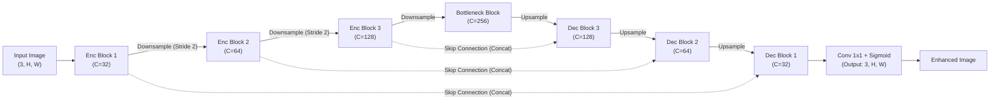

# 🌟 Tăng Cường Chất Lượng Ảnh Trong Điều Kiện Thiếu Sáng Bằng Mạng Nơ-ron Tích Chập (CNN)

### _Low-Light Image Enhancement Using a Lightweight Convolutional Neural Network_

<div align="center">

[](https://www.python.org/)
[](https://pytorch.org/)
[](LICENSE)
[](#-các-bộ-dữ-liệu-thực-nghiệm-datasets)
[](#-phương-pháp-đánh-giá--đối-chuẩn-evaluation--benchmarks)
[](#-lộ-trình-phát-triển-roadmap)

<p align="center">
  <b>Một giải pháp Deep Learning gọn nhẹ (Lightweight CNN) dựa trên kiến trúc Compact U-Net nhằm khôi phục độ sáng, độ tương phản và chi tiết không gian cho ảnh chụp ban đêm/thiếu sáng.</b>
</p>

</div>

---

## 📌 Mục Lục (Table of Contents)

1. [Giới Thiệu Đề Tài (Overview)](#-giới-thiệu-đề-tài-overview)
2. [Đặc Trưng Bài Toán (Problem Statement)](#-đặc-trưng-bài-toán-problem-statement)
3. [Kiến Trúc Mô Hình (Model Architecture)](#-kiến-trúc-mô-hình-model-architecture)
4. [Các Bộ Dữ Liệu Thực Nghiệm (Datasets)](#-các-bộ-dữ-liệu-thực-nghiệm-datasets)
5. [Phương Pháp Đánh Giá & Đối Chuẩn (Evaluation & Benchmarks)](#-phương-pháp-đánh-giá--đối-chuẩn-evaluation--benchmarks)
6. [Cấu Trúc Thư Mục (Project Structure)](#-cấu-trúc-thư-mục-project-structure)
7. [Cài Đặt & Hướng Dẫn Chạy (Quick Start)](#-cài-đặt--hướng-dẫn-chạy-quick-start)
8. [Lộ Trình Phát Triển (Roadmap)](#-lộ-trình-phát-triển-roadmap)
9. [Tài Liệu Tham Khảo (References)](#-tài-liệu-tham-khảo-references)
10. [Giấy Phép (License)](#-giấy-phép-license)

---

## 📖 Giới Thiệu Đề Tài (Overview)

Chụp ảnh trong điều kiện ánh sáng yếu (Low-Light Photography) là một thách thức kinh điển trong thị giác máy tính (Computer Vision) và xử lý ảnh số. Khi chụp trong môi trường thiếu sáng, cảm biến camera phải tăng độ nhạy sáng (ISO) hoặc kéo dài thời gian phơi sáng, dẫn đến các hệ quả tiêu cực:

- **Ảnh tối, độ tương phản thấp (Low contrast & underexposure)**.
- **Nhiễu hạt nghiêm trọng (Sensor noise / Grain artifacts)**.
- **Biến dạng màu sắc (Color distortion & color casting)**.
- **Mất mát chi tiết cấu trúc và biên cạnh (Edge & fine detail degradation)**.

Đề tài **"Tăng cường chất lượng ảnh trong điều kiện thiếu sáng bằng mạng nơ-ron tích chập (CNN)"** tập trung nghiên cứu và hiện thực hóa một mạng nơ-ron tích chập gọn nhẹ (**Lightweight CNN**) theo mô hình học ánh xạ ảnh-sang-ảnh (**Image-to-Image translation**). Mô hình học cách khôi phục trực tiếp ảnh thiếu sáng $I_{low}$ thành ảnh đủ sáng có độ trung thực cao $I_{enhanced}$, cân bằng giữa hiệu năng phục hồi và chi phí tính toán để phù hợp triển khai trên các thiết bị tài nguyên giới hạn.

---

## 🎯 Đặc Trưng Bài Toán (Problem Statement)

```
       [ Ảnh Thiếu Sáng (Input) ]
       - Độ rọi thấp, tương phản kém
       - Nhiễu hạt cảm biến (Poisson/Gaussian)
       - Mất kết cấu vi mô (Texture loss)
                  │
                  ▼
       ┌───────────────────────────┐
       │      Lightweight CNN      │
       │     (Compact U-Net)       │
       └───────────────────────────┘
                  │
                  ▼
       [ Ảnh Đã Tăng Cường (Output) ]
       - Độ sáng tự nhiên, tương phản cao
       - Triệt tiêu nhiễu, bảo toàn màu sắc
       - Biên cạnh sắc nét, giàu chi tiết
```

### Mục Tiêu Cốt Lõi:

1. **Lightweight & Efficient**: Thiết kế số lượng tham số nhỏ (parameters) và số phép tính dấu phẩy động thấp (FLOPs), cho phép suy luận nhanh.
2. **Detail Preservation via Skip Connections**: Kết hợp các liên kết tắt để chuyển giao thông tin không gian độ phân giải cao từ bộ mã hóa (Encoder) sang bộ giải mã (Decoder), ngăn ngừa hiện tượng mờ nhòe (blurriness).
3. **End-to-End Image-to-Image Learning**: Ánh xạ trực tiếp từ không gian ảnh tối sang không gian ảnh sáng mà không cần các bước tiền/hậu xử lý thủ công phức tạp.

---

## 🧠 Kiến Trúc Mô Hình (Model Architecture)

Mô hình được phát triển dựa trên biến thể **Compact U-Net** tối ưu hóa cho bài toán phục hồi ảnh:



### Các Khối Thành Phần Chính:

- **Encoder (Mã hóa đa tầng):** Sử dụng các khối `Conv2d + BatchNorm/InstanceNorm + LeakyReLU` để trích xuất đặc trưng ngữ nghĩa và ngữ cảnh ở nhiều tỷ lệ không gian.
- **Skip Connections (Kết nối tắt):** Nối trực tiếp tensor đặc trưng từ mỗi tầng Encoder sang Decoder tương ứng. Giúp giữ lại chi tiết cạnh biên, kết cấu tần số cao và hỗ trợ dòng gradient lan truyền ổn định trong quá trình huấn luyện.
- **Decoder (Giải mã & Tái tạo):** Dùng `Bilinear Upsampling` (hoặc `ConvTranspose2d`) kết hợp convolution để phục hồi kích thước không gian nguyên bản của ảnh.
- **Output Layer:** Lớp tích chập $1 \times 1$ kết hợp hàm kích hoạt `Sigmoid` đảm bảo giá trị pixel đầu ra chuẩn hóa trong khoảng $[0, 1]$.

### Hàm Mất Mát Kết Hợp (Composite Loss Function):

Mô hình tối ưu hóa hàm mất mát kết hợp đa thành phần:

$$\mathcal{L}_{Total} = \mathcal{L}_{1} + \lambda_{SSIM} \mathcal{L}_{SSIM} + \lambda_{Percep} \mathcal{L}_{Percep}$$

- **$\mathcal{L}_{1}$ (Pixel-wise L1 Loss):** Đảm bảo độ sáng tổng thể và độ chính xác màu ở mức điểm ảnh, hạn chế mờ nhòe so với L2.
- **$\mathcal{L}_{SSIM}$ (Structural Similarity Loss):** Bảo toàn cấu trúc cục bộ, tương phản và cảm nhận thị giác người.
- **$\mathcal{L}_{Percep}$ (Perceptual Loss - VGG):** Trích xuất đặc trưng sâu từ mạng VGG tiền huấn luyện để giữ chi tiết kết cấu tự nhiên.

---

## 📂 Các Bộ Dữ Liệu Thực Nghiệm (Datasets)

Để đảm bảo tính khoa học và toàn diện trong quá trình huấn luyện và kiểm thử, dự án tích hợp và hỗ trợ đa dạng các bộ dữ liệu Low-Light Image Enhancement (LLIE) chuẩn mực, bao gồm dữ liệu chụp thực tế có cặp đối ứng (paired real-captured), dữ liệu tổng hợp (synthetic), và dữ liệu chụp đêm khắc nghiệt từ thực tế (unpaired in-the-wild).

### 1. Bảng Tổng Hợp Các Bộ Dữ Liệu

| Bộ Dữ Liệu | Phân Nhánh | Loại Dữ Liệu | Số Cặp Train | Số Cặp Test | Đặc Điểm & Vai Trò Trong Đề Tài |
| :--- | :--- | :---: | :---: | :---: | :--- |
| **LOL-v1** *(Wei et al., BMVC 2018)* | Standard | Paired (Chụp thật) | 485 | 15 | Benchmark cơ sở kinh điển. Cố định camera, thay đổi ISO/thời gian phơi sáng. |
| **LOL-v2 (Real)** *(Yang et al., IJCV 2021)* | `Real_captured` | Paired (Chụp thật) | 689 | 100 | Mở rộng số lượng cảnh trong nhà/ngoài trời, nhiễu thực tế phức tạp và đa dạng hơn. |
| **LOL-v2 (Synthetic)** *(Yang et al., IJCV 2021)* | `Synthetic` | Paired (Tổng hợp) | 900 | 100 | Sinh từ ảnh đủ sáng qua phân rã Retinex và điều chỉnh độ phơi sáng, đa dạng kết cấu. |
| **ExDark** *(Loh et al., CVIU 2019)* | `In-the-wild` | Unpaired (Chụp thật) | — | 7,363 ảnh | Dữ liệu đêm tối cực đoan (10 môi trường ánh sáng yếu). Đánh giá khả năng tổng quát hóa (Zero-shot test). |

---

### 2. Cấu Trúc Tổ Chức Thư Mục Dữ Liệu

Thư mục `datasets/` trong dự án được tổ chức đồng bộ và phân tách rõ ràng như sau:

```
datasets/
├── LOLv1Dataset/
│   └── lol_dataset/
│       ├── our485/                     # Tập huấn luyện LOL-v1 (485 cặp ảnh)
│       │   ├── low/                    # Ảnh chụp thiếu sáng đầu vào (400 x 600)
│       │   └── high/                   # Ảnh Ground Truth phơi sáng chuẩn
│       └── eval15/                     # Tập kiểm thử chuẩn LOL-v1 (15 cặp ảnh)
│           ├── low/                    # Ảnh test thiếu sáng
│           └── high/                   # Ảnh test đủ sáng Ground Truth
│
├── LOL-v2/                             # Bộ dữ liệu mở rộng LOL phiên bản 2
│   ├── Real_captured/                  # Nhánh ảnh chụp thực nghiệm thực tế
│   │   ├── Train/                      # 689 cặp huấn luyện
│   │   │   ├── Low/                    # Ảnh thiếu sáng
│   │   │   └── Normal/                 # Ảnh bình thường
│   │   └── Test/                       # 100 cặp kiểm thử
│   │       ├── Low/                    # Ảnh test thiếu sáng
│   │       └── Normal/                 # Ảnh test bình thường
│   └── Synthetic/                      # Nhánh ảnh tổng hợp mô phỏng
│       ├── Train/                      # 900 cặp huấn luyện
│       │   ├── Low/                    # Ảnh tổng hợp thiếu sáng
│       │   └── Normal/                 # Ảnh gốc đủ sáng
│       └── Test/                       # 100 cặp kiểm thử
│           ├── Low/                    # Ảnh test tổng hợp thiếu sáng
│           └── Normal/                 # Ảnh test gốc
│
└── ExDark/                             # Exclusively Dark Dataset
    └── [Annotations & Images]          # 7,363 ảnh phục vụ kiểm thử ngoại suy thực tế
```

---

### 3. Phân Tích Chi Tiết Từng Bộ Dữ Liệu

#### 🔹 LOL-v1 Dataset (Low-Light Dataset v1)
- **Nguồn gốc:** Đề xuất bởi Wei et al. (BMVC 2018) trong công trình RetinexNet.
- **Quy trình thu thập:** Sử dụng máy ảnh DSLR cố định chân máy (tripod), tinh chỉnh thời gian phơi sáng và ISO để thu được cặp ảnh cùng một góc nhìn tuyệt đối mà không bị dịch chuyển điểm ảnh (pixel alignment chuẩn xác).
- **Phân bổ:** 485 cặp huấn luyện và 15 cặp đánh giá với độ phân giải gốc $400 \times 600$.
- **Vai trò trong đề tài:** Là **benchmark cốt lõi** để huấn luyện mô hình Compact U-Net và đối chuẩn trực tiếp với các phương pháp truyền thống (HE, CLAHE, Retinex).

#### 🔹 LOL-v2 Dataset (Real-captured & Synthetic)
- **Nguồn gốc:** Giới thiệu bởi Yang et al. (IJCV 2021) nhằm khắc phục nhược điểm quy mô nhỏ của LOL-v1.
- **Nhánh Real_captured (789 cặp):** Tăng cường số lượng cảnh thực tế (689 train, 100 test), thu thập trong nhiều khung cảnh phức tạp hơn (cảnh đường phố đêm, văn phòng, ánh sáng hắt ngược) với mức độ nhiễu cảm biến chân thực.
- **Nhánh Synthetic (1,000 cặp):** 900 cặp train và 100 cặp test được tổng hợp từ dữ liệu ảnh chất lượng cao thông qua mô hình phân rã độ phản xạ và độ rọi Retinex, giúp mạng học được các phân phối ánh sáng phi tuyến phong phú.
- **Vai trò trong đề tài:** Dùng để mở rộng kiểm nghiệm năng lực học sâu của CNN, kiểm chứng tính ổn định khi mở rộng quy mô dữ liệu.

#### 🔹 ExDark Dataset (Exclusively Dark)
- **Nguồn gốc:** Công bố bởi Loh et al. (CVIU 2019).
- **Quy mô & Đặc trưng:** Gồm 7,363 ảnh chụp thực tế hoàn toàn trong môi trường thiếu sáng tự nhiên đến cực đoan, bao gồm 10 loại điều kiện ánh sáng (Low light, Ambient light, Indoor, Outdoor, Dusk, Night, Twilight, v.v.).
- **Vai trò trong đề tài:** Được sử dụng cho pha **In-the-wild / Zero-shot Inference Test** để đánh giá trực quan chất lượng phục hồi và độ ổn định của mô hình khi xử lý ảnh thực tế không có Ground Truth tương ứng.

---

### 4. Pipeline Tiền Xử Lý & Tăng Cường Dữ Liệu (Preprocessing & Augmentation)

Nhằm tối ưu hóa hiệu quả huấn luyện cho mạng CNN nhẹ và chống hiện tượng quá khớp (overfitting), pipeline xử lý dữ liệu được thiết kế theo các bước:

```
[ Ảnh Gốc (Low & High) ]
         │
         ▼
[ Random Crop (256 x 256) ] ────────► Giữ tỷ lệ không gian, giảm tải GPU VRAM
         │
         ▼
[ Data Augmentation ]
  - Random Horizontal Flip (p=0.5)
  - Random Vertical Flip (p=0.5)
  - Random Rotation (90°, 180°, 270°)
         │
         ▼
[ Chuẩn Hóa Pixel ] ────────────────► Ánh xạ dải [0, 255] về tensor [0.0, 1.0]
         │
         ▼
[ DataLoader Batching ] ────────────► Cung cấp mini-batch cho Compact U-Net
```

- **Patch Training:** Huấn luyện trên các patch $256 \times 256$ cắt ngẫu nhiên giúp mạng tập trung vào các đặc trưng cục bộ (texture, edge) và đồng thời tăng tốc độ hội tụ.
- **Evaluation / Test Inference:** Giữ nguyên độ phân giải gốc của ảnh test (hoặc thêm padding bội số của 16/32 để tương thích hoàn toàn với các tầng downsample của U-Net) nhằm đảm bảo kết quả PSNR/SSIM khách quan nhất.

---

## 📊 Phương Pháp Đánh Giá & Đối Chuẩn (Evaluation & Benchmarks)

### 1. Độ Đo Khách Quan (Objective Metrics)

- **PSNR (Peak Signal-to-Noise Ratio):** Đo lường tỷ số tín hiệu cực đại trên nhiễu giữa ảnh phục hồi và Ground Truth (tính bằng dB). Giá trị càng cao, ảnh phục hồi càng ít sai khác.

  $$\text{PSNR} = 10 \cdot \log_{10} \left( \frac{\text{MAX}^2}{\text{MSE}} \right)$$

- **SSIM (Structural Similarity Index Measure):** Đánh giá độ tương đồng cấu trúc dựa trên ba yếu tố: độ chói (luminance), độ tương phản (contrast) và cấu trúc (structure). Giá trị dao động trong khoảng $[-1, 1]$ (càng gần 1 càng tốt).

### 2. Các Phương Pháp Đối Chuẩn (Baselines)

Dự án so sánh mô hình đề xuất với cả hai nhóm phương pháp:

1. **Phương pháp xử lý ảnh truyền thống:**
   - **HE (Histogram Equalization):** Cân bằng lược đồ độ sáng toàn cục.
   - **CLAHE (Contrast Limited Adaptive Histogram Equalization):** Cân bằng lược đồ thích nghi giới hạn độ tương phản cục bộ.
   - **Retinex-based (SSR, MSR):** Phân tích ảnh thành phản xạ (reflectance) và độ rọi (illumination).
2. **Đối chiếu với các công trình hiện đại (CVF 2024–2026):**
   - Nghiên cứu các xu hướng tiên tiến trong các hội nghị hàng đầu (CVPR / ICCV / ECCV giai đoạn 2024–2026) như mô hình khuếch tán (Diffusion-based LLIE), mô hình Transformer đa quy mô, và Retinex học sâu.
   - Đối chiếu nhằm làm nổi bật ưu thế của giải pháp CNN nhẹ: **tốc độ suy luận cao, tiêu thụ ít bộ nhớ GPU, cài đặt đơn giản nhưng vẫn đạt chất lượng vượt trội so với các thuật toán truyền thống.**

### Bảng Kết Quả Kỳ Vọng / Tham Chiếu (Benchmark Template)

| Phương Pháp               | Loại Tiếp Cận             |     PSNR (dB) ↑     |       SSIM ↑       | Số Tham Số (Params) | Tốc Độ (FPS) |
| :------------------------ | :------------------------ | :-----------------: | :----------------: | :-----------------: | :----------: |
| **Input (Low-Light)**     | -                         |       ~10.90        |       ~0.35        |          -          |      -       |
| **HE**                    | Truyền thống              |       ~14.20        |       ~0.48        |          -          |  Real-time   |
| **CLAHE**                 | Truyền thống              |       ~16.10        |       ~0.53        |          -          |  Real-time   |
| **Retinex (MSRCR)**       | Truyền thống              |       ~16.80        |       ~0.56        |          -          |    15–30     |
| **Compact U-Net (Ours)**  | **Deep Learning (CNN)**   | **Target: > 20.00** | **Target: > 0.80** |     **< 1.5M**      |   **> 45**   |
| _CVF 2024-2026 SOTA Ref._ | _Transformer / Diffusion_ |  _~23.00 - 25.00_   |   _~0.85 - 0.88_   |       _> 15M_       |  _~5 - 15_   |

---

## 📁 Cấu Trúc Thư Mục (Project Structure)

```
low-light-image-enhancement-cnn/
├── datasets/                   # Dữ liệu ảnh thực nghiệm (bị ignore trên Git)
│   ├── LOLv1Dataset/
│   │   └── lol_dataset/
│   │       ├── our485/         # 485 cặp train
│   │       └── eval15/         # 15 cặp test
│   ├── LOL-v2/
│   │   ├── Real_captured/      # 689 cặp train / 100 cặp test
│   │   └── Synthetic/          # 900 cặp train / 100 cặp test
│   └── ExDark/                 # 7,363 ảnh đêm thực tế (In-the-wild evaluation)
├── docs/                       # Tài liệu nghiên cứu, báo cáo
│   ├── ai/                     # Ghi chú kỹ thuật AI & mô hình
│   ├── papers/                 # Tài liệu tổng hợp các bài báo tham khảo (CVPR/CVPRW)
│   ├── reports/                # Báo cáo tiến độ & báo cáo môn học
│   └── research/               # Tài liệu khảo sát CVF 2024-2026
├── src/                        # Mã nguồn chính của dự án (dự kiến)
│   ├── models/                 # Định nghĩa kiến trúc Compact U-Net
│   │   ├── __init__.py
│   │   └── unet_light.py
│   ├── datasets/               # Dataset loader cho LOL-v1, LOL-v2 & ExDark
│   │   ├── __init__.py
│   │   ├── lol_v1_dataset.py
│   │   ├── lol_v2_dataset.py
│   │   └── exdark_dataset.py
│   ├── baselines/              # Thuật toán truyền thống (HE, CLAHE, Retinex)
│   │   ├── __init__.py
│   │   └── traditional.py
│   ├── utils/                  # Hàm tiện ích (PSNR, SSIM, visualization)
│   │   ├── metrics.py
│   │   └── visualizer.py
│   ├── train.py                # Kịch bản huấn luyện mô hình
│   ├── evaluate.py             # Kịch bản đánh giá & xuất báo cáo số liệu
│   └── infer.py                # Kịch bản tăng cường ảnh đơn lẻ (demo)
├── tasks/                      # Theo dõi công việc (tasks & notes)
├── .gitignore                  # Cấu hình bỏ qua tệp nhị phân & dữ liệu lớn
├── LICENSE                     # Apache License 2.0
├── pyproject.toml              # Quản lý dependencies (uv / pip)
└── README.md                   # Tài liệu hướng dẫn dự án
```

---

## 🚀 Cài Đặt & Hướng Dẫn Chạy (Quick Start)

### 1. Yêu Cầu Môi Trường (Prerequisites)

- Python $\ge$ 3.10
- GPU với CUDA (khuyên dùng để huấn luyện) hoặc CPU (cho suy luận nhẹ)

### 2. Khởi Tạo Môi Trường Cục Bộ (Virtual Environment)

Dự án tuân thủ nghiêm ngặt nguyên tắc cách ly môi trường (`uv` hoặc `venv` cục bộ):

```bash
# Cách 1: Sử dụng uv (nhanh và khuyến nghị)
uv venv .venv
source .venv/bin/activate  # Trên Linux/macOS
# Hoặc trên Windows PowerShell:
.venv\Scripts\Activate.ps1

# Cách 2: Sử dụng venv chuẩn của Python
python -m venv .venv
.venv\Scripts\Activate.ps1
```

### 3. Cài Đặt Thư Viện Phụ Thuộc (Dependencies)

```bash
# Cài đặt qua pip trong môi trường đã kích hoạt:
pip install torch torchvision --index-url https://download.pytorch.org/whl/cu121
pip install numpy opencv-python pillow scikit-image matplotlib tqdm
```

### 4. Chuẩn Bị Dữ Liệu

Đảm bảo cấu trúc các bộ dữ liệu được đặt tại thư mục `datasets/` như chi tiết tại mục [Các Bộ Dữ Liệu Thực Nghiệm](#-các-bộ-dữ-liệu-thực-nghiệm-datasets):
- **LOL-v1:** `datasets/LOLv1Dataset/lol_dataset/{our485, eval15}`
- **LOL-v2:** `datasets/LOL-v2/{Real_captured, Synthetic}/{Train, Test}`
- **ExDark:** `datasets/ExDark/`

### 5. Huấn Luyện Mô Hình (Training)

```bash
# Huấn luyện trên LOL-v1 (Mặc định)
python src/train.py --dataset lol_v1 --data_dir datasets/LOLv1Dataset/lol_dataset --epochs 100 --batch_size 8 --lr 1e-4

# Hoặc huấn luyện trên LOL-v2 Real-captured
python src/train.py --dataset lol_v2_real --data_dir datasets/LOL-v2/Real_captured --epochs 100 --batch_size 8 --lr 1e-4
```

### 6. Đánh Giá & So Sánh Định Lượng (Evaluation)

```bash
# Đánh giá trên tập LOL-v1 eval15 (Tính toán PSNR, SSIM)
python src/evaluate.py --dataset lol_v1 --checkpoint checkpoints/best_model.pth --data_dir datasets/LOLv1Dataset/lol_dataset/eval15

# Đánh giá trên tập LOL-v2 Real Test (100 cặp)
python src/evaluate.py --dataset lol_v2_real --checkpoint checkpoints/best_model.pth --data_dir datasets/LOL-v2/Real_captured/Test
```

### 7. Tăng Cường Ảnh Thiếu Sáng Bất Kỳ (Inference & In-the-wild Demo)

```bash
# Test ảnh đơn lẻ
python src/infer.py --input sample_dark.png --output sample_enhanced.png --weights checkpoints/best_model.pth

# Chạy thử nghiệm trên tập ảnh đêm thực tế ExDark
python src/infer.py --input_dir datasets/ExDark --output_dir outputs/exdark_enhanced --weights checkpoints/best_model.pth
```

---

## 📚 Tài Liệu Tham Khảo (References)

1. **Wei, C., Wang, W., Yang, W., & Liu, J. (2018).** *Deep Retinex Decomposition for Low-Light Enhancement*. BMVC. *(Nguồn gốc bộ dữ liệu LOL-v1).*
2. **Yang, W., Wang, W., Fang, Y., Wang, J., & Liu, J. (2021).** *From Fidelity to Perceptual Quality: A Semi-Supervised Approach for Low-Light Image Enhancement*. IJCV. *(Nguồn gốc bộ dữ liệu LOL-v2 Real & Synthetic).*
3. **Loh, Y. P., & Chan, C. S. (2019).** *Getting to know low-light images with the Exclusively Dark (ExDark) dataset*. Computer Vision and Image Understanding (CVIU). *(Bộ dữ liệu ExDark).*
4. **Ronneberger, O., Fischer, P., & Brox, T. (2015).** *U-Net: Convolutional Networks for Biomedical Image Segmentation*. MICCAI. *(Kiến trúc nền tảng U-Net & Skip Connections).*
5. **Liu et al. (CVPRW 2024).** *NTIRE 2024 Challenge on Low Light Image Enhancement: Methods and Results*. ([docs/papers/Liu_NTIRE_2024_..._CVPRW_2024_paper.pdf](file:///E:/MyProject/low-light-image-enhancement-cnn/docs/papers/Liu_NTIRE_2024_Challenge_on_Low_Light_Image_Enhancement_Methods_and_CVPRW_2024_paper.pdf)).
6. **Sharif et al. (CVPRW 2024).** *Learning Optimized Low-Light Image Enhancement for Edge Vision Tasks*. ([docs/papers/Sharif_Learning_Optimized_..._CVPRW_2024_paper.pdf](file:///E:/MyProject/low-light-image-enhancement-cnn/docs/papers/Sharif_Learning_Optimized_Low-Light_Image_Enhancement_for_Edge_Vision_Tasks_CVPRW_2024_paper.pdf)).
7. **Feijoo et al. (CVPR 2025).** *DarkIR: Robust Low-Light Image Restoration*. ([docs/papers/Feijoo_DarkIR_..._CVPR_2025_paper.pdf](file:///E:/MyProject/low-light-image-enhancement-cnn/docs/papers/Feijoo_DarkIR_Robust_Low-Light_Image_Restoration_CVPR_2025_paper.pdf)).
8. **Yan et al. (CVPR 2025).** *HVI: A New Color Space for Low-light Image Enhancement*. ([docs/papers/Yan_HVI_..._CVPR_2025_paper.pdf](file:///E:/MyProject/low-light-image-enhancement-cnn/docs/papers/Yan_HVI_A_New_Color_Space_for_Low-light_Image_Enhancement_CVPR_2025_paper.pdf)).
9. **Wang, Z., Bovik, A. C., Sheikh, H. R., & Simoncelli, E. P. (2004).** *Image quality assessment: from error visibility to structural similarity*. IEEE TIP. *(Cơ sở độ đo SSIM).*

---

## 📄 Giấy Phép (License)

Dự án được phân phối dưới giấy phép **Apache License 2.0**. Xem chi tiết tại tệp [LICENSE](LICENSE).
