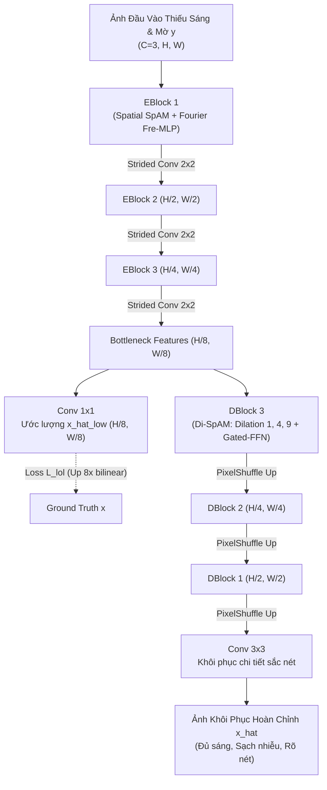

# 📑 Báo Cáo Nghiên Cứu Bài Báo 01: DarkIR (CVPR 2025)

> **Tên bài báo:** *DarkIR: Robust Low-Light Image Restoration*  
> **Tác giả:** Daniel Feijoo, Juan C. Benito, Alvaro Garcia, Marcos V. Conde  
> **Đơn vị nghiên cứu:** Cidaut AI (Tây Ban Nha), Computer Vision Lab - Đại học Würzburg (Đức)  
> **Hội nghị xuất bản:** IEEE/CVF Conference on Computer Vision and Pattern Recognition (CVPR 2025)  
> **Tài liệu gốc:** [Feijoo_DarkIR_Robust_Low-Light_Image_Restoration_CVPR_2025_paper.pdf](file:///E:/MyProject/low-light-image-enhancement-cnn/docs/papers/Feijoo_DarkIR_Robust_Low-Light_Image_Restoration_CVPR_2025_paper.pdf)  
> **Mã nguồn chính thức:** [https://github.com/cidautai/DarkIR](https://github.com/cidautai/DarkIR)  

---

## 1. Bối Cảnh & Vấn Đề Nghiên Cứu (Problem Formulation & Motivation)

### 1.1. Hiện tượng suy thoái phức hợp trong chụp ảnh đêm
Trong nhiếp ảnh ban đêm hoặc điều kiện ánh sáng cực yếu, quá trình hình thành ảnh quan sát $y$ từ khung cảnh thực $x$ được mô hình hóa theo phương trình:
$$y = \gamma(x \otimes k) + n$$
Trong đó:
- $x$: Cảnh thực chưa bị biến dạng (ground-truth).
- $k$: Kernel gây mờ quang học (Point-Spread Function - PSF), phát sinh do rung tay (hand tremor) hoặc phơi sáng lâu (long exposure / slow shutter speed) để gom sáng.
- $n$: Nhiễu cảm biến cộng gộp (shot noise tuân theo phân phối Poisson và read noise tuân theo phân phối Gaussian), tăng vọt khi cảm biến đẩy ISO cao.
- $\gamma$: Hàm phi tuyến kiểm soát dải động (dynamic range) và độ bão hòa điểm ảnh.

### 1.2. Hạn chế cốt lõi của các công trình trước đây
Hầu hết các nghiên cứu hiện tại giải quyết bài toán xử lý ảnh thiếu sáng (LLIE) và khử mờ (Deblurring) một cách hoàn toàn tách biệt:
1. **Các mô hình khử mờ (Deblurring SOTA)** như NAFNet, Restormer, MIMO-UNet chỉ được huấn luyện trên ảnh ban ngày đủ sáng (GoPro, RealBlur), dẫn đến việc suy luận thất bại hoàn toàn trên ảnh đêm vì bị nhiễu cảm biến và độ tối áp đảo.
2. **Các mô hình tăng cường sáng (LLIE SOTA)** như RetinexNet, Zero-DCE, RetinexFormer chỉ tập trung nâng sáng và cân bằng màu, khi gặp ảnh có hiện tượng mờ chuyển động sẽ khuếch đại vệt mờ (blur artifacts) thành các vệt nhòe lớn.
3. **Mô hình chuỗi 2 giai đoạn (Cascaded 2-step pipelines)** như `LLIE -> Deblur` hoặc `Deblur -> LLIE` gây tích tụ sai số nghiêm trọng (PSNR chỉ đạt khoảng 14 - 18 dB trên tập LOLBlur).
4. Rất ít mô hình giải quyết đồng thời cả 3 tác vụ (Denoising, Deblurring, LLIE) theo dạng end-to-end; công trình tiêu biểu trước đó là LEDNet (CVPR 2023) nhưng còn cồng kềnh và chi phí tính toán cao.

---

## 2. Ý Tưởng Cốt Lõi & Kiến Trúc Mô Hình DarkIR (Proposed Architecture)

DarkIR đề xuất một mạng nơ-ron tích chập bất đối xứng (Asymmetric CNN Encoder-Decoder) dựa trên triết lý **MetaFormer**, phân chia ranh giới chức năng rõ ràng giữa miền tần số (Fourier Domain) và miền không gian (Spatial Domain).

### 2.1. Bộ mã hóa nâng sáng trong miền tần số (EBlock - Fourier Encoder)
- **Cơ sở khoa học:** Thông tin độ sáng (illumination) của ảnh liên kết chặt chẽ với biên độ (Amplitude) trong miền Fourier, trong khi pha (Phase) chứa cấu trúc không gian. Do đó, việc can thiệp vào biên độ Fourier giúp điều chỉnh độ sáng toàn cục rất tự nhiên và nhất quán qua nhiều độ phân giải.
- **Thành phần EBlock:**
  - **SpAM (Spatial Attention Module):** Mô phỏng khối NAFBlock tối giản với Inverted Residual, Simple Gate (SG) thay thế hàm kích hoạt phi tuyến, và Simplified Channel Attention (SCA) để trích xuất đặc trưng không gian.
  - **Fre-MLP (Fourier Frequency MLP):** Áp dụng Fast Fourier Transform (FFT) trên tensor đặc trưng, chỉ xử lý trên phổ biên độ qua MLP + LeakyReLU, giữ nguyên pha, sau đó đưa ngược về miền không gian qua Inverse FFT (IFFT).
- **Đầu ra bộ mã hóa:** Tại tầng đáy (bottleneck), mô hình tạo ra một ảnh thu nhỏ độ phân giải thấp $\hat{x}_{\downarrow 8}$ ($8\times$ downsampled) đã được cân bằng sáng hoàn chỉnh.

### 2.2. Bộ giải mã khử mờ trong miền không gian (DBlock - Spatial Deblurring Decoder)
- Do thông tin độ sáng đã được Encoder hiệu chỉnh, Decoder chỉ tập trung vào 2 mục tiêu: phóng đại không gian (Upsampling) và triệt tiêu vệt mờ, khôi phục độ sắc nét (Deblurring).
- Khử mờ đòi hỏi trường tiếp nhận (Receptive Field) cực lớn. Thay vì dùng Large Kernel chuẩn tốn kém tài nguyên, nhóm tác giả thiết kế khối **Di-SpAM (Dilated-Spatial Attention Module)**:
  - Tách thành 3 nhánh tích chập sâu (Depthwise Separable Convolutions) với các hệ số giãn nở (dilation factors) lần lượt là **1, 4, và 9**.
  - Hợp nhất đặc trưng đa tỉ lệ qua Simplified Channel Attention (SCA).
  - Kết hợp với **Gated-FFN** (Feed-Forward Network có Simple Gate) tạo thành cấu trúc MetaFormer hoàn chỉnh.

### 2.3. Các biến thể kích thước mô hình
DarkIR được mở rộng linh hoạt theo số kênh cơ sở (embedding channels):
- **DarkIR-s (Small):** 16 channels, **0.87M tham số**, **2.04 GMACs**.
- **DarkIR-m (Medium - Mặc định):** 32 channels, **3.31M tham số**, **7.25 GMACs**.
- **DarkIR-l (Large):** 64 channels, **12.96M tham số**, **27.19 GMACs**.

---

## 3. Hàm Mất Mát & Mục Tiêu Huấn Luyện (Loss Function)

Hàm mất mát tổng thể kết hợp giữa độ đo biến dạng không gian, tri giác và định hướng kiến trúc:
$$\mathcal{L} = \lambda_p \mathcal{L}_{1} + \lambda_{pe} \mathcal{L}_{percep} + \lambda_{ed} \mathcal{L}_{edge} + \mathcal{L}_{lol}$$

Trong đó:
1. **$\mathcal{L}_{1}$ (Pixel Loss):** $\|x - \hat{x}\|_1$ đảm bảo độ chính xác giá trị điểm ảnh ở mức độ pixel.
2. **$\mathcal{L}_{percep}$ (Perceptual Loss):** Sử dụng LPIPS dựa trên trích xuất đặc trưng VGG-19, giúp hình ảnh đầu ra tự nhiên theo cảm nhận thị giác con người.
3. **$\mathcal{L}_{edge}$ (Gradient Edge Loss):** $\|\nabla x - \nabla \hat{x}\|_2^2$ nhằm bảo toàn cấu trúc vi mô, gờ cạnh sắc nét (tần số cao).
4. **$\mathcal{L}_{lol}$ (Architecture Guiding Loss):** Ép buộc tầng Encoder phải giải quyết triệt để bài toán nâng sáng ở độ phân giải thấp $\hat{x}_{\downarrow 8}$:
   $$\mathcal{L}_{lol} = \|x - \hat{x}_{\uparrow 8}\|_1 + \text{LPIPS}(x, \hat{x}_{\uparrow 8})$$
   (với $\hat{x}_{\uparrow 8}$ là ảnh nội suy song tuyến tính phóng to 8 lần từ tầng đáy Encoder).
5. **Trọng số thực nghiệm:** $\lambda_p = 1$, $\lambda_{pe} = 0.01$, $\lambda_{ed} = 50$.

---

## 4. Kết Quả Thực Nghiệm & Đánh Giá Đối Chuẩn (Benchmarks)

### 4.1. Đánh giá định lượng trên tập chuẩn tổng hợp LOLBlur
Tập dữ liệu **LOLBlur** gồm 10.200 cặp huấn luyện và 1.800 cặp kiểm thử (chứa cả độ mờ chuyển động thực tế và nhiễu cảm biến).

| Mô hình | Số Tham Số (M) ↓ | GMACs (256px) ↓ | PSNR (dB) ↑ | SSIM ↑ | LPIPS ↓ |
| :--- | :---: | :---: | :---: | :---: | :---: |
| KinD++ (TPAMI'21) | 1.20 | 34.99 | 21.26 | 0.753 | 0.359 |
| DRBN (CVPR'20) | 0.60 | 48.61 | 21.78 | 0.768 | 0.325 |
| DeblurGAN-v2 (ICCV'19) | 60.90 | - | 22.30 | 0.745 | 0.356 |
| MIMO-UNet (ICCV'21) | 6.80 | 67.25 | 22.41 | 0.835 | 0.262 |
| NAFNet (ECCV'22) | 12.05 | 12.30 | 25.36 | 0.882 | 0.158 |
| LEDNet (CVPR'23 SOTA) | 7.40 | 38.65 | 25.74 | 0.850 | 0.224 |
| RetinexFormer (ICCV'23) | 1.61 | 15.57 | 26.02 | 0.887 | 0.181 |
| Restormer (CVPR'22) | 26.13 | 144.25 | 26.72 | 0.902 | 0.133 |
| **DarkIR-m (Ours)** | **3.31** | **7.25** | **27.00** | **0.883** | **0.162** |
| **DarkIR-l (Ours)** | **12.96** | **27.19** | **27.30** | **0.898** | **0.137** |

> **Nhận xét then chốt:**  
> - **DarkIR-m** vượt trội hơn SOTA trước đó là LEDNet tới **+1.26 dB PSNR** trong khi giảm **55% số lượng tham số** (3.31M so với 7.4M) và giảm **hơn 5 lần số phép tính MACs** (7.25G so với 38.65G).  
> - Vượt qua mô hình Transformer hạng nặng Restormer tới **+0.58 dB** nhưng chỉ tốn **1/20 số lượng phép tính MACs** (7.25G so với 144.25G).

### 4.2. Đánh giá đa tác vụ (Multi-task & All-in-One Training)
Khi huấn luyện mô hình đa nhiệm (**DarkIR-mt**) kết hợp đồng thời các bộ dữ liệu LOLBlur, LOLv2-Real, LOLv2-Synthetic và LSRW:
- Trên tập **LOLv2-Real**: Đạt **23.87 dB PSNR** và **0.880 SSIM** (vượt RetinexFormer 22.80 dB / 0.840).
- Trên tập **LOLv2-Synthetic**: Đạt **25.54 dB PSNR** và **0.934 SSIM**.
- Trên tập **LSRW-Huawei & Nikon (50 ảnh test)**: Đạt **18.93 dB PSNR** và **0.583 SSIM** (vượt xa các phương pháp KinD 16.47 dB, SCI 15.01 dB, EnGAN 16.31 dB).

### 4.3. Kiểm thử trên ảnh chụp thực tế không có Ground Truth (Real-LOLBlur)
Sử dụng các độ đo không tham chiếu (Blind Quality Metrics: MUSIQ, NRQM, NIQE):
- DarkIR-l đạt điểm tri giác **MUSIQ: 48.79** (cao vượt bậc so với LEDNet 39.11 và MIMO-UNet 28.36), điểm **NIQE: 5.051**, khôi phục chi tiết tự nhiên mà không bị hiện tượng quầng sáng (halo artifacts) hay vỡ hạt nhiễu.

---

## 5. Phân Tích Ưu Điểm & Điểm Nghẽn Kỹ Thuật (Pros & Cons)

### 5.1. Điểm mạnh vượt trội
1. **Thiết kế chuyên biệt hóa theo miền dữ liệu:** Thay vì đối xứng Encoder-Decoder thông thường, việc đặt xử lý phổ Fourier ở Encoder (chữa sáng) và Dilated Attention ở Decoder (chữa nét) đem lại sự tinh gọn và hiệu quả phi thường.
2. **Chi phí tính toán siêu thấp:** Đạt SOTA toàn diện với chỉ 7.25 GMACs (trên khung hình 256x256), rất khả thi cho các mô hình thị giác tính toán trên thiết bị di động.
3. **Cơ chế Loss hướng dẫn tầng đáy ($\mathcal{L}_{lol}$):** Đảm bảo tính minh bạch và ổn định trong quá trình phân tách vai trò của từng tầng mạng.

### 5.2. Hạn chế kỹ thuật (Limitations)
- Mô hình phụ thuộc nhiều vào tích chập theo chiều sâu (**Depthwise Separable Convolutions**). Dù giảm mạnh số phép tính lý thuyết (FLOPs/MACs), nhưng do cường độ tính toán trên mỗi byte bộ nhớ (arithmetic intensity) thấp, tốc độ suy luận thực tế (latency) trên một số phần cứng GPU chuẩn không tăng tương ứng theo tỉ lệ tuyến tính của FLOPs.

---

## 6. Bài Học Ứng Dụng Cho Dự Án Compact U-Net Hiện Tại

1. **Ý tưởng phân tách miền xử lý:** Có thể thử nghiệm đưa một khối xử lý biên độ phổ Fourier giản lược vào tầng đáy (Bottleneck) của Compact U-Net để hỗ trợ điều hòa ánh sáng toàn cục mà không tốn nhiều tham số.
2. **Hàm mất mát đa thành phần:** Bổ sung **Gradient Edge Loss ($\mathcal{L}_{edge}$)** song song với $\mathcal{L}_1$ và SSIM giúp Compact U-Net tránh hiện tượng ảnh đầu ra bị mờ hoặc mất biên cạnh sắc nét.
3. **Cơ chế Simple Gate (SG) & SCA:** Có thể thay thế các hàm kích hoạt ReLU/LeakyReLU nặng nề bằng Simple Gate (chia đôi channel rồi nhân chập) theo phong cách NAFNet/MetaFormer để tăng tốc độ suy luận mà vẫn duy trì tính phi tuyến mạnh mẽ.
