# 📑 Báo Cáo Nghiên Cứu Bài Báo 02: NTIRE 2024 Challenge on Low Light Image Enhancement (CVPRW 2024)

> **Tên bài báo:** *NTIRE 2024 Challenge on Low Light Image Enhancement: Methods and Results*  
> **Ban tổ chức & Tác giả:** Xiaoning Liu, Zongwei Wu, Ao Li, Florin-Alexandru Vasluianu, Yulun Zhang, Shuhang Gu, Le Zhang, Ce Zhu, Radu Timofte, Zhi Jin, cùng 22 nhóm nghiên cứu tham gia.  
> **Hội nghị xuất bản:** IEEE/CVF Conference on Computer Vision and Pattern Recognition Workshops (CVPRW 2024 - NTIRE Workshop)  
> **Tài liệu gốc:** [Liu_NTIRE_2024_Challenge_on_Low_Light_Image_Enhancement_Methods_and_CVPRW_2024_paper.pdf](file:///E:/MyProject/low-light-image-enhancement-cnn/docs/papers/Liu_NTIRE_2024_Challenge_on_Low_Light_Image_Enhancement_Methods_and_CVPRW_2024_paper.pdf)  
> **Mã nguồn tổng hợp:** [https://github.com/AVC2-UESTC/NTIRE24-LLE/](https://github.com/AVC2-UESTC/NTIRE24-LLE/)  

---

## 1. Bối Cảnh & Động Lực Tổ Chức Cuộc Thi (Challenge Motivation)

Cuộc thi **NTIRE (New Trends in Image Restoration and Enhancement)** tại hội nghị CVPR hàng năm được xem là "Olympic của lĩnh vực phục hồi ảnh số". Năm 2024 đánh dấu lần đầu tiên NTIRE tổ chức đường đua chuyên biệt cho **Tăng Cường Ảnh Thiếu Sáng (Low Light Image Enhancement - LLIE)**.

### 1.1. Những giới hạn nghiêm trọng của các bộ benchmark truyền thống
Ban tổ chức chỉ ra rằng các tập dữ liệu kinh điển như **LOL (v1/v2)** hoặc **MIT-Adobe FiveK** đã bộc lộ những hạn chế lớn, khiến các mô hình học máy bị bão hòa hoặc sai lệch khi đưa vào thực tế:
1. **Độ phân giải thấp:** Ảnh thường chỉ ở mức $400 \times 600$ hoặc $1000 \times 1500$, không tương thích với camera điện thoại hiện đại (chuẩn 4K trở lên).
2. **Kịch bản thiếu sáng đơn điệu:** Phần lớn là ảnh trong nhà tắt đèn, thiếu trầm trọng ảnh chụp đêm ngoài trời (night scenes), ảnh ngược sáng gắt (backlighting), hoặc ảnh có nguồn sáng cục bộ phức tạp (non-uniform lighting).
3. **Mô hình SOTA quá nặng nề:** Nhiều kiến trúc Transformer hoặc Diffusion đạt điểm cao trong phòng thí nghiệm nhưng không thể nạp vừa bộ nhớ của thiết bị tiêu dùng.

### 1.2. Mục tiêu của cuộc thi NTIRE 2024
- Xây dựng một chuẩn dữ liệu đa dạng quy mô lớn, bao quát từ ảnh cực tối, ngược sáng, ánh sáng không đồng nhất, đến cảnh đêm ở độ phân giải siêu nét **Ultra-High Definition (4K và cao hơn)**.
- Khảo sát các giải pháp kiến trúc tối ưu (CNN, Transformer, Diffusion, State Space Model/Mamba) và phân tích các thách thức khi triển khai trên phần cứng thực tế.
- Cuộc thi thu hút **428 người đăng ký**, với **22 đội nghiên cứu** nộp giải pháp hợp lệ sau cùng.

---

## 2. Quy Chuẩn Đánh Giá & Dữ Liệu Thi Đấu (Dataset & Evaluation Protocol)

### 2.1. Tập dữ liệu NTIRE 2024 LLIE
- **230 cặp ảnh huấn luyện** (Low-light / Normal-light Ground Truth).
- **35 ảnh kiểm chuẩn (Validation)** và **35 ảnh kiểm thử chính thức (Test)** — ảnh nhãn Ground Truth được giấu kín hoàn toàn nhằm chống over-fitting.
- Ảnh bao quát cả trong nhà và ngoài trời, độ phân giải lên đến 4K+.

### 2.2. Tiêu chí xếp hạng (Ranking Metric)
Xếp hạng chung cuộc được tính toán theo công thức kết hợp có trọng số giữa độ sai lệch điểm ảnh và độ tương đồng cấu trúc:
$$\text{Score} = 0.6 \times \text{PSNR} + 0.4 \times \text{SSIM}$$
Độ đo tri giác **LPIPS (Learned Perceptual Image Patch Similarity)** được sử dụng làm chỉ số phụ giải quyết trường hợp hòa điểm (tie-breaker).

---

## 3. Bảng Xếp Hạng & Phân Tích Các Giải Pháp Đột Phá (Top Solutions)

### 3.1. Bảng tổng hợp kết quả chung cuộc của các đội tham gia

| Hạng | Đội thi / Mô hình | PSNR (dB) ↑ | SSIM ↑ | LPIPS ↓ | Kiến trúc & Phương pháp cốt lõi |
| :---: | :--- | :---: | :---: | :---: | :--- |
| 🥇 **1** | **SYSU-FVL-T2** | **25.52** | **0.8637** | 0.1221 | **ESDNet-L** + Semantic-Aligned Modules + Progressive Training |
| 🥈 **2** | **Retinexformer** | **25.30** | **0.8525** | 0.1424 | One-Stage Retinex Framework + Illumination-Guided Transformer |
| 🥉 **3** | **DH-AISP** | **24.97** | **0.8528** | 0.1235 | **DWT-FFC** (Discrete Walsh + Fourier Convolutions) + ConvNeXt |
| **4** | **NWPU-DiffLight** | **24.78** | **0.8556** | 0.1673 | Dual-Branch (DiffIR + LEDNet) + Progressive Patch Fusion (PPF) |
| **5** | **GiantPandaCV** | **24.83** | **0.8474** | 0.1353 | **UHDMamba** (State Space Model - Mamba) + Test-Time Augmentation |
| **6** | LVGroup HFUT | 24.88 | 0.8395 | 0.1371 | Multi-scale CNN Restoration |
| **7** | Try1try8 | 24.49 | 0.8483 | 0.1359 | Hybrid Frequency-Spatial Enhancement |
| **8** | Pixel warrior | 24.74 | 0.8416 | 0.1514 | Advanced U-Net with Local Gating |
| **13** | Cidaut AI (InstructIR) | 23.07 | 0.8075 | 0.1559 | Language-Guided Restoration Backbone |
| **14** | OptDev (Jetson Edge) | 22.93 | 0.8097 | 0.1592 | Lightweight Edge-Oriented Network |

---

### 3.2. Đi sâu vào giải pháp của các đội dẫn đầu

```mermaid
flowchart TD
    subgraph Rank1["Hạng 1: SYSU-FVL-T2 (ESDNet-L)"]
        R1_In["Ảnh 4K"] --> R1_Enc["3-Scale Encoder"]
        R1_Enc --> R1_SAM["Semantic-Aligned Scale-Aware Modules (SAM)"]
        R1_SAM --> R1_Dec["3-Scale Decoder + Dense Blocks"]
        R1_Dec --> R1_Loss["Charbonnier Loss + VGG-19 Perceptual Loss"]
    end

    subgraph Rank2["Hạng 2: Retinexformer (ICCV 2023)"]
        R2_In["Ảnh Low-light"] --> R2_Est["Illumination Estimator (Depthwise 9x9)"]
        R2_Est --> R2_Lit["Ảnh Đã Nâng Sáng (Lit-up)"]
        R2_Lit --> R2_IGT["Illumination-Guided Transformer (IGAB Blocks)"]
        R2_IGT --> R2_Out["Khôi Phục Nhiễu & Tái Lập Cấu Trúc"]
    end

    subgraph Rank5["Hạng 5: GiantPandaCV (UHDMamba)"]
        R5_In["Ảnh 4K UHD"] --> R5_Unshuffle["PixelUnshuffle Downsample"]
        R5_Unshuffle --> R5_SSM["Residual State-Space Blocks (Mamba - Linear Complexity)"]
        R5_SSM --> R5_Shuffle["PixelShuffle Upsample"]
        R5_Shuffle --> R5_TTA["Test-Time Augmentation (6 Hướng)"]
    end
```

#### 1. Đội Quán Quân: SYSU-FVL-T2 (Đại học Tôn Trung Sơn)
- **Kiến trúc:** Dựa trên mạng xương sống **ESDNet-L**, gồm mạng Encoder-Decoder 3 tỉ lệ không gian kết hợp liên kết tắt (skip-connections).
- **Cơ chế SAM (Semantic-Aligned Scale-Aware Module):** Kết hợp khối trích xuất ngữ cảnh kim tự tháp (Pyramid Context Extraction) và hợp nhất động đa tỉ lệ (Cross-Scale Dynamic Fusion), giúp mô hình nắm bắt tốt cả ánh sáng toàn cục lẫn chi tiết nhỏ tại độ phân giải 4K.
- **Hàm mất mát phân tầng đa tỉ lệ:**
  $$\mathcal{L}_{total} = \sum_{i=1}^3 \left( \mathcal{L}_{\text{Charbonnier}}(I_i, \hat{I}_i) + 0.04 \times \mathcal{L}_{\text{Perceptual}}(I_i, \hat{I}_i) \right)$$
- **Chiến lược huấn luyện tuần tiến (Progressive Training Strategy):** Đây là "vũ khí bí mật" của đội:
  - Giai đoạn 1: Crop kích thước nhỏ $720 \times 720$, batch size 8.
  - Sau đó tăng dần kích thước patch theo các mốc lặp: $1024 \to 1280 \to 1600$, đồng thời giảm dần batch size xuống $4 \to 2 \to 1$.
  - Cách làm này giúp mô hình vừa học nhanh đặc trưng tổng thể ở giai đoạn đầu, vừa thích ứng hoàn hảo với các dải tương phản rộng của ảnh 4K ở giai đoạn cuối mà không tràn bộ nhớ GPU (48GB A6000).

#### 2. Đội Á Quân: Retinexformer (Nhóm tác giả Yuanhao Cai et al.)
- **Đóng góp lý thuyết:** Sửa đổi mô hình Retinex cổ điển $I = R \odot L$. Thay vì giả định ảnh không nhiễu, nhóm đề xuất **One-Stage Retinex Framework (ORF)** xét tới các thành phần nhiễu cộng và sai lệch chiếu sáng:
  $$I_{lu} = I \odot \bar{L} = R + C$$
  (với $I_{lu}$ là ảnh được nâng sáng sơ bộ bởi bản đồ $\bar{L}$, và $C$ là tensor tổng hợp các biến dạng/nhiễu).
- **Kiến trúc:** Bộ ước lượng chiếu sáng (Illumination Estimator) dùng Depthwise Conv $9 \times 9$ kết hợp với mạng **Illumination-Guided Transformer (IGT)** gồm các khối IGAB nhằm hướng dẫn các vùng đủ sáng chia sẻ ngữ cảnh phục hồi cho các vùng tối om.

#### 3. Đội Hạng Ba: DH-AISP
- **Kiến trúc lai tần số & không gian:** Dùng **DWT-FFC** (biến đổi Wavelet rời rạc 2D kết hợp tích chập Fourier nhanh Fast Fourier Convolutions). DWT tách các thành phần tần số cao (gờ cạnh, chi tiết) trong khi FFC mở rộng trường tiếp nhận toàn cục.
- **Nhánh tri thức tiên nghiệm (Prior Knowledge Branch):** Tích hợp mạng backbone **ConvNeXt** đã tiền huấn luyện trên ImageNet để trích xuất đặc trưng ngữ cảnh cấp cao, bù đắp cho kích thước tập dữ liệu huấn luyện còn nhỏ.

#### 4. Đội Hạng Tư: NWPU-DiffLight
- **Kiến trúc 2 nhánh:** Nhánh Denoising Enhancement (kết hợp mô hình khuếch tán DiffIR và LEDNet) và nhánh Detail Preservation (Restormer).
- **Thuật toán Progressive Patch Fusion (PPF):** Khi suy luận ảnh 4K, ảnh được cắt thành các ô nhỏ chồng lấn (overlapping patches), sau đó trộn lại bằng hàm trọng số trượt tuyến tính từ 1 về 0 để triệt tiêu hoàn toàn hiện tượng đường viền cắt ghép (boundary seam artifacts).

#### 5. Đội Hạng Năm: GiantPandaCV (UHDMamba)
- **Đón đầu xu hướng State Space Models:** Lần đầu tiên đưa kiến trúc **Mamba (SSM)** vào xử lý ảnh 4K thiếu sáng. Với độ phức tạp tính toán **tuyến tính $\mathcal{O}(N)$** thay vì bậc hai $\mathcal{O}(N^2)$ của Transformer tự chú ý (Self-Attention), UHDMamba xử lý trực tiếp ảnh kích thước lớn với mức tiêu thụ bộ nhớ rất khiêm tốn.
- Áp dụng **PixelUnshuffle/PixelShuffle** để hạ/nâng mẫu không gian cực kỳ hiệu quả.

---

## 4. Những Đúc Rút Sâu Sắc Từ Cuộc Thi (Insights & Hardware Reality)

1. **Nghịch lý độ phân giải cao và phần cứng:**
   - Hầu hết các đội đạt giải cao đều cần đến card đồ họa khủng (NVIDIA A6000 48GB hoặc RTX 3090/4090 24GB).
   - Khi chạy ở độ phân giải gốc 4K, **gần như 100% các mô hình đều bị tràn bộ nhớ (Out-Of-Memory - OOM) trên các card đồ họa phổ thông 8GB - 12GB** nếu không dùng chiến thuật cắt lát (tiling/patching).
2. **Kêu gọi hướng tới mô hình gọn nhẹ (Lightweight AI):**
   - Ban tổ chức kết luận trong báo cáo: Trong các kỳ thi tới, NTIRE sẽ bổ sung các tiêu chí bắt buộc về hiệu năng phần cứng: **thời gian suy luận (latency), dung lượng bộ nhớ tiêu thụ (peak VRAM), số lượng tham số (Params), và FLOPs**.
   - Điều này khẳng định tầm quan trọng sống còn của việc phát triển các mạng **CNN gọn nhẹ (Lightweight CNN / Compact U-Net)** phục vụ thiết bị di động và biên.

---

## 5. Bài Học Áp Dụng Cho Dự Án Compact U-Net Của Chúng Ta

1. **Chiến lược huấn luyện Progressive Patch:** Có thể áp dụng kỹ thuật tăng dần kích thước crop ảnh trong quá trình huấn luyện Compact U-Net trên tập LOLv1/LOLv2 (ví dụ từ $128 \times 128 \to 256 \times 256 \to 384 \times 384$) để tăng độ ổn định hội tụ.
2. **Thiết kế khối rút gọn từ ESDNet và ConvNeXt:** Có thể tích hợp tư tưởng Residual Dense hoặc Inverted Bottleneck với tích chập Depthwise $7 \times 7$ để tăng trường tiếp nhận cho U-Net mà vẫn giữ tham số dưới 1.5M.
3. **Cơ chế cắt vá ảnh có trọng số (PPF):** Khi cần nâng sáng ảnh kích thước lớn thực tế, thuật toán trộn ô trượt của đội NWPU là một giải pháp hoàn hảo để tránh vết ghép nối.
