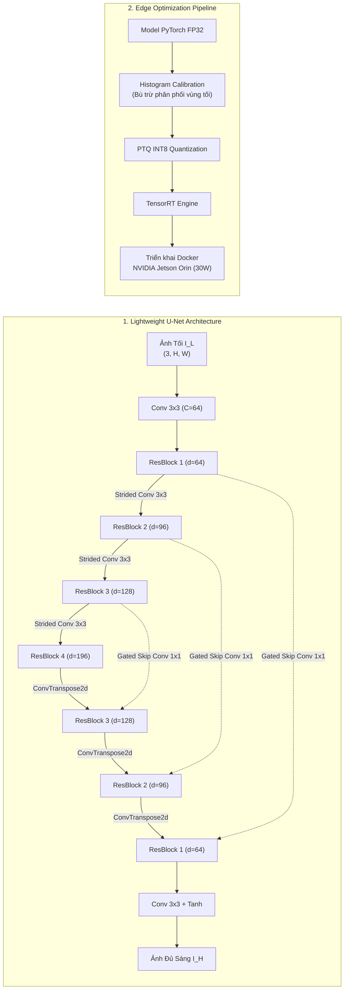

# 📑 Báo Cáo Nghiên Cứu Bài Báo 03: Edge-LLIE (CVPRW 2024)

> **Tên bài báo:** *Learning Optimized Low-Light Image Enhancement for Edge Vision Tasks*  
> **Tác giả:** S M A Sharif, Azamat Myrzabekov, Nodirkhuja Khujaev, Roman Tsoy, Seongwan Kim, Jaeho Lee  
> **Đơn vị nghiên cứu:** Opt-AI Inc. (LG Sciencepark, Seoul, Hàn Quốc)  
> **Hội nghị xuất bản:** IEEE/CVF Conference on Computer Vision and Pattern Recognition Workshops (CVPRW 2024)  
> **Tài liệu gốc:** [Sharif_Learning_Optimized_Low-Light_Image_Enhancement_for_Edge_Vision_Tasks_CVPRW_2024_paper.pdf](file:///E:/MyProject/low-light-image-enhancement-cnn/docs/papers/Sharif_Learning_Optimized_Low-Light_Image_Enhancement_for_Edge_Vision_Tasks_CVPRW_2024_paper.pdf)  

---

## 1. Bối Cảnh & Động Lực Nghiên Cứu (Motivation & Edge Dilemma)

### 1.1. Tầm quan trọng của tăng cường sáng đối với thị giác thiết bị biên (EVA)
Các hệ thống thị giác biên (**Edge Vision Applications - EVA**) như xe tự hành (autonomous vehicles), camera giám sát an ninh (surveillance), drone và robot công nghiệp phụ thuộc tuyệt đối vào luồng hình ảnh thời gian thực để ra quyết định sống còn. Khi hoạt động trong môi trường ban đêm:
- Hiệu suất lượng tử của cảm biến giảm sút nghiêm trọng dẫn đến ảnh chụp tối mịt và ngập tràn nhiễu hạt (quantum noise).
- Các thuật toán thị giác hạ nguồn (**downstream vision tasks**) như **Nhận diện đối tượng (Object Detection - YOLO)** và **Đối sánh đặc trưng / Khớp ảnh đa góc (Image Registration - SuperGlue)** bị sụt giảm độ chính xác thảm hại vì mất độ tương phản và biên cạnh.

### 1.2. Nghịch lý giữa mô hình SOTA và giới hạn phần cứng thiết bị biên
- Hầu hết các mô hình SOTA hiện nay được thiết kế chạy trên máy chủ với kiến trúc Transformer phức tạp (Retinexformer, Restormer) hoặc mở rộng lặp (unrolling Retinex).
- Những kiến trúc này sử dụng các phép toán không thân thiện với chip nhúng (non-hardware-friendly operations), tiêu tốn nhiều bộ nhớ RAM/VRAM và không thể chạy được ở tốc độ khung hình thời gian thực (real-time FPS) trên các bo mạch tiêu thụ điện năng thấp (như dòng NVIDIA Jetson Orin/Nano).
- **Mục tiêu của bài báo:** Xây dựng một đường ống (framework) trọn vẹn từ thiết kế mạng CNN dạng U-Net siêu nhẹ, áp dụng kỹ thuật lượng tử hóa sau huấn luyện (**Post-Training Quantization - PTQ INT8**) có cân chỉnh biểu đồ (Histogram Calibration), và đánh giá trực tiếp hiệu năng trên bo mạch biên thực tế cũng như các tác vụ thị giác hạ nguồn.

---

## 2. Phương Pháp Đề Xuất & Kiến Trúc Mô Hình (Proposed Framework)

### 2.1. Thiết kế mạng nơ-ron tích chập U-Net gọn nhẹ (Lightweight FCN U-Net)
- **Cấu trúc hoàn toàn tích chập (Fully Convolutional Network - FCN):** Loại bỏ hoàn toàn các lớp Attention nặng nề, chỉ sử dụng các phép tích chập chuẩn 2D ($3 \times 3$) thân thiện với bộ tăng tốc phần cứng phần cứng (hardware accelerators/DSP/NPU).
- **Phân cấp kênh của Encoder:** Trải qua 4 cấp độ với số kênh tăng dần: $d \in [64, 96, 128, 196]$.
- **Khối dư (Residual Block):** Mỗi cấp tích hợp một khối gồm 2 lớp tích chập $3 \times 3$ kết hợp hàm kích hoạt **PReLU** (Parametric ReLU). Khối dư có tác dụng cực kỳ tích cực trong việc học cách lọc nhiễu cảm biến (Denoising).
- **Hạ mẫu và nâng mẫu:** Hạ mẫu bằng Convolution bước nhảy 2 (`stride=2`), nâng mẫu bằng tích chập chuyển vị (`ConvTranspose2d`).
- **Liên kết tắt có cổng chặn nhiễu (Convolutional Residual-Gating Skip Connection):**
  - Tác giả nhận định: Trong ảnh thiếu sáng, bộ mã hóa (Encoder) không chỉ trích xuất thông tin cấu trúc mà còn vô tình mã hóa cả nhiễu cảm biến nặng hạt. Nếu truyền thẳng qua Decoder bằng kết nối tắt thông thường (như U-Net nguyên bản), nhiễu sẽ bị đẩy thẳng ra ảnh đầu ra.
  - Giải pháp: Đặt một lớp tích chập điểm $1 \times 1$ tại mỗi liên kết tắt:
    $$F_G = C_{1 \times 1}(X_R)$$
    Lớp này đóng vai trò tinh lọc không gian, ngăn chặn nhiễu thô rò rỉ sang Decoder.
- **Hàm mất mát huấn luyện:** Sử dụng chuẩn sai số tuyệt đối $L_1$ pixel-wise:
  $$\mathcal{L}_R = \|I_G - I_H\|_1$$
  (Nhóm tác giả lý giải: hàm $L_2$ phạt bình phương sai số, có xu hướng làm nhẵn mịn quá đà (oversmoothing) và làm mất biên hạt chi tiết khi gặp nhiễu cảm biến cao).

### 2.2. Chiến lược lượng tử hóa INT8 sau huấn luyện (PTQ) & Cân chỉnh biểu đồ
1. **Lượng tử hóa INT8:** Chuyển đổi trọng số (weights) và hàm kích hoạt (activations) từ dấu phẩy động 32-bit (FP32) sang số nguyên 8-bit (INT8) theo công thức làm tròn:
   $$\text{INT8}_Q = \text{Round}\left(\frac{P}{S}\right)$$
   (với $P$ là giá trị thực và $S$ là hệ số tỉ lệ scale factor).
2. **Cân chỉnh biểu đồ (Histogram Calibration):**
   - Trong ảnh thiếu sáng, biểu đồ phân bố độ sáng (histogram) bị co cụm dày đặc về phía giá trị tối ($0 \sim 30$). Nếu dùng phương pháp cân chỉnh giá trị cực đại thông thường (Max Calibration), các vùng tối sẽ bị làm tròn thành 0 (mất sạch thông tin).
   - Nhóm tác giả dùng kỹ thuật Histogram Calibration nhằm giãn phân phối kích hoạt, phân bổ dải biểu diễn INT8 tập trung vào vùng bóng tối, giúp mô hình INT8 bảo toàn chi tiết tối mà không bị bão hòa đen.
3. **Đóng gói TensorRT:** Mô hình INT8 sau khi cân chỉnh được biên dịch sang TensorRT Engine và chạy trong môi trường Docker trên thiết bị biên.

---

## 3. Kết Quả Thực Nghiệm & Tốc Độ Trên Thiết Bị Biên (Edge Benchmarks)

### 3.1. So sánh chất lượng phục hồi ảnh với các mô hình gọn nhẹ
Huấn luyện trên tập kết hợp (LOL-v1, LOL-v2 Real, và NTIRE'24 cropped patches):

| Mô hình | LOL-v1 (PSNR ↑ / SSIM ↑ / LPIPS ↓) | LOL-v2 Real (PSNR ↑ / SSIM ↑ / LPIPS ↓) | Trung bình PSNR ↑ / SSIM ↑ / LPIPS ↓ |
| :--- | :---: | :---: | :---: |
| Vanilla U-Net (MICCAI'15) | 15.37 / 0.6326 / 0.4007 | 17.22 / 0.6516 / 0.3718 | 16.30 / 0.6421 / 0.3863 |
| RetinexNet (BMVC'18) | 17.63 / 0.7185 / 0.4051 | 17.71 / 0.6049 / 0.4403 | 17.67 / 0.6617 / 0.4227 |
| LIME (TIP'16) | 16.28 / 0.6278 / 0.4315 | 17.52 / 0.5674 / 0.4115 | 16.90 / 0.5976 / 0.4215 |
| MobileUnet (ICCV'19) | 15.80 / 0.6508 / 0.4047 | 18.54 / 0.6994 / 0.3668 | 17.17 / 0.6751 / 0.3857 |
| DnCNN (TIP'17) | 16.18 / 0.6839 / 0.4209 | 18.91 / 0.7063 / 0.3909 | 17.54 / 0.6951 / 0.4059 |
| **Mô hình Đề Xuất (Ours - FP32)** | **16.44 / 0.7006 / 0.3499** | **19.04 / 0.7558 / 0.3190** | **17.74 / 0.7282 / 0.3344** |

> **Nhận xét:** Mô hình của Sharif et al. vượt trội hơn hẳn MobileUnet và Vanilla U-Net trên cả hai tập dữ liệu, đặc biệt chỉ số tri giác LPIPS giảm mạnh xuống **0.3344** (thể hiện ảnh tự nhiên, ít nhiễu và ít giả tạo).

---

### 3.2. Hiệu năng thực thi trên bo mạch biên thực tế (NVIDIA Jetson Orin - 30W Mode)
Số lượng tham số toàn mạng: **4.46M**. Thử nghiệm trên bo mạch nhúng NVIDIA Jetson Orin (chế độ tiết kiệm năng lượng 30 Watts):

| Phần cứng | Độ phân giải | Định dạng | PSNR (dB) | SSIM | LPIPS | Thời gian (ms) ↓ | Tốc độ (FPS) ↑ |
| :--- | :---: | :---: | :---: | :---: | :---: | :---: | :---: |
| Máy trạm GPU (A6000) | $512 \times 512$ | Full (FP32) | 17.738 | 0.7282 | 0.3344 | 9.33 ms | 164.50 FPS |
| Nhúng ARM64 (Jetson Orin) | $512 \times 512$ | Full (FP32) | 17.738 | 0.7282 | 0.3344 | 140.87 ms | 7.09 FPS |
| **Nhúng ARM64 (Jetson Orin)** | **$512 \times 512$** | **INT8 (TensorRT)** | 16.340 | 0.6325 | 0.3506 | **18.37 ms** | **54.42 FPS** |
| Nhúng ARM64 (Jetson Orin) | $256 \times 256$ | Full (FP32) | 17.310 | 0.6719 | 0.2169 | 39.39 ms | 25.39 FPS |
| **Nhúng ARM64 (Jetson Orin)** | **$256 \times 256$** | **INT8 (TensorRT)** | 15.920 | 0.5457 | 0.2403 | **5.01 ms** | **199.67 FPS** |

> **Điểm bứt phá then chốt:**  
> - Chuyển đổi từ FP32 sang INT8 trên CPU/GPU nhúng ARM64 giúp **tăng tốc gần 8 lần** (từ 25.39 FPS vọt lên **199.67 FPS**, độ trễ chỉ còn **5.01 ms**)!  
> - Tốc độ ~200 FPS hoàn toàn vượt xa ngưỡng thời gian thực (30-60 FPS), mở ra khả năng ghép nối trực tiếp vào pipeline camera mà không gây độ trễ cảm nhận được.

---

### 3.3. Tăng cường hiệu năng cho các tác vụ thị giác hạ nguồn (Downstream Vision)

#### 1. Nhận diện đối tượng (Object Detection - YOLOv3 trên tập ExDark)
Thử nghiệm trên 12 lớp đối tượng khó trong điều kiện ban đêm của tập ExDark:
- **Ảnh gốc chụp đêm (chưa tăng cường):** Mean AP = **0.3410**
- **Qua mô hình đề xuất INT8 + YOLOv3:** Mean AP = **0.3500** (+0.9% mAP tổng thể)
- **Qua mô hình đề xuất FP32 + YOLOv3:** Mean AP = **0.3550** (+1.4% mAP tổng thể)
- *Các lớp tăng vượt bậc:* Xe đạp (`Bicycle`: 0.393 $\to$ 0.423), Thuyền (`Boat`: 0.189 $\to$ 0.205), Xe máy (`Bike`: 0.373 $\to$ 0.421), Người (`People`: 0.396 $\to$ 0.412).

#### 2. Đối sánh đặc trưng stereo (Image Registration - SuperGlue trên tập MID)
Thử nghiệm đối sánh cặp ảnh stereo góc tối (Matching-in-the-Dark - MID):
- **Ảnh gốc thiếu sáng:** SuperGlue chỉ tìm được trung bình **217.89 điểm khớp (matches)** mỗi cặp ảnh.
- **Sau khi nâng sáng bằng mô hình INT8:** Số điểm khớp tăng vọt lên **304.89 matches/cặp** (tăng thêm **hơn 90 điểm khớp chính xác** mỗi cặp ảnh!).
- **Điều đặc biệt:** Trên ảnh đa mức xám (grayscale) phục vụ khớp ảnh, mô hình INT8 đạt kết quả khớp **hoàn toàn tương đương 100% với phiên bản đầy đủ FP32**, chứng minh không hề có tổn thất thông tin hình học khi lượng tử hóa INT8.

---

## 4. Phân Tích Ưu Điểm & Hạn Chế Kỹ Thuật (Pros & Cons)

### 4.1. Điểm mạnh
1. **Tính ứng dụng thực chiến cực cao:** Không chỉ đua điểm số trên tập benchmark tĩnh, bài báo giải quyết trọn vẹn bài toán từ mô hình hóa đến nén phần cứng INT8 và đo đạc FPS trên thiết bị nhúng thực.
2. **Khắc phục hiện tượng nhiễu rò rỉ qua Skip Connection:** Giải pháp đặt $1 \times 1$ conv gating trên skip-connection giải quyết triệt để vấn đề muôn thuở của U-Net khi làm việc với ảnh nhiễu.
3. **Độ trễ siêu thấp (5ms, ~200 FPS):** Đủ sức phục vụ các ứng dụng bay tự hành hoặc hỗ trợ lái xe ADAS ở vận tốc cao.

### 4.2. Hạn chế
- **Hiện tượng cắt cụm dải động màu (Dynamic Range Clipping):** Khi lượng tử hóa INT8 trong không gian sRGB, một số kênh màu bị cắt dải biên khiến màu sắc có thể kém rực rỡ hơn một chút so với FP32.
- Nhóm tác giả đề xuất giải pháp tiếp theo là áp dụng kỹ thuật **Huấn luyện nhận biết lượng tử (Quantization-Aware Training - QAT)** thay vì chỉ PTQ.

---

## 5. Bài Học Trực Tiếp Cho Dự Án Compact U-Net Của Chúng Ta

1. **Khẳng định tính đúng đắn của kiến trúc Compact U-Net:** Dự án của chúng ta chọn Compact U-Net hoàn toàn đồng nhất với kết luận của nhóm tác giả: mạng FCN U-Net với residual blocks là lựa chọn tối ưu nhất cho thiết bị tài nguyên giới hạn.
2. **Thiết kế Skip-Connection tinh chỉnh:** Trong mã nguồn `src/models/unet.py` sắp xây dựng, chúng ta **nhất thiết nên thêm một lớp Conv $1 \times 1$** (hoặc tích chập giảm chiều) tại các đường nối tắt skip connections để lọc nhiễu hạt trước khi concat vào Decoder.
3. **Lựa chọn hàm mất mát:** Nên dùng $L_1$ loss làm nền tảng kết hợp cùng SSIM thay vì dùng Mean Squared Error ($L_2$), vì $L_1$ giúp bảo toàn biên hạt trong điều kiện nhiễu cảm biến cao.
4. **Sẵn sàng cho việc tối ưu hóa ONNX/TensorRT:** Giữ nguyên các phép toán cơ bản (Conv2d, PReLU/LeakyReLU, ConvTranspose2d/Bilinear Upsample), không dùng các toán tử dị biệt để thuận tiện xuất mô hình sang ONNX và lượng tử hóa INT8 sau này.
