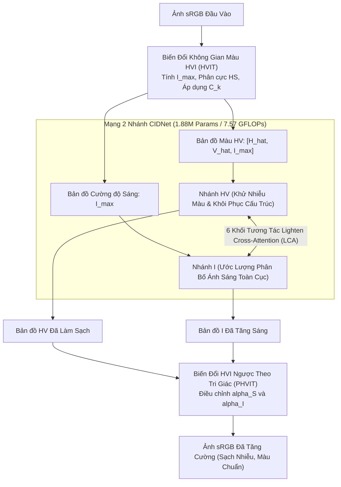

# 📑 Báo Cáo Nghiên Cứu Bài Báo 04: HVI Color Space & CIDNet (CVPR 2025)

> **Tên bài báo:** *HVI: A New Color Space for Low-light Image Enhancement*  
> **Tác giả:** Qingsen Yan, Yixu Feng, Cheng Zhang, Guansong Pang, Kangbiao Shi, Peng Wu, Wei Dong, Jinqiu Sun, Yanning Zhang  
> **Đơn vị nghiên cứu:** Đại học Công nghiệp Tây Bắc (NPU - Trung Quốc), Đại học Quản lý Singapore (SMU), Đại học Kiến trúc và Công nghệ Tây An  
> **Hội nghị xuất bản:** IEEE/CVF Conference on Computer Vision and Pattern Recognition (CVPR 2025)  
> **Tài liệu gốc:** [Yan_HVI_A_New_Color_Space_for_Low-light_Image_Enhancement_CVPR_2025_paper.pdf](file:///E:/MyProject/low-light-image-enhancement-cnn/docs/papers/Yan_HVI_A_New_Color_Space_for_Low-light_Image_Enhancement_CVPR_2025_paper.pdf)  
> **Mã nguồn chính thức:** [https://github.com/Fediory/HVI-CIDNet](https://github.com/Fediory/HVI-CIDNet)  

---

## 1. Bối Cảnh & Vấn Đề Khoa Học Cốt Lõi (Problem & Color Space Flaws)

Trong các bài toán tăng cường ảnh thiếu sáng (LLIE), mục tiêu là khôi phục đồng thời độ sáng, độ tương phản và màu sắc chân thực từ ảnh tối bị suy thoái nặng nề. Tuy nhiên, việc lựa chọn không gian màu (Color Space) xử lý ảnh hưởng quyết định đến chất lượng đầu ra.

### 1.1. Khuyết tật của không gian màu chuẩn sRGB (High Color Sensitivity)
- Trong không gian sRGB, thông tin độ sáng (Illuminance) và màu sắc (Chrominance) bị ràng buộc chặt chẽ với nhau (high color coupling/sensitivity) trên cả 3 kênh Red, Green, Blue.
- Khi mạng nơ-ron cố gắng "kéo sáng" các điểm ảnh tối, sự sai lệch tỷ lệ nhỏ giữa 3 kênh sẽ dẫn đến **hiện tượng lệch màu nghiêm trọng (color bias & color casting)**, khiến ảnh bị ám vàng, ám đỏ hoặc biến dạng màu sắc phi thực tế.

### 1.2. Khuyết tật của không gian màu HSV truyền thống (Color Space Noise)
Để giải quyết sự gắn kết của sRGB, nhiều nghiên cứu chuyển đổi ảnh sang không gian **HSV (Hue - Sắc độ, Saturation - Độ bão hòa, Value - Giá trị sáng)** nhằm tách kênh $V$ để nâng sáng riêng. Tuy nhiên, phép biến đổi toán học sang HSV gây ra **2 loại nhiễu hình học màu nguy hiểm**:

```
[ sRGB ] --(Độ nhạy màu cao)--> Biến dạng màu khi nâng sáng
   │
   ▼
[ HSV  ] --(Tách sáng V tốt)--> Xuất hiện 2 loại nhiễu không gian màu:
   ├─ ① Red Discontinuity Noise: Đứt gãy màu đỏ ở biên h=0 và h=6
   └─ ② Black Plane Noise: Vùng đen tuyệt đối vẫn bung thành đĩa tròn nhiễu HS
   │
   ▼
[ HVI  ] (Đề xuất mới CVPR 2025):
   ├─ Phân cực HS (Polarized HS) -> Triệt tiêu đứt gãy màu đỏ
   └─ Hàm co sụp cường độ C_k (Learnable Intensity Collapse) -> Khử nhiễu đĩa đen
```

1. **Nhiễu đứt gãy màu đỏ (Red Discontinuity Noise):**
   - Trục sắc độ $H$ (Hue) được định nghĩa tuần hoàn trong đoạn $[0, 6)$ theo số học đồng dư (modular arithmetic). Cùng là sắc đỏ nguyên bản nhưng lại bị xé đôi: một nửa nằm ở $h = 0$, nửa còn lại nằm ở $h \to 6$.
   - Khoảng cách Euclid giữa hai điểm màu đỏ gần như giống hệt nhau lại bị phóng đại cực đại ($\approx 6$). Khi mạng nơ-ron học gradient, điều này tạo ra các vết rách, đốm đen hoặc nhiễu đốm loang lổ trên các vật thể màu đỏ.
2. **Nhiễu mặt phẳng đen (Black Plane Noise):**
   - Khi độ sáng $V \to 0$ (vùng tối đen như mực), mặt phẳng $HS$ vẫn trải rộng thành một hình tròn đơn vị ($S \in [0, 1]$).
   - Nhiễu cảm biến nhỏ nhất trong vùng tối sẽ làm vector $(H, S)$ quay hỗn loạn khắp mặt phẳng, sinh ra các vệt nhiễu màu hạt mè (chromatic noise artifacts) khi ảnh được kích sáng.

---

## 2. Giải Pháp Đột Phá: Không Gian Màu HVI & Mạng CIDNet (Proposed Method)

### 2.1. Định nghĩa toán học của không gian màu HVI (Horizontal/Vertical-Intensity)
Không gian màu **HVI** được thiết kế chuyên biệt cho LLIE dựa trên hai nguyên lý hình học chặt chẽ:

#### 1. Bản đồ cường độ sáng tối đa (Max-RGB Intensity Map)
Thay vì dùng mạng nơ-ron đoán mò bản đồ chiếu sáng Retinex, tác giả dùng lý thuyết Max-RGB trực tiếp:
$$I_{max}(x) = \max_{c \in \{R,G,B\}}(I_c(x))$$
Bản đồ $I_{max}$ đóng vai trò trục cường độ $I$ (Intensity) trong HVI.

#### 2. Phân cực trục sắc độ (Polarized HS Projection)
Để triệt tiêu hiện tượng đứt gãy màu đỏ, trục sắc độ $h$ được chiếu trực giao sang hệ tọa độ 2 chiều $(h_{proj}, v_{proj})$:
$$h_{proj} = \cos\left(\frac{\pi h}{3}\right), \quad v_{proj} = \sin\left(\frac{\pi h}{3}\right)$$
Nhờ phép phân cực trực giao này, hai điểm đỏ tại $h=0$ và $h=6$ hòa làm một tại tọa độ $(1, 0)$, khoảng cách Euclid giữa chúng bằng 0.

#### 3. Hàm co sụp cường độ học được (Trainable Intensity Collapse Function $C_k$)
Để triệt tiêu nhiễu mặt phẳng đen, bán kính không gian màu được điều tiết bởi hàm phi tuyến có tham số học được $k \in \mathbb{Q}^+$:
$$C_k(x) = \frac{k}{r} \sin\left(\frac{\pi I_{max}(x)}{2}\right) + \varepsilon$$
- Khi vùng ảnh cực tối ($I_{max} \to 0$), $C_k(x) \to 0$, toàn bộ đĩa tròn $HS$ bị co sụp (collapse) về gốc tọa độ duy nhất (điểm đen chuẩn), triệt tiêu hoàn toàn nhiễu màu ngẫu nhiên.
- Khi độ sáng tăng dần, $C_k(x)$ mở rộng mượt mà về 1 để bảo toàn trọn vẹn màu sắc tự nhiên.

Hai thành phần màu ngang (Horizontal - $\hat{H}$) và dọc (Vertical - $\hat{V}$) được tính:
$$\hat{H} = C_k \odot S \odot h_{proj}, \quad \hat{V} = C_k \odot S \odot v_{proj}$$
Bộ ba $[\hat{H}, \hat{V}, I_{max}]$ tạo thành tensor ảnh trong không gian **HVI** hoàn toàn khả vi (differentiable).

---

### 2.2. Kiến trúc mạng phân tách màu và cường độ CIDNet (Color & Intensity Decoupling Network)



- **Mạng U-Net 2 nhánh chuyên biệt:**
  - **Nhánh I (Intensity Branch):** Tiếp nhận $I_{max}$, chỉ tập trung học ánh xạ chiếu sáng toàn cục.
  - **Nhánh HV (Color Branch):** Tiếp nhận ghép kênh $[\hat{H}, \hat{V}, I_{max}]$, chuyên trách khử nhiễu và bảo tồn độ bão hòa màu sắc.
- **Khối Lighten Cross-Attention (LCA):** Thay vì tự chú ý (self-attention) riêng lẻ, 6 khối LCA cho phép nhánh $I$ hướng dẫn nhánh $HV$ khử nhiễu chính xác (vùng tối khử mạnh, vùng sáng khử nhẹ tránh mất nét); ngược lại, thông tin độ sáng sạch từ $HV$ quay lại giúp nhánh $I$ chuyển tiếp ánh sáng mượt mà.
- **Biến đổi ngược PHVIT (Perceptual-inverse HVI Transform):** Cho phép người dùng tùy chỉnh độc lập hệ số bão hòa $\alpha_S$ và hệ số độ sáng $\alpha_I$ theo gu thẩm mỹ cá nhân.
- **Hàm mất mát đa không gian (Dual-space Loss):**
  $$\mathcal{L} = \lambda \cdot \ell(\hat{I}_{HVI}, I_{HVI}) + \ell(\hat{I}, I)$$
  (Giám sát đồng thời trên cả không gian HVI và không gian sRGB chuẩn).

---

## 3. Kết Quả Thực Nghiệm Trên 10 Bộ Dữ Liệu Chuẩn (Comprehensive Benchmarks)

Mô hình CIDNet cực kỳ gọn nhẹ (**chỉ 1.88M tham số và 7.57 GFLOPs** trên ảnh $256 \times 256$), nhưng thiết lập kỷ lục SOTA mới trên hầu như toàn bộ các tập dữ liệu thử nghiệm.

### 3.1. Đánh giá định lượng trên bộ chuẩn kinh điển LOL (v1 và v2)

| Phương pháp | Không gian màu | Số Tham Số (M) ↓ | FLOPs (G) ↓ | LOL-v1 (PSNR ↑ / SSIM ↑ / LPIPS ↓) | LOL-v2 Real (PSNR ↑ / SSIM ↑ / LPIPS ↓) | LOL-v2 Synthetic (PSNR ↑ / SSIM ↑ / LPIPS ↓) |
| :--- | :---: | :---: | :---: | :---: | :---: | :---: |
| RetinexNet (BMVC'18) | Retinex | 0.84 | 584.47 | 18.91 / 0.427 / 0.470 | 16.10 / 0.401 / 0.543 | 17.14 / 0.762 / 0.255 |
| KinD (IJCV'21) | Retinex | 8.02 | 34.99 | 23.02 / 0.843 / 0.156 | 17.54 / 0.669 / 0.375 | 18.32 / 0.796 / 0.252 |
| ZeroDCE (CVPR'20) | sRGB | **0.075** | **4.83** | 21.88 / 0.640 / 0.335 | 16.06 / 0.580 / 0.313 | 17.71 / 0.815 / 0.169 |
| LLFlow (AAAI'22) | sRGB | 17.42 | 358.40 | 25.00 / 0.871 / 0.117 | 17.43 / 0.831 / 0.176 | 24.81 / 0.919 / 0.067 |
| RetinexFormer (ICCV'23) | Retinex | 1.53 | 15.85 | 27.14 / 0.850 / 0.129 | 22.79 / 0.840 / 0.171 | 25.67 / 0.930 / 0.059 |
| GSAD (Diffusion SOTA) | sRGB | 17.36 | 442.02 | 27.61 / 0.876 / 0.092 | 20.15 / 0.846 / 0.113 | 24.47 / 0.929 / 0.051 |
| QuadPrior (CVPR'24) | Kubelka-Munk | 1252.75 | 1103.20 | 22.85 / 0.800 / 0.201 | 20.59 / 0.811 / 0.202 | 16.11 / 0.758 / 0.114 |
| **CIDNet (Ours - CVPR'25)**| **HVI** | **1.88** | **7.57** | **28.20 / 0.889 / 0.079** | **24.11 / 0.871 / 0.108** | **25.71 / 0.942 / 0.045** |

> **Nhận xét chấn động:**  
> - Trên tập **LOL-v1**: CIDNet đạt **28.20 dB PSNR**, vượt qua mô hình khuếch tán GSAD (+0.6 dB) trong khi chỉ dùng **1/9 số lượng tham số** và **1/58 số phép tính FLOPs** (7.57G so với 442G).  
> - Trên tập **LOLv2-Real**: Đạt **24.11 dB PSNR**, vượt qua RetinexFormer tới **+1.32 dB** và vượt KinD tới **+6.57 dB**.

### 3.2. Đột phá trên tập cực tối Sony-Total-Dark (SID) & SICE
- Trên tập **Sony-Total-Dark** (ảnh RAW tối đen không qua gamma correction):
  - CIDNet đạt **22.904 dB PSNR** và **0.676 SSIM**.
  - **Bỏ xa mô hình đứng thứ hai (LLFlow 16.226 dB) tới tận +6.68 dB PSNR!**
  - Nhờ có hàm co sụp $C_k$, vùng nhiễu tối đen được dập tắt hoàn toàn, giúp mô hình trích xuất tín hiệu ảnh trung thực thay vì khuếch đại nhiễu trắng.
- Trên 5 bộ dữ liệu ảnh thực tế không có nhãn (Unpaired: DICM, LIME, MEF, NPE, VV): CIDNet đạt điểm số tri giác mù **NIQE tốt nhất (3.523)** và **BRISQUE hàng đầu (23.521)**.

### 3.3. Khả năng tương thích Plug-and-Play trên các mô hình khác
Khi tích hợp module đổi không gian màu HVI vào các kiến trúc SOTA khác (giữ nguyên mạng, chỉ đổi đầu vào/đầu ra qua HVI):
- **GSAD (Diffusion):** Tăng vọt **+3.562 dB PSNR** (từ 20.15 lên 23.71 dB trên LOLv2-Real).
- **LEDNet (CNN):** Tăng vọt **+3.456 dB PSNR** (từ 19.93 lên 23.39 dB).
- **LLFormer (Transformer):** Tăng **+2.615 dB PSNR**.
- **FourLLIE (Fourier CNN):** Tăng **+0.381 dB PSNR**.
- Kết quả này chứng minh: **Không gian màu HVI là một công cụ cải tiến nền tảng mang tính phổ quát cho toàn bộ ngành LLIE!**

---

## 4. Phân Tích Ưu Điểm & Hạn Chế Kỹ Thuật (Pros & Cons)

### 4.1. Điểm mạnh xuất sắc
1. **Bản chất toán học chặt chẽ và thanh lịch:** Giải quyết tận gốc hai khuyết tật hình học của HSV (Red Discontinuity và Black Plane) bằng công thức giải tích phân cực và hàm co sụp $C_k$.
2. **Khả năng học thích ứng (Trainable parameter $k$):** Hệ số $k$ tự co giãn theo từng bộ dữ liệu thông qua lan truyền ngược (backpropagation).
3. **Hiệu suất tính toán vô địch:** Vừa nhẹ (1.88M params, 7.57 GFLOPs), vừa nhanh (thời gian xử lý GPU chỉ **0.053 giây**), hoàn toàn phù hợp triển khai sản phẩm thực tế.

### 4.2. Hạn chế
- Việc chuyển đổi qua lại giữa sRGB $\leftrightarrow$ HVI đòi hỏi các phép toán lượng giác ($\sin, \cos, \arctan$), có thể tốn một lượng nhỏ chu kỳ tính toán CPU nếu triển khai trên các vi điều khiển rất yếu không có phần cứng xử lý số thực (FPU).

---

## 5. Bài Học Trực Tiếp Cho Dự Án Compact U-Net Của Chúng Ta

1. **Hiểu rõ nguyên nhân gây méo màu:** Trong giai đoạn huấn luyện Compact U-Net sắp tới trên LOLv1/LOLv2, nếu chỉ dùng không gian sRGB chuẩn và hàm mất mát $L_1$ thông thường, mạng có thể gặp hiện tượng ám màu hoặc lệch tông (color shift) ở các vùng tối.
2. **Tiềm năng tích hợp HVI vào tiền xử lý:** Chúng ta hoàn toàn có thể cân nhắc tích hợp hàm chuyển đổi không gian màu HVI vào pipeline dữ liệu (`src/datasets/`) như một tùy chọn nâng cao. Vì HVI có thể dùng độc lập như một lớp tiền/hậu xử lý, nó có thể giúp Compact U-Net tăng từ 1 - 3 dB PSNR mà không cần làm mạng nặng thêm một tham số nào!
3. **Thiết kế nhánh tách biệt (Decoupled processing):** Nếu tài nguyên cho phép, ý tưởng phân tách một nhánh xử lý độ sáng toàn cục và một nhánh xử lý chi tiết/màu sắc là một hướng mở rộng rất giá trị cho Compact U-Net.
