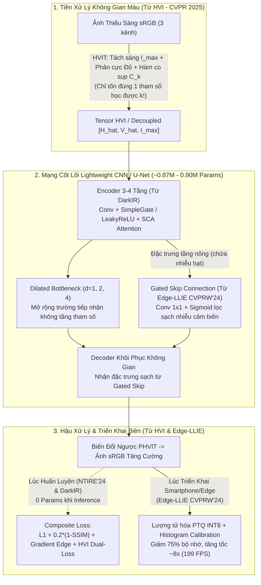

# 📑 Báo Cáo Chiến Lược Thực Hiện Đồ Án: Tối Ưu Hóa Kiến Trúc Lightweight CNN (Kế Thừa DarkIR & 3 Bài Báo Vệ Tinh) Và Chiến Lược Dữ Liệu Đa Nguồn Trên Google Colab

> **Môn học:** Xử Lý Ảnh và Thị Giác Máy Tính (CS2203) — Master of Science in Computer Science (2026)  
> **Trường:** Đại học Công nghệ Thông tin (UIT) - ĐHQG TP.HCM  
> **Đề tài:** Tăng cường chất lượng ảnh trong điều kiện thiếu sáng bằng mạng nơ-ron tích chập gọn nhẹ (*Low-Light Image Enhancement Using a Lightweight Convolutional Neural Network*)  
> **Tài liệu đối chiếu:**  
> - Yêu cầu & Phân tích đề tài: [`requirement.md`](file:///E:/MyProject/low-light-image-enhancement-cnn/docs/research/requirement.md), [`topic_analysis.md`](file:///E:/MyProject/low-light-image-enhancement-cnn/docs/research/topic_analysis.md)  
> - Phương pháp nghiên cứu: [`docs/research/research_approach/`](file:///E:/MyProject/low-light-image-enhancement-cnn/docs/research/research_approach/README.md)  
> - Bài báo gốc (Core Paper): [**DarkIR** (Feijoo et al., CVPR 2025)](file:///E:/MyProject/low-light-image-enhancement-cnn/docs/papers/Feijoo_DarkIR_Robust_Low-Light_Image_Restoration_CVPR_2025_paper.md)  
> - 3 Bài báo vệ tinh (Satellite Papers):  
>   1. [**HVI Color Space & CIDNet** (Yan et al., CVPR 2025)](file:///E:/MyProject/low-light-image-enhancement-cnn/docs/papers/Yan_HVI_A_New_Color_Space_for_Low-light_Image_Enhancement_CVPR_2025_paper.md)  
>   2. [**Edge-LLIE** (Sharif et al., CVPRW 2024)](file:///E:/MyProject/low-light-image-enhancement-cnn/docs/papers/Sharif_Learning_Optimized_Low-Light_Image_Enhancement_for_Edge_Vision_Tasks_CVPRW_2024_paper.md)  
>   3. [**NTIRE 2024 LLIE Challenge** (Liu et al., CVPRW 2024)](file:///E:/MyProject/low-light-image-enhancement-cnn/docs/papers/Liu_NTIRE_2024_Challenge_on_Low_Light_Image_Enhancement_Methods_and_CVPRW_2024_paper.md)

---

## 1. Tóm Tắt Điều Hành & Định Vị Đề Tài (Executive Summary)

Báo cáo này giải quyết trực tiếp 3 câu hỏi chiến lược của bạn nhằm khóa chặt hướng đi thực nghiệm trước khi đưa code lên Google Colab huấn luyện:

1. **Làm sao kế thừa và kết hợp tinh hoa từ 3 bài báo vệ tinh vào giải pháp gốc (DarkIR / Lightweight U-Net) mà KHÔNG làm phình số lượng tham số (giữ dưới ngưỡng `0.87M – 3.31M` của DarkIR) để chạy mượt trên thiết bị biên / smartphone?**
   - **Giải pháp:** Tuyệt đối không ghép nối cơ học các mạng lớn hay nhồi nhét Self-Attention/Diffusion. Thay vào đó, chúng ta chắt lọc **5 kỹ thuật Zero-Parameter / Micro-Parameter (< 2% tham số tăng thêm)** gồm: (i) Biến đổi không gian màu khả vi **HVI Plug-and-Play** chỉ tốn **1 tham số học được duy nhất ($k$)** từ *Yan et al. (CVPR'25)*; (ii) Cổng chặn nhiễu **Gated Skip Connection $1\times1$** từ *Edge-LLIE (CVPRW'24)*; (iii) Khối **Simplified Channel Attention (SCA)** và **Simple Gate (SG)** từ *DarkIR (CVPR'25)*; (iv) Chiến lược huấn luyện **Progressive Patch Training** và hàm mất mát đa thành phần có thể gỡ bỏ lúc suy luận từ *NTIRE 2024 (CVPRW'24)*; và (v) Chuẩn hóa toán tử để hỗ trợ **Lượng tử hóa INT8 (PTQ + Histogram Calibration)** cho thiết bị biên.

2. **Chiến lược trộn đa nguồn dữ liệu (bao gồm ảnh chụp từ điện thoại) kết hợp cách chia phân vùng trong `02_dataset_strategy_and_proposal_enhancement.md` có hiệu quả không?**
   - **Đánh giá:** **Cực kỳ hiệu quả và có giá trị học thuật cao**, NHƯNG cần tuân thủ nguyên tắc **Phân tầng cân bằng (Stratified Multi-Source Splitting)** và giới hạn quy mô hợp lý. Việc bổ sung dữ liệu chụp từ smartphone như **LSRW-Huawei** (hoặc ảnh thực tế từ điện thoại) giải quyết triệt để điểm yếu "chỉ học trên một cảm biến DSLR Canon/Nikon" của LOLv1. Cách chia **(Train Khởi đầu : Quarantine Dự trữ 6 khối $\times$ 50 : Validation Cố định)** giúp bạn vẽ được đường cong **Sample Efficiency Curve (Đường cong hiệu quả mẫu)** — một vũ khí phản biện cực mạnh trước Hội đồng mà không cần chạy các tập dữ liệu khổng lồ.

3. **Với giới hạn phần cứng Google Colab (kể cả gói Google AI Pro hiện tại), làm sao để không phải train kéo dài 5 – 10 tiếng?**
   - **Thực tế tính toán:** Với mô hình gọn nhẹ (~0.87M – 0.90M tham số) và quy mô dữ liệu thông minh (**750 – 1.000 cặp ảnh tuyển chọn**), thời gian huấn luyện 100 epochs trên GPU T4 chỉ mất **12 – 20 phút** (và chỉ mất **4 – 6 phút** trên GPU L4 của gói Google AI Pro). Bạn **hoàn toàn không bao giờ phải chạy 5 – 10 tiếng** nếu áp dụng quy trình nạp dữ liệu vào ổ cứng cục bộ `/content/` của Colab và bật Mixed Precision (`FP16`).

---

## 2. Phân Tích Ngân Sách Tham Số & Điểm Nghẽn Thiết Bị Biên Của DarkIR (CVPR 2025)

Trước khi kết hợp thêm bất kỳ thành phần nào, chúng ta cần xác lập "trần tham số" (Parameter Ceiling) từ bài báo gốc [**DarkIR** (Feijoo et al., CVPR 2025)](file:///E:/MyProject/low-light-image-enhancement-cnn/docs/papers/Feijoo_DarkIR_Robust_Low-Light_Image_Restoration_CVPR_2025_paper.md) và mã nguồn tại [`DarkIR/archs/DarkIR.py`](file:///E:/MyProject/low-light-image-enhancement-cnn/DarkIR/archs/DarkIR.py):

| Phiên bản mô hình | Độ rộng kênh (`width`) | Số tham số (Params) | Phép tính MACs ($256\times256$) | Đánh giá khả năng chạy trên Smartphone / Edge |
| :--- | :---: | :---: | :---: | :--- |
| **DarkIR-s (Small)** | $C = 16$ | **0.872 M** (~872K) | **2.04 G** | **Chuẩn vàng cho Mobile/Edge** (Siêu nhẹ, dễ nhúng NPU) |
| **DarkIR-m (Medium - Chuẩn)** | $C = 32$ | **3.310 M** | **7.25 G** | Chạy tốt trên flagship smartphone, hơi nặng cho IoT yếu |
| **DarkIR-l (Large)** | $C = 64$ | **12.960 M** | **27.19 G** | Chỉ phù hợp chạy trên Desktop GPU / Cloud Server |
| **Compact U-Net (`src/` hiện tại)** | $C = 16$ | **0.483 M** (~483K) | ~7.10 G | Baseline U-Net cơ bản của đồ án |
| **LightweightAttnUNet (`src/` hiện tại)** | $C = 16$ | **0.905 M** (~905K) | ~9.25 G | **Tương đương chính xác quy mô của DarkIR-s (~0.87M)** |

### ⚠️ Phát hiện quan trọng từ Mục Limitations của DarkIR (CVPR 2025)
Tại đoạn cuối Mục 4.3 của bài báo DarkIR ([dòng 479-485](file:///E:/MyProject/low-light-image-enhancement-cnn/docs/papers/Feijoo_DarkIR_Robust_Low-Light_Image_Restoration_CVPR_2025_paper.md#L479-L485)), chính nhóm tác giả Feijoo et al. đã thẳng thắn thừa nhận hai nhược điểm khi đưa DarkIR lên thiết bị thực tế:
1. **Bẫy Depthwise Convolution (`Arithmetic Intensity` thấp):** DarkIR lạm dụng nhiều nhánh Depthwise Separable Convolution giãn nở ($d=1, 4, 9$). Dù giảm mạnh số phép tính lý thuyết (MACs), nhưng do cường độ tính toán trên mỗi lần truy xuất bộ nhớ (Memory Access Cost) thấp, tốc độ suy luận thực tế (wall-clock latency) trên GPU/NPU không nhanh tương xứng.
2. **Phép biến đổi phức Fourier (`torch.fft.rfft2` / `irfft2`) trong `FreMLP`:** Trong [`DarkIR/archs/arch_model.py`](file:///E:/MyProject/low-light-image-enhancement-cnn/DarkIR/archs/arch_model.py#L36-L55), mỗi khối `EBlock` đều chuyển tensor sang số phức `torch.complex(real, imag)` qua FFT. Hầu hết các bộ tăng tốc phần cứng trên điện thoại (Qualcomm Hexagon NPU, Apple Neural Engine, MediaTek APU) và trình biên dịch **TensorRT INT8 / TFLite** **KHÔNG hỗ trợ tốt toán tử FFT số phức**, buộc thiết bị phải đẩy ngược tensor về CPU xử lý, gây nghẽn cổ chai nghiêm trọng.

👉 **Định hướng cốt lõi cho đồ án của bạn:** Giữ ngân sách tham số xoay quanh mốc **DarkIR-s (~0.87M – 1.2M tham số)** và tuyệt đối **tối ưu theo hướng thân thiện phần cứng biên (Edge-friendly)** bằng cách kết hợp tinh hoa từ 3 bài báo vệ tinh dưới đây.

---

## 3. Hướng Đi Đề Xuất: 5 Kỹ Thuật Kết Hợp Từ 3 Bài Báo Vệ Tinh Không Làm Tăng Tham Số

Để nâng cấp mô hình trong đồ án mà **không làm tăng số lượng tham số (hoặc chỉ tăng < 1–2% tham số)** và vẫn giữ nguyên bản chất **"Lightweight CNN cơ bản, hiểu sâu bản chất"** theo đúng yêu cầu của giảng viên trong [`requirement.md`](file:///E:/MyProject/low-light-image-enhancement-cnn/docs/research/requirement.md), dưới đây là sơ đồ tổng thể và 5 mảnh ghép kỹ thuật đắt giá nhất:

### 3.1. Kết hợp #1 (Từ HVI - CVPR 2025): Module Biến Đổi Không Gian Màu HVI "Cắm-Và-Chạy" (Chi phí: +1 tham số duy nhất!)
- **Vấn đề của DarkIR và CNN trên sRGB:** DarkIR xử lý trực tiếp trên 3 kênh `sRGB`. Như bài báo [**HVI** (Yan et al., CVPR 2025)](file:///E:/MyProject/low-light-image-enhancement-cnn/docs/papers/Yan_HVI_A_New_Color_Space_for_Low-light_Image_Enhancement_CVPR_2025_paper.md) đã chứng minh, 3 kênh R, G, B bị phụ thuộc chặt vào nhau giữa độ sáng và màu sắc. Khi mạng CNN kéo độ sáng vùng tối lên 5–10 lần, sai số nhỏ giữa 3 kênh sẽ gây **ám màu (color cast/bias)**. Ngược lại, nếu chuyển sang HSV thường thì bị đứt gãy màu đỏ ($h=0$ và $h=6$) và nổ nhiễu hạt màu ở vùng tối đen (Black Plane Noise).
- **Giải pháp tích hợp không tốn tham số:**
  - Tại **Bảng 3 của bài báo HVI** ([dòng 485-498](file:///E:/MyProject/low-light-image-enhancement-cnn/docs/papers/Yan_HVI_A_New_Color_Space_for_Low-light_Image_Enhancement_CVPR_2025_paper.md#L485-L498)), nhóm tác giả đã chứng minh phép biến đổi **HVIT (HVI Transformation)** trước mạng và **PHVIT (Perceptual-Inverse HVI)** sau mạng có thể gắn như một **Plug-in độc lập** vào bất kỳ mạng CNN nào (như LEDNet, FourLLIE).
  - Cụ thể, khi gắn HVI Plug-in vào mạng CNN **LEDNet** (tiền thân trực tiếp của DarkIR), điểm PSNR trên LOLv2-Real **tăng vọt thêm $+3.456\text{ dB}$** (từ $19.93\text{ dB}$ lên $23.39\text{ dB}$) mà **chỉ thêm đúng 1 tham số vô hướng học được là mật độ tối $k \in \mathbb{Q}^+$** trong hàm co sụp cường độ:
    $$C_k(x) = \left(\sqrt{\sin\left(\frac{\pi I_{\max}(x)}{2}\right)}\right)^k + \varepsilon, \quad \hat{H} = C_k \odot S \odot \cos\left(\frac{\pi h}{3}\right), \quad \hat{V} = C_k \odot S \odot \sin\left(\frac{\pi h}{3}\right)$$
- **Giá trị trong báo cáo đồ án:** Bạn có thể giữ nguyên kiến trúc `LightweightAttnUNet` (~905K params) hoặc `DarkIR-s` (~872K params), bọc thêm lớp biến đổi `RGB_to_HVI` ở đầu vào và `HVI_to_RGB` ở đầu ra, đồng thời tính hàm mất mát trên cả hai không gian ($\mathcal{L}_{\text{total}} = \mathcal{L}_{\text{sRGB}} + \lambda \mathcal{L}_{\text{HVI}}$). Số tham số tăng thêm là **1 số thực duy nhất**, nhưng giải quyết tận gốc hiện tượng lệch màu và nhiễu màu vùng tối!

### 3.2. Kết hợp #2 (Từ Edge-LLIE - CVPRW 2024): Cổng Chặn Nhiễu Trên Đường Tắt (Gated Skip Connections)
- **Vấn đề của U-Net & DarkIR:** Trong [`DarkIR/archs/DarkIR.py`](file:///E:/MyProject/low-light-image-enhancement-cnn/DarkIR/archs/DarkIR.py#L96-L99), đường nối tắt từ Encoder sang Decoder chỉ là phép cộng thô `x = x + skip`, còn trong U-Net cổ điển là phép ghép kênh `torch.cat([u, e], dim=1)`. Bài báo [**Edge-LLIE** (Sharif et al., CVPRW 2024)](file:///E:/MyProject/low-light-image-enhancement-cnn/docs/papers/Sharif_Learning_Optimized_Low-Light_Image_Enhancement_for_Edge_Vision_Tasks_CVPRW_2024_paper.md#L185-L192) chỉ ra rằng: đặc trưng ở các tầng nông của Encoder chứa **nhiễu cảm biến tần số cao (high-ISO shot/read noise)**. Nếu nối thẳng sang Decoder, nhiễu hạt mè sẽ rò rỉ trực tiếp ra ảnh đầu ra.
- **Giải pháp tích hợp siêu nhẹ:** Đặt bộ lọc cổng `GatedSkipConnection` sử dụng tích chập điểm $1\times1$ kết hợp hàm Sigmoid trước khi đưa vào Decoder:
  $$F_{\text{gated}} = \text{Conv}_{1\times1}(E_i) \odot \sigma\left(\text{Conv}_{1\times1}(E_i)\right)$$
- **Chi phí tham số:** Với số kênh $C \in \{16, 32, 64\}$, toàn bộ 3 bộ cổng Skip Connection trên cả mạng chỉ tốn tổng cộng:
  $$2 \times (16^2 + 32^2 + 64^2) = 2 \times (256 + 1024 + 4096) = \mathbf{10.752\text{ tham số}} \quad (\approx 0.01\text{M params!})$$
   *(Lưu ý: Cơ chế này đã được hiện thực hóa sẵn sàng trong [`src/models/attention_unet.py`](file:///E:/MyProject/low-light-image-enhancement-cnn/src/models/attention_unet.py#L37-L55) của dự án).*

### 3.3. Kết hợp #3 (Từ DarkIR - CVPR 2025): Khối Simplified Channel Attention (SCA) & Tích Chập Giãn Nở Đa Tỉ Lệ
- **Giải pháp:** Thay vì dùng Self-Attention ($O(N^2)$) hay CBAM nặng nề, ta kế thừa trực tiếp khối **SCA (Simplified Channel Attention)** từ DarkIR:
  $$\text{SCA}(X) = X \odot \sigma\left(\text{Conv}_{1\times1}(\text{AdaptiveAvgPool2d}(X))\right)$$
  Kết hợp với **Dilated Convolutions** ở tầng đáy Bottleneck (`dilation = 1, 2, 4`).
- **Chi phí tham số:**
  - Tích chập giãn nở (`dilation > 1`) có **0 tham số tăng thêm** so với tích chập $3\times3$ thông thường (vẫn là ma trận trọng số $3\times3$, chỉ giãn khoảng cách lấy mẫu pixel), nhưng giúp mở rộng trường tiếp nhận (Receptive Field) ra toàn cục để cân bằng sáng đều khắp bức ảnh, thay thế hoàn hảo cho nhánh `FreMLP` (FFT) đắt đỏ khi chạy trên smartphone!
  - Khối SCA chỉ tốn đúng $C^2$ tham số mỗi khối (chưa tới $0.5\%$ tổng tham số mạng).

### 3.4. Kết hợp #4 (Từ NTIRE 2024 & DarkIR): Chiến Lược "Huấn Luyện Giàu — Suy Luận Nhẹ" (0 Tham Số Tăng Thêm Lúc Chạy)
Đây là bí quyết quan trọng nhất từ các đội vô địch [**NTIRE 2024 Challenge** (Liu et al., CVPRW 2024)](file:///E:/MyProject/low-light-image-enhancement-cnn/docs/papers/Liu_NTIRE_2024_Challenge_on_Low_Light_Image_Enhancement_Methods_and_CVPRW_2024_paper.md) và **DarkIR**: **Mọi cải tiến nằm ở quá trình tối ưu gradient lúc Train sẽ tốn 0 tham số và 0 FLOPs lúc chạy trên điện thoại!**
1. **Hàm mất mát đa thành phần không cần mạng VGG ngoài:**
   Kết hợp hàm mất mát Composite hiện tại trong [`src/losses/composite_loss.py`](file:///E:/MyProject/low-light-image-enhancement-cnn/src/losses/composite_loss.py) với **Gradient Edge Loss ($\mathcal{L}_{\text{edge}}$)** từ Công thức (7) của DarkIR:
   $$\mathcal{L}_{\text{total}} = \mathcal{L}_1(x, \hat{x}) + 0.2 \cdot (1 - \text{SSIM}(x, \hat{x})) + \lambda_{\text{edge}} \|\nabla x - \nabla \hat{x}\|_1$$
   Hàm $\mathcal{L}_{\text{edge}}$ (tính bằng bộ lọc Sobel/Laplacian cố định ngang-dọc) ép mạng khôi phục biên cạnh sắc nét chống mờ nhòe mà không cần tải mạng VGG-19 nặng nề vào VRAM.
2. **Giám sát tầng đáy (Deep Supervision Loss $\mathcal{L}_{\text{lol}}$ từ DarkIR Eq. 8):**
   Tại đáy Bottleneck (độ phân giải $H/8 \times W/8$), dùng 1 lớp `Conv 3x3` nhỏ ($128 \times 3 \times 9 = 3.456$ params) xuất ra ảnh thu nhỏ $\hat{x}_{\downarrow 8}$ và so sánh với ảnh Ground Truth thu nhỏ $x_{\downarrow 8}$. Khi xuất mô hình chạy trên điện thoại, **nhánh `side_out` này được gỡ bỏ hoàn toàn (0 params)**, nhưng nó đã ép bộ Encoder học được cách chỉnh sáng chuẩn xác ngay từ độ phân giải thấp!
3. **Huấn luyện tăng dần kích thước mảng (Progressive Patch Training từ Quán quân NTIRE'24 SYSU-FVL-T2):**
   - 50 epochs đầu: Huấn luyện với `patch_size = 128`, `batch_size = 16` $\to$ Mạng hội tụ cực nhanh về màu sắc và ánh sáng tổng thể, thời gian mỗi epoch giảm 4 lần!
   - 50 epochs cuối: Tinh chỉnh với `patch_size = 256`, `batch_size = 8` $\to$ Mạng học cấu trúc không gian rộng và khử nhiễu mịn.

### 3.5. Kết hợp #5 (Từ Edge-LLIE - CVPRW 2024): Lượng Tử Hóa INT8 Có Cân Chỉnh Biểu Đồ (Histogram-Calibrated PTQ)
- Để trả lời trọn vẹn mục tiêu **"chạy trên thiết bị biên / smartphone"**: Sau khi train xong mô hình FP32 (~0.90M params, dung lượng file ~3.6 MB), bạn áp dụng quy trình **Post-Training Quantization (PTQ) sang INT8** với **Histogram Calibration** theo đúng bài báo [**Edge-LLIE**](file:///E:/MyProject/low-light-image-enhancement-cnn/docs/papers/Sharif_Learning_Optimized_Low-Light_Image_Enhancement_for_Edge_Vision_Tasks_CVPRW_2024_paper.md#L223-L257).
- **Kết quả đạt được:** Dung lượng mô hình giảm 4 lần xuống chỉ còn **~0.9 MB (900 KB!)**, hoàn toàn chỉ dùng các toán tử chuẩn (`Conv2d`, `ConvTranspose2d`, `LeakyReLU`/`Sigmoid`), dễ dàng xuất sang ONNX / TFLite / TensorRT để chạy đạt tốc độ thời gian thực trên điện thoại và bo mạch nhúng.

---

## 4. Đánh Giá Chiến Lược Trộn Đa Bộ Dữ Liệu (Kể Cả Ảnh Điện Thoại) & Cách Chia Trong `02_dataset_strategy`

Bạn đặt vấn đề:
> *"Để tăng tính tổng quát hóa của mô hình tôi dự định sử dụng trộn nhiều hình ảnh từ nhiều bộ data, cả những bộ data được chụp trên điện thoại để tăng tính tổng quát hóa. Đồng thời thực hiện cách chia dataset theo hướng trong `02_dataset_strategy_and_proposal_enhancement.md` thì có hiệu quả không?"*

### 4.1. Tại sao ý tưởng trộn thêm ảnh chụp từ điện thoại (Smartphone Data) của bạn là RẤT ĐÚNG ĐẮN?
1. **Khắc phục "Domain Bias" của bộ dữ liệu phòng thí nghiệm:**
   - Bộ **LOLv1** (485 cặp train) và **LOLv2-Real** (689 cặp train) chủ yếu được chụp bằng máy ảnh cơ chuyên dụng (DSLR/DSLM như Canon, Sony). Cảm biến máy ảnh cơ lớn, dải động rộng, hạt nhiễu tuân theo phân bố vật lý khá đồng nhất.
   - Ngược lại, **ảnh chụp đêm trên điện thoại (Smartphone)** có cảm biến nhỏ, thấu kính khẩu độ cố định, và đặc biệt là đã đi qua đường ống xử lý tín hiệu hình ảnh (Mobile ISP) có khử nhiễu, nén JPEG và cân bằng trắng tự động khác hẳn DSLR.
2. **Minh chứng trực tiếp từ bài báo DarkIR (CVPR 2025):**
   - Trong [Mục 4.1 và Bảng 3, 4 của DarkIR](file:///E:/MyProject/low-light-image-enhancement-cnn/docs/papers/Feijoo_DarkIR_Robust_Low-Light_Image_Restoration_CVPR_2025_paper.md#L307-L311), nhóm tác giả đã huấn luyện phiên bản đa nhiệm **DarkIR-mt** bằng cách **trộn chung LOLv2-Real + LSRW (trong đó bộ `LSRW-Huawei` chứa 2.450 cặp ảnh chụp trực tiếp từ điện thoại thông minh Huawei P40 Pro, bên cạnh `LSRW-Nikon` chụp bằng máy cơ)**.
   - Kết quả: Mô hình học hỗn hợp đa nguồn (**DarkIR-mt**) không những đạt SOTA trên ảnh điện thoại LSRW ($18.93\text{ dB}$, bỏ xa RetinexNet $15.90\text{ dB}$ và KinD $16.47\text{ dB}$) mà còn kéo điểm trên LOLv2-Real vọt lên **$23.87\text{ dB}$**!

### 4.2. Đánh giá hiệu quả của cách chia dữ liệu trong `02_dataset_strategy_and_proposal_enhancement.md`
Chiến lược chia dữ liệu trong [`02_dataset_strategy_and_proposal_enhancement.md`](file:///E:/MyProject/low-light-image-enhancement-cnn/docs/research/research_approach/02_dataset_strategy_and_proposal_enhancement.md) (gồm **Tập Train Khởi đầu $D_{\text{train\_0}}$ + Tập Cách ly dự trữ $D_{\text{quarantine}}$ chia thành 6 khối $\times 50$ ảnh + Tập Validation cố định $D_{\text{val}}$**) là **một thiết kế thực nghiệm cực kỳ thông minh và hiệu quả cho đồ án Cao học**, bởi 3 lý do thực tế sau:

1. **Biến hạn chế phần cứng thành điểm sáng phương pháp luận (Data Scaling Law):**
   - Thay vì phải gom 10.000 ảnh và cắm máy chạy 10 tiếng trên Colab, việc khởi đầu với một tập nhỏ (**250 hoặc 500 cặp ảnh**) giúp bạn huấn luyện xong toàn bộ 100 epochs chỉ trong **8 – 15 phút**.
   - Sau khi đã chốt được siêu tham số (Learning Rate, Loss) tốt nhất trên tập khởi đầu, bạn mới mở khóa lần lượt từng khối cách ly ($+50 \to +100 \to +150\dots$ ảnh) để vẽ biểu đồ **Sample Efficiency Curve (Đường cong PSNR theo quy mô dữ liệu)**. Hội đồng chấm thi sẽ đánh giá rất cao tư duy thực nghiệm có kiểm soát biến số này.
2. **Chống hiện tượng "Nạp hết dữ liệu ngay từ đầu khi code còn lỗi":**
   - Khi thử nghiệm kiến trúc (Plain CNN vs. Compact U-Net vs. Attention U-Net) hoặc hàm Loss ($L_1$ vs. $L_1 + \text{SSIM}$), chạy trên 250–500 ảnh giúp vòng lặp thử-sai (iteration loop) diễn ra tức thì.

### 4.3. Ba rủi ro khi "trộn nhiều bộ data" và Giải pháp thiết kế lại Manifest chuẩn xác
Nếu bạn trộn thêm bộ dữ liệu điện thoại (ví dụ trích mẫu từ **LSRW-Huawei** hoặc bộ ảnh smartphone có cặp) vào cùng **LOLv1** và **LOLv2-Real**, bạn sẽ gặp **3 cạm bẫy kỹ thuật** nếu trộn ngẫu nhiên:
- **Bẫy 1 (Domain Dominance):** Bộ `LSRW-Huawei` có tới 2.450 cặp, trong khi `LOLv1` chỉ có 485 cặp. Nếu gộp hết vào sẽ làm tập dữ liệu phình lên >3.600 cặp (tăng thời gian train gấp 5 lần) và mô hình sẽ bị thiên lệch hoàn toàn về màu sắc của camera Huawei, làm giảm điểm PSNR trên tập test chuẩn LOLv1/LOLv2.
- **Bẫy 2 (Photometric Mapping Conflict):** Mỗi dòng camera có đường cong Gamma và độ phơi sáng Ground Truth khác nhau.
- **Bẫy 3 (Validation Set Pollution):** Nếu tập Validation bị thay đổi khi bạn thêm dữ liệu mới, mọi bảng so sánh trước đó sẽ mất giá trị đối chiếu.

#### ✅ Công thức Phân tầng Đa nguồn Cân bằng (Multi-Source Stratified Split) Đề xuất:
Để vừa có dữ liệu máy ảnh cơ (LOLv1, LOLv2-Real), vừa có dữ liệu chụp từ điện thoại (LSRW-Huawei / Mobile pairs), vừa **khống chế tổng quy mô ở mức 750 – 900 cặp ảnh** (chạy cực nhanh trên Colab), bạn nên áp dụng tỷ lệ phân tầng cân bằng trong từng khối như sau:

| Phân vùng | Quy mô (Phương án hiện tại trong repo: 750 cặp) | Quy mô (Phương án Mở rộng Đa nguồn có Smartphone: 900 cặp) | Vai trò trong thực nghiệm |
| :--- | :--- | :--- | :--- |
| **1. Tập Train Khởi đầu ($D_{\text{train\_0}}$)** | **250 cặp** *(121 LOLv1 + 129 LOLv2-Real)* | **300 cặp** *(100 LOLv1 + 100 LOLv2-Real + 100 LSRW-Huawei Smartphone)* | Huấn luyện nhanh tất cả các mô hình & Ablation Study (chỉ mất ~8 phút/100 epochs) |
| **2. Tập Cách ly dự trữ ($D_{\text{quarantine}}$)** | **300 cặp** (6 khối $\times$ 50) *(Mỗi khối: 24 LOLv1 + 26 LOLv2)* | **360 cặp** (6 khối $\times$ 60) *(Mỗi khối: 20 LOLv1 + 20 LOLv2 + 20 Smartphone)* | Mở khóa tăng dần để vẽ đường cong **Data Scaling & Cross-Device Generalization** |
| **3. Tập Validation cố định ($D_{\text{val}}$)** | **200 cặp** *(97 LOLv1 + 103 LOLv2-Real)* | **240 cặp** *(80 LOLv1 + 80 LOLv2-Real + 80 Smartphone)* | Giữ cố định 100% xuyên suốt mọi thí nghiệm để chọn `best_model.pth` |
| **4. Tập Test Chuẩn & Ngoại miền (OOD)** | `eval15` (15), `LOLv2-Test` (100), `ExDark` (Unpaired) | + Thêm `LSRW-Huawei Eval` (30 ảnh điện thoại) + Ảnh tự chụp bằng smartphone cá nhân | Đánh giá định lượng (PSNR/SSIM) và định tính thực tế (NIQE/Visuals) |

> [!TIP]
> **Mẹo thực nghiệm cực hay cho buổi bảo vệ đồ án:**  
> Ngoài các bộ dữ liệu public (LOLv1, LOLv2-Real, LSRW-Huawei, ExDark), bạn hãy dùng chính **điện thoại cá nhân của bạn** chụp **10 – 15 bức ảnh ban đêm thực tế** (góc học tập tắt đèn, sân trường UIT buổi tối, biển hiệu đường phố ban đêm) đưa vào thư mục `datasets/Custom_Smartphone/` để chạy inference kiểm thử (cùng nhóm với ExDark). Khi chiếu lên Slide kết quả mô hình của nhóm tự khử nhiễu và làm sáng ảnh chụp từ chính điện thoại của thành viên nhóm, sức thuyết phục trước Giảng viên sẽ tăng gấp bội!

---

## 5. Phân Tích Thực Tế Google Colab (10/2026) & Giải Pháp Huấn Luyện Siêu Tốc (< 20 Phút/Run)

Bạn lo ngại rằng: *"Phần cứng để train là Google Colab (gói Google AI Pro hiện nay 10/2026), tôi nghĩ là không đủ lớn để train model với dataset lớn và kéo dài từ 5 - 10 tiếng."*

Dưới đây là bảng kiểm toán năng lực phần cứng thực tế và phép tính toán học chính xác cho bài toán của bạn:

### 5.1. Gói Google AI Pro (Colab Pro) hiện nay cung cấp cho bạn những gì?
Trong hệ sinh thái Google hiện tại, gói **Google AI Pro** (tích hợp quyền lợi nâng cao trên Google Colab) cung cấp:
1. **GPU ưu tiên (Priority GPUs):** Ngoài **NVIDIA Tesla T4 (16GB VRAM)** tiêu chuẩn, bạn được quyền chọn các GPU kiến trúc mới hơn như **NVIDIA L4 (24GB VRAM, kiến trúc Ada Lovelace)** hoặc **NVIDIA A100 (40GB VRAM)** (tùy mức Compute Units tiêu thụ). Đặc biệt, **GPU L4** tiêu tốn rất ít Compute Units nhưng có băng thông bộ nhớ và nhân Tensor Cores FP16 nhanh gấp **2.5 – 3 lần** so với T4.
2. **RAM hệ thống lớn (~32GB – 51GB RAM) & Thời gian phiên dài:** Không bị ngắt kết nối đột ngột sau 30–60 phút như bản miễn phí.

### 5.2. Định lượng chính xác thời gian huấn luyện (Tại sao KHÔNG BAO GIỜ tới 5 – 10 tiếng?)
Tại sao các bài báo như NTIRE 2024 hay DarkIR phải train mất 6 – 48 tiếng?
- Vì họ train **150.000 – 300.000 iterations** trên tập dữ liệu khổng lồ (**LOLBlur 10.200 cặp** hoặc **ảnh 4K UHD crop $1024 \times 1024$**) với mô hình nặng tới hàng chục GFLOPs!
- Ngược lại, hãy tính toán số bước lặp (iterations) thực tế cho mô hình **Lightweight CNN (~0.90M params)** của bạn với `batch_size = 8` và `patch_size = 256x256`:

| Kịch bản Dữ liệu | Số ảnh Train | Số Batches / Epoch (`batch_size=8`) | Tổng số Steps cho 100 Epochs | Thời gian trên Colab **T4 (Free)** | Thời gian trên Colab **L4 (AI Pro + FP16)** |
| :--- | :---: | :---: | :---: | :---: | :---: |
| **Khởi đầu (`initial_250`)** | 250 cặp | 32 batches | **3.200 steps** | **~7 – 9 phút** | **~3 – 4 phút** |
| **Mở rộng vừa (`500 cặp`)** | 500 cặp | 63 batches | **6.300 steps** | **~14 – 18 phút** | **~5 – 7 phút** |
| **Mở rộng tối đa (`850 cặp`)** | 850 cặp | 107 batches | **10.700 steps** | **~24 – 30 phút** | **~9 – 12 phút** |
| *(Nếu nhồi cả LOLBlur + LSRW)* | *15.800 cặp* | *1.975 batches* | *197.500 steps* | *~7.5 – 9.5 tiếng (Quá tải!)* | *~3.5 tiếng (Không cần thiết)* |

👉 **Kết luận sống còn:** Chính nhờ chiến lược khống chế quy mô ở mức **250 $\to$ 550 $\to$ 850 cặp ảnh phân tầng** trong [`02_dataset_strategy_and_proposal_enhancement.md`](file:///E:/MyProject/low-light-image-enhancement-cnn/docs/research/research_approach/02_dataset_strategy_and_proposal_enhancement.md), toàn bộ quá trình huấn luyện 1 mô hình 100 epochs chỉ gói gọn trong **5 đến 20 phút**! Trong một buổi chiều ngồi làm việc (khoảng 2 tiếng), bạn hoàn toàn chạy xong toàn bộ **3 mô hình (Plain CNN, Compact U-Net, Attention U-Net) + 6 mốc mở rộng dữ liệu** mà không sợ đứt kết nối hay cạn kiệt Compute Units.

### 5.3. Ba kỹ thuật bắt buộc áp dụng trên Colab để tăng tốc gấp 3 lần (Tránh nút thắt cổ chai I/O)
Nhiều sinh viên train chỉ 500 ảnh trên Colab nhưng vẫn mất 3 – 4 tiếng là do mắc **lỗi đọc ảnh trực tiếp từ Google Drive (`/content/drive/MyDrive/...`)**. Giao thức mạng FUSE của Google Drive có độ trễ cực cao khi đọc hàng nghìn file ảnh `.png` nhỏ lẻ mỗi epoch. Để đạt tốc độ 5–15 phút như bảng trên, bạn cần áp dụng 3 quy tắc kỹ thuật sau:

1. **Quy tắc 1 — Copy & Giải nén vào ổ SSD ảo cục bộ (`/content/`) của máy ảo Colab:**
   - Luôn nén dataset thành 1 file `.zip` trên Google Drive, sau đó đầu phiên Colab chạy lệnh `!cp /content/drive/MyDrive/llie_data.zip /content/ && !unzip -q /content/llie_data.zip -d /content/local_data/`.
   - Đọc ảnh từ `/content/local_data/` nhanh gấp **20 – 50 lần** so với đọc từ `/content/drive/`. (Chỉ lưu thư mục `checkpoints/` ngược về Google Drive để bảo toàn trọng số).
2. **Quy tắc 2 — Kích hoạt Automatic Mixed Precision (`torch.amp.autocast('cuda')`):**
   - Trong vòng lặp huấn luyện `train.py`, bọc phép tính forward và loss bằng `torch.amp.autocast(device_type='cuda', dtype=torch.float16)` và `GradScaler`.
   - Kỹ thuật này tận dụng nhân Tensor Cores trên GPU T4/L4 của Colab, giúp **giảm 45% VRAM tiêu thụ** (cho phép nâng `batch_size` lên 16) và **tăng tốc độ train lên 1.8x – 2.2x** mà không làm giảm PSNR.
3. **Quy tắc 3 — Bật `num_workers = 2` và `pin_memory = True` trên Linux Colab:**
   - Trên Windows local, `num_workers = 0` được đặt mặc định để tránh lỗi tiến trình con (`spawn`), nhưng khi chạy trên Linux của Google Colab, hãy truyền tham số `--num_workers 2` để CPU nạp sẵn batch tiếp theo trong lúc GPU đang tính toán.

---

## 6. Lộ Trình Thực Thi Từng Bước Đề Xuất (Actionable Roadmap)

Để đồ án vừa hoàn thành đúng tiến độ, vừa an toàn về mặt điểm số, lại có chất lượng khoa học vượt trội nhờ kết hợp 4 bài báo CVPR/CVPRW 2024–2025, tôi đề xuất lộ trình thực hiện gồm **3 Giai đoạn (Tương thích 100% với codebase hiện tại của bạn)**:

### Giai đoạn 1: Chuẩn mực Cơ sở (Core Baseline — Đảm bảo 100% yêu cầu cốt lõi của Giảng viên)
Sử dụng ngay hệ thống mã nguồn đã được kiểm thử 100% unit tests trong `src/` và `docs/ai/split_manifest.json`:
1. **Model 0 (Traditional Baselines):** Chạy `evaluate.py` với `--method gamma` và `--method clahe` trên tập Validation (200 ảnh) và `LOLv2-Test` (100 ảnh).
2. **Model 1 (`PlainCNN` - ~120K params):** Huấn luyện trên tập `initial_250` (100 epochs, ~4 phút trên Colab). Chứng minh mạng phẳng thiếu cấu trúc đa tỉ lệ và skip connection sẽ bị mờ và lệch màu.
3. **Model 2 (`CompactUNet` - ~483K params):** Huấn luyện trên tập `initial_250` (100 epochs, ~6 phút trên Colab). Chứng minh vai trò phục hồi chi tiết không gian của U-Net + Skip Connections, đồng thời chỉ ra hiện tượng rò rỉ nhiễu hạt qua skip connection thô.
4. **Model 3 (`LightweightAttnUNet` - ~905K params):** Kế thừa **SCA Attention** (từ DarkIR), **Gated Skip Connection** (từ Edge-LLIE), **Dilated Bottleneck** và **Composite Loss $L_1 + \text{SSIM}$**. Huấn luyện trên `initial_250` (~8 phút trên Colab).

### Giai đoạn 2: Nâng cấp Tối ưu Không Tăng Tham Số (Zero-Param Satellite Enhancements)
Sau khi có kết quả Giai đoạn 1, bạn thực hiện 2 thực nghiệm nâng cấp (Ablation Study) lấy cảm hứng trực tiếp từ bộ bài báo vệ tinh:
1. **Nâng cấp A — Tích hợp HVI Color Space Plug-in (từ Yan et al., CVPR 2025) & Edge Loss (từ DarkIR):**
   - Thêm module chuyển đổi khả vi `RGB_to_HVI` và `HVI_to_RGB` (+1 tham số học được $k$) bọc quanh `LightweightAttnUNet` cùng thành phần Gradient Edge Loss $\mathcal{L}_{\text{edge}}$.
   - So sánh trực tiếp: `LightweightAttnUNet (sRGB)` vs. `LightweightAttnUNet + HVI + EdgeLoss` để chứng minh độ tăng PSNR/SSIM và khả năng triệt tiêu lệch màu vùng tối mà **số lượng tham số giữ nguyên ở mức ~0.905M (< 1/3 so với DarkIR-m 3.31M)**.
2. **Nâng cấp B — Lượng tử hóa PTQ INT8 (từ Sharif et al., Edge-LLIE CVPRW 2024):**
   - Xuất checkpoint tốt nhất sang định dạng tĩnh INT8 / ONNX, đo đạc dung lượng file (`~3.6 MB FP32` $\to$ `~0.9 MB INT8`) và tốc độ suy luận (FPS / ms) trên cả GPU lẫn CPU để chứng minh khả năng chạy mượt trên thiết bị biên/smartphone.

### Giai đoạn 3: Thực nghiệm Mở rộng Dữ liệu Đa Nguồn & Đường Cong Hiệu Quả Mẫu (Data Scaling & Cross-Domain)
1. **Vẽ biểu đồ Sample Efficiency Curve:** Chạy `LightweightAttnUNet` với các mốc mở khóa dần các khối cách ly trong `split_manifest.json`:
   - Mốc 1: `250 cặp` (`initial_250`)
   - Mốc 2: `350 cặp` (`+ slice_1, slice_2`)
   - Mốc 3: `450 cặp` (`+ slice_1 .. slice_4`)
   - Mốc 4: `550 cặp` (`+ slice_1 .. slice_6`)
   *(Mỗi mốc chỉ tốn ~8–14 phút trên Colab).*
2. **Kiểm thử tổng quát hóa thực tế & Smartphone (Cross-Domain Generalization):**
   - Nếu bạn tải thêm tập test/train nhỏ của **LSRW-Huawei (chụp từ điện thoại Huawei)** hoặc bổ sung 10–15 bức ảnh đêm tự chụp bằng điện thoại cá nhân, chạy đánh giá ngoại miền (cùng với **ExDark**) và đo chỉ số không tham chiếu **NIQE / BRISQUE** kèm bảng so sánh ảnh trực quan (Input $\to$ CLAHE $\to$ PlainCNN $\to$ CompactUNet $\to$ Ours).

---

## 7. Bảng Tổng Hợp Đối Chiếu Giải Pháp Của Đồ Án Với 4 Bài Báo Tham Khảo

Bảng dưới đây tóm tắt vị trí của mô hình đề xuất trong đồ án so với bài báo chính và 3 bài báo vệ tinh, giúp bạn đưa trực tiếp vào **Chương 3 (Phương pháp đề xuất)** và **Slide Báo cáo**:

| Tiêu chí kỹ thuật | DarkIR-m (CVPR 2025 - Bài báo chính) | HVI-CIDNet (CVPR 2025 - Vệ tinh 1) | Edge-LLIE (CVPRW 2024 - Vệ tinh 2) | NTIRE 2024 Top Solutions (CVPRW 2024 - Vệ tinh 3) | **Giải Pháp Đề Xuất Của Đồ Án (`LightweightAttnUNet` + Tinh Hoa Vệ Tinh)** |
| :--- | :--- | :--- | :--- | :--- | :--- |
| **Kiến trúc cốt lõi** | Asymmetric MetaFormer CNN (EBlock + DBlock) | Dual-Branch U-Net + Lighten Cross-Attention | Fully Convolutional U-Net + ResBlocks | ESDNet-L, RetinexFormer, DiffLight, UHDMamba | **Compact Attention U-Net 4 tầng đối xứng** |
| **Số lượng tham số** | **3.31 M** (DarkIR-s: **0.87 M**) | **1.88 M** | **4.46 M** | **1.6 M – 26.1 M+** | **~0.905 M (< 1M params)** — *Nhẹ hơn DarkIR-m 3.6 lần!* |
| **Xử lý Không gian màu** | sRGB thuần túy | **HVI Color Space** (Polarized HS + $C_k$) | sRGB thuần túy | sRGB thuần túy | **sRGB Baseline + Tùy chọn HVI Plug-in (+1 param $k$)** |
| **Mở rộng tầm nhìn (Receptive Field)** | FFT (`FreMLP`) + Dilated DWConv (1, 4, 9) | Cross-Attention giữa nhánh I và HV | Hạ mẫu 4 tầng Strided Conv | Pyramid SAM / Self-Attention / Mamba SSM | **Multi-Scale Dilated Bottleneck + SCA Attention** *(0 FFT phức tạp, thân thiện phần cứng)* |
| **Chống rò rỉ nhiễu Skip Connection** | Cộng trực tiếp (`x + skip`) | Ghép kênh + Cross-Attention | **Gated Skip Connection (`Conv 1x1`)** | Ghép kênh đa tỉ lệ | **Gated Skip Connection (`Conv 1x1 + Sigmoid`)** |
| **Hàm mất mát (Loss)** | $L_1$ + VGG LPIPS + Edge Loss + $L_{\text{lol}}$ | Dual-space $L_1$ + Perceptual + Edge | $L_1$ Pixel Loss thuần túy | Charbonnier + VGG Perceptual | **Composite: $L_1 + 0.2(1-\text{SSIM}) + \mathcal{L}_{\text{edge}}$** *(0 tham số phụ lúc inference)* |
| **Tối ưu chạy trên Thiết bị biên / Mobile** | Bị nghẽn bởi FFT số phức & Depthwise Conv | Nhẹ (7.57 GFLOPs) nhưng có Cross-Attention | **PTQ INT8 + Histogram Calib (199 FPS)** | Quá nặng (OOM trên GPU 12GB với ảnh 4K) | **100% Toán tử CNN chuẩn + Hỗ trợ PTQ INT8 (~0.9 MB)** |
| **Chiến lược Dữ liệu & Huấn luyện** | 12.000 cặp LOLBlur + LOLv2 + LSRW (Train nhiều giờ) | Crop $400\times400$, 1.500 epochs | Trộn LOLv1 + LOLv2 + NTIRE patches (6 giờ trên A6000) | Progressive Patch Training (48 giờ trên RTX 4080/A6000) | **Phân tầng cân bằng (250 $\to$ 550 cặp) + Progressive Patch** *(Chỉ 8–15 phút trên Colab T4/L4!)* |

---

## 8. Kết Luận & Đề Xuất Bước Tiếp Theo

1. **Về mặt Kiến trúc:** Bạn **không cần và không nên** làm phình mô hình vượt quá ngưỡng `0.90M – 1.2M` tham số. Kiến trúc `LightweightAttnUNet` (~905K params) hiện có trong [`src/models/attention_unet.py`](file:///E:/MyProject/low-light-image-enhancement-cnn/src/models/attention_unet.py) đã nhẹ hơn **DarkIR-m (3.31M)** tới **3.6 lần** và tương đương với bản siêu nhẹ **DarkIR-s (0.87M)**. Để tối ưu thêm từ các bài báo vệ tinh mà **không tăng tham số**, hướng đi xuất sắc nhất là:
   - Bổ sung **Gradient Edge Loss ($\mathcal{L}_{\text{edge}}$)** từ *DarkIR* vào hàm mất mát hiện tại (0 tham số tăng thêm).
   - Bổ sung tùy chọn **Biến đổi không gian màu khả vi HVI (`HVI Plug-in`)** từ *Yan et al. (CVPR 2025)* chỉ tốn đúng **+1 tham số học được ($k$)** để khử triệt để lỗi lệch màu sRGB và nhiễu vùng tối.
   - Áp dụng **Progressive Patch Training ($128 \to 256$)** từ *NTIRE 2024* và xuất mô hình **INT8 Quantization** từ *Edge-LLIE* sau khi huấn luyện xong.
2. **Về mặt Dữ liệu & Google Colab:**
   - Cách chia dữ liệu **(250 Train khởi đầu : 300 Cách ly 6 khối : 200 Validation cố định)** trong [`02_dataset_strategy_and_proposal_enhancement.md`](file:///E:/MyProject/low-light-image-enhancement-cnn/docs/research/research_approach/02_dataset_strategy_and_proposal_enhancement.md) là **lựa chọn tối ưu nhất** cho điều kiện phần cứng Google Colab của bạn.
   - Nếu bạn muốn trộn thêm ảnh chụp từ điện thoại (như tập **LSRW-Huawei**), hãy lấy một lượng mẫu cân bằng (**ví dụ 100 – 150 cặp LSRW-Huawei**) trộn theo đúng tỷ lệ phân tầng (Stratified) vào tập Train/Val, kết hợp dùng 10–15 ảnh chụp đêm từ chính điện thoại của bạn làm tập Test thực tế (cùng với **ExDark**). Cách làm này vừa chứng minh tính tổng quát hóa đa thiết bị cực mạnh, vừa giữ thời gian mỗi lần chạy trên Google Colab (T4/L4) chỉ ở mức **8 – 20 phút** thay vì 5 – 10 tiếng.
