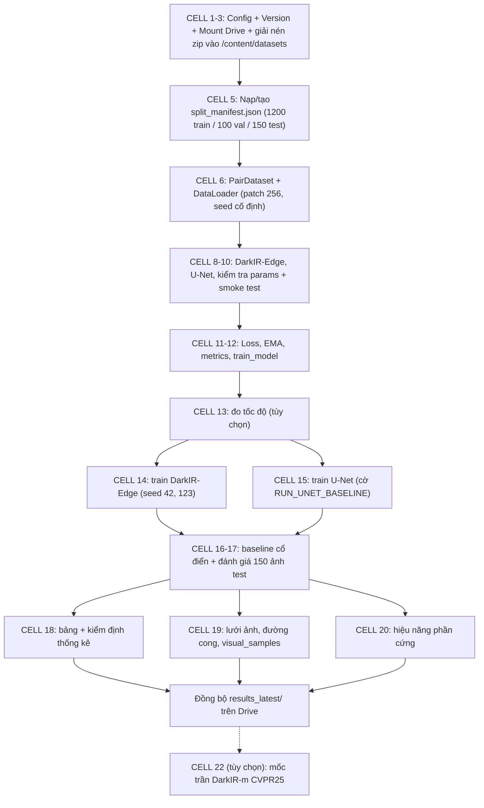

# Hướng Dẫn Vận Hành & Nhật Ký — `LLIE_DarkIR_Edge_Colab.ipynb`

> Notebook: [LLIE_DarkIR_Edge_Colab.ipynb](file:///E:/MyProject/low-light-image-enhancement-cnn/notebook/LLIE_DarkIR_Edge_Colab.ipynb)
> Nguồn sinh notebook (sửa ở đây rồi build lại): [build_colab_notebook.py](file:///E:/MyProject/low-light-image-enhancement-cnn/docs/ai/build_colab_notebook.py)
> Thư mục Drive gốc: `/content/drive/MyDrive/llie_project/`
> Mô hình chính `DarkIR-Edge (C=24)` = 1,924,038 params; baseline `Standard U-Net (base=32)` = 1,928,483 params.

> [!NOTE]
> **Quy ước số cell:** trong notebook, nhãn `# ===== CELL n =====` ở dòng đầu mỗi code cell **không trùng** với chỉ số cell của Colab (vì có markdown xen kẽ). Tài liệu này dùng **nhãn CELL n** (cái bạn thấy ở đầu cell).

---

## 1. Flow toàn cục



## 2. Cấu trúc lưu trữ trên Drive

```text
llie_project/
├── llie_data_clean.zip          # dữ liệu đầu vào (bạn tải lên trước)
├── split_manifest.json          # chia dữ liệu cố định, dùng chung mọi version
├── results_latest/              # bản sao kết quả lần chạy gần nhất (ghi đè mỗi lần)
└── experiments/{EXP_VERSION}/
    ├── run_config.json          # cấu hình lúc chạy (ghi ở CELL 2)
    ├── checkpoints/{tag}_seed{S}/  best.pt, last.pt, final.pt, history.csv
    └── results/                 # results_per_image.csv, table_main.csv, diagnostic_gtmean.csv,
                                 # efficiency.csv, qualitative.png, curves.png, visual_samples/
```

`results_latest/` **luôn bị ghi đè** — kết quả cần giữ lâu dài nằm ở `experiments/{version}/results/`.

## 3. Từng cell giải quyết vấn đề gì

| Nhãn | Vấn đề giải quyết | Lưu ý |
| :-- | :-- | :-- |
| **CELL 1** | Import, `MASTER_SEED=42`, `CFG`, `EXP_VERSION`, `FORCE_RETRAIN`, đường dẫn Drive theo version, cài `lpips` | `EXP_VERSION`/`FORCE_RETRAIN` được đọc **một lần ở đây** vào `CFG`; đổi giá trị phải chạy lại CELL 1 |
| **CELL 2** | Mount Drive, tạo thư mục version, ghi `run_config.json`, copy zip → giải nén vào SSD `/content/datasets` | Cần `llie_data_clean.zip` ở `llie_project/`. Runtime restart sẽ mất `/content/datasets` → chạy lại CELL 2 |
| **CELL 3** | In cây thư mục sau giải nén để soát cấu trúc | Chỉ để nhìn, không ghi gì |
| **CELL 5** | Dò đường dẫn dữ liệu, ghép cặp low/high, chia Train/Val/Test, kiểm tra không rò rỉ (theo đường dẫn), lưu manifest kèm SHA-256 | Nếu `split_manifest.json` **đã có trên Drive** thì dùng lại, không chia lại. Phải thấy `train 1200 / val 100 / test 150` |
| **CELL 6** | `PairDataset` cache RAM, crop patch 256 + flip, DataLoader seed cố định (`generator` + `worker_init_fn`) | 300 steps/epoch (1200×2/8) → 30,000 steps/100 epochs |
| **CELL 8** | `DarkIREdge`: FreMLP, Di-SpAM (dilation 1/4/9), SCA, SimpleGate, 4-kênh đầu vào RGB+I_max, `GatedSkip` ×3, side supervision 1/8 | `pad8` hỗ trợ kích thước ảnh bất kỳ |
| **CELL 9** | `UNetBaseline(base=32)` đối chuẩn cùng quy mô params | |
| **CELL 10** | Đếm params, smoke test ảnh kích thước lẻ | In 3 mốc: 1,924,038 / 1,928,483 / 3,321,638 |
| **CELL 11** | `CompositeLoss` = L1 + 0.5·L1(side) + 0.2·(1−SSIM) + 0.1·CosineColor (mask gt≥5/255); `EMA` (0.999); `psnr_u8`, `predict_u8`, `val_psnr` | Suy luận dùng FP16 autocast khi có GPU |
| **CELL 12** | `train_model`: AMP, grad clip 1.0, AdamW + CosineAnnealing, EMA, val mỗi 5 epoch, lưu `best/last/final.pt` + `history.csv`, auto-resume, skip nếu đã có `final.pt` | `last.pt` chỉ lưu mỗi 5 epoch → resume có thể lặp lại tối đa 4 epoch |
| **CELL 13** | `probe_speed`: 200 bước để ước lượng phút/run trên GPU hiện tại | Tùy chọn; tốn một ít GPU |
| **CELL 14** | Train `DarkIR-Edge` các seed trong `SEEDS_TO_RUN_DARKIR_EDGE` | Muốn nhanh: đặt `[42]` |
| **CELL 15** | Train `U-Net` nếu `RUN_UNET_BASELINE=True` | |
| **CELL 16** | Gamma/CLAHE/MSRCR, `metrics` (PSNR, SSIM, PSNR_gtmean, LPIPS), `eval_method`, `find_checkpoint`, `nn_fn` | `find_checkpoint` chỉ tìm trong version hiện tại: `final.pt` rồi `best.pt` |
| **CELL 17** | Chạy 150 ảnh test → `results_per_image.csv` | Bỏ qua mô hình chưa có checkpoint (in WARN) |
| **CELL 18** | Bảng Mean±Std theo domain, bảng chẩn đoán GT-mean, paired t-test/Wilcoxon/bootstrap CI, liệt kê các version trên Drive | So sánh DarkIR-Edge vs U-Net (hoặc CLAHE nếu chưa có U-Net) |
| **CELL 19** | Lưới ảnh định tính, đường cong học tập, ảnh phục chế lưu riêng vào `visual_samples/` | Tiêu đề cell nhắc DICM/LIME nhưng **chưa có code cho ảnh không cặp** |
| **CELL 20** | Params, GFLOPs@256², latency FP32/FP16, FPS, Peak VRAM | Latency/VRAM chỉ đo khi có GPU |
| **CELL 22** | Tùy chọn: tải `Cidaut/DarkIR` làm mốc trần | `RUN_OFFICIAL_DARKIR_REF=False` mặc định; cần `RES` từ CELL 17 |

## 4. Hướng dẫn nhanh

**Thứ tự chạy lần đầu:** CELL 1 → 2 → 3 → 5 → 6 → 8 → 9 → 10 → 11 → 12 → (13) → 14 → (15) → 16 → 17 → 18 → 19 → 20.

- **Chạy nhanh (1 seed):** CELL 14 đặt `SEEDS_TO_RUN_DARKIR_EDGE = [42]`, CELL 15 đặt `RUN_UNET_BASELINE = False`. Lưu ý CELL 17/18 vẫn chạy được vì tự bỏ qua mô hình thiếu.
- **Đầy đủ:** giữ mặc định (DarkIR-Edge seed 42+123, U-Net seed 42).
- **Train lại với thiết lập mới:** đổi `EXP_VERSION` (vd `'v2'`) và/hoặc sửa tham số trong `CFG` ở CELL 1, chạy lại từ CELL 1. Version cũ không bị đụng tới.
- **Ép train lại trong cùng version:** `FORCE_RETRAIN = True` ở CELL 1 (chạy lại CELL 1 trước).
- **Colab ngắt giữa chừng:** chạy lại CELL 1, 2, 5, 6, 8, 9, 11, 12 rồi CELL 14/15 — sẽ thấy `[RESUME] ... từ epoch N`.
- **Chỉ đánh giá lại (đã có checkpoint):** CELL 1, 2, 5, 6, 8, 9, 11, 12, 16 → 20.

### Checklist trước khi tốn GPU
1. CELL 5 in đúng `train {'lolv2': 639, 'huawei': 561}`, `val {50, 50}`, `test {'lolv2': 100, 'huawei': 30, 'nikon': 20}`. Sai ⇒ manifest cũ trên Drive không khớp, xóa/đổi tên rồi chạy lại CELL 5.
2. CELL 10 in 1,924,038 / 1,928,483.
3. `Device: cuda` ở CELL 1.
4. Nếu trước đây đã train bằng bản notebook cũ, checkpoint nằm ở `llie_project/checkpoints/...`. Notebook hiện **không đọc** thư mục này. Muốn resume/dùng lại: chép `checkpoints/<tag>_seed<S>/` vào `experiments/v1/checkpoints/`.

## 5. Giới hạn đã biết
- Resume không tái tạo chính xác dãy crop ngẫu nhiên của run không bị gián đoạn (generator được seed lại từ đầu) → kết quả resume khớp về phân phối, không khớp bit-by-bit.
- `Peak VRAM` ở CELL 20 đo sau khi reset theo từng lượt FP32/FP16, nên giá trị cuối là của lượt FP16 và có thể gồm bộ nhớ các mô hình khác còn nằm trên GPU.
- `pytest` hiện có 2 test fail (`tests/test_dataset_and_manifest.py`) do khóa `validation_set` không còn trong `docs/ai/split_manifest.json`; không liên quan notebook, chưa sửa.

---

## 6. Nhật ký thay đổi

### 28/10/2026 (đợt 2) — Rà soát trước khi train Colab
- Phát hiện lỗi cách ly version: `find_checkpoint` và phần vẽ đường cong từng fallback sang `llie_project/checkpoints/`, nên version mới có thể âm thầm lấy checkpoint của run cũ. **Đã bỏ fallback**; chỉ đọc trong `experiments/{version}/checkpoints/`.
- Sửa lại báo cáo này: bản trước ghi sai số ảnh test (đúng là 100/30/20), sai thành phần loss (không có Charbonnier/Edge loss), sai cơ chế seed của DataLoader, sai tên khối kiến trúc, và có ước lượng thời gian không có cơ sở. Đã thay bằng nội dung đối chiếu trực tiếp với code.
- Kiểm tra: `ast.parse` 25 cell, chạy end-to-end ở `LLIE_TEST=1`, kiểm tra `CFG` serialize được cho `run_config.json`, kiểm tra không rò checkpoint giữa version — script `docs/ai/verify_notebook_colab_readiness.py`.
- **Chưa kiểm chứng được ở local:** đường GPU/AMP, mount Drive thật, LPIPS tải trọng số, dữ liệu thật (phần này bạn đã chạy được đến cell train trên Colab).

### 28/10/2026 (đợt 1) — Versioning & lưu Drive
- Thêm `EXP_VERSION`, `FORCE_RETRAIN`; thư mục `experiments/{version}/{checkpoints,results}`; `run_config.json`; đồng bộ `results_latest/`; `visual_samples/`; liệt kê version ở CELL 18; skip/retrain theo `final.pt` và cờ.
