# An Empirical Evaluation of a Compact Spatial–Frequency Network and a Lightweight U-Net for Multi-Domain Low-Light Image Enhancement

**Đánh Giá Thực Nghiệm Kiến Trúc Lai Không Gian – Tần Số Thu Gọn và Mạng U-Net Nhẹ Cho Bài Toán Tăng Cường Ảnh Thiếu Sáng Đa Miền**

**Phạm Văn Tiến**  
Khoa Khoa học Máy tính, Trường Đại học Công nghệ Thông tin, ĐHQG-HCM (UIT), Việt Nam  
Email: `26848223@ms.uit.edu.vn`

---

## Tóm Tắt (Abstract)

Phục hồi ảnh chụp trong điều kiện thiếu sáng (Low-Light Image Enhancement — LLIE) kết hợp khử mờ chuyển động là một bài toán nghịch đảo có tính bất định cao trong thị giác máy tính. Gần đây, kiến trúc DarkIR (CVPR 2025) đã chứng minh hiệu quả của việc kết hợp biến đổi Fourier trong miền tần số với tích chập chiều sâu giãn nở đa tỉ lệ trong miền không gian ở quy mô $3.32\text{M}$ tham số. Tuy nhiên, hiệu quả tương đối của thiết kế lai không gian – tần số này khi thu hẹp về ngân sách tham số nhỏ ($\le 2.0\text{M}$) và huấn luyện chung trên nhiều miền cảm biến vẫn chưa được đối chứng đầy đủ với kiến trúc tích chập thuần túy. Bài báo này khảo sát một biến thể thu gọn có tên **DarkIR-Edge** ($C=24$, $1.924\text{M}$ tham số) — tích hợp khung xương DarkIR với kênh tiên nghiệm độ rọi cực đại Max-RGB và cổng kết nối tắt dư (Residual Gated Skip Connections) — đặt trong phép so sánh có kiểm soát chặt chẽ với mô hình **Standard U-Net** ($1.928\text{M}$ tham số) và biến thể cắt bỏ nhánh tần số **DarkIR-Edge (no-FFT)** ($1.495\text{M}$ tham số). Thực nghiệm được tiến hành qua hai giai đoạn với tập kiểm định (150 ảnh) và tập kiểm thử (190 ảnh) cố định: Giai đoạn I huấn luyện trên $1,600$ cặp ảnh thuộc 3 miền (`LOL-v2 Real`, `LSRW-Huawei`, `LOL-Blur`) trong 70 epochs cố định ($28,000$ bước cập nhật); Giai đoạn II mở rộng tập huấn luyện lên $6,777$ cặp ảnh thuộc 5 miền (bổ sung `LSRW-Nikon` và `LOL-v2 Synthetic`) kết hợp bộ lấy mẫu hạn ngạch cố định `QuotaSampler` ($42,000$ bước cập nhật). Kết quả kiểm định thống kê ghép cặp đã đăng ký trước (Bootstrap 95% CI, paired $t$-test và Wilcoxon signed-rank test qua 2 hạt giống khởi tạo) chỉ ra bốn phát hiện chính: (1) Cả ba mô hình học sâu đều vượt các thuật toán truyền thống hơn $+4.0\text{ dB}$ PSNR trên tập kiểm thử gộp; (2) Dưới cùng ngân sách tham số và lịch trình huấn luyện, `DarkIR-Edge` và `Standard U-Net` đạt PSNR tương đương nhau về mặt thống kê ở cả Giai đoạn I ($\Delta\text{PSNR} = -0.214\text{ dB}$, 95% CI $[-0.530, +0.132]$, $p = 0.222$) và Giai đoạn II ($\Delta\text{PSNR} = -0.063\text{ dB}$, 95% CI $[-0.360, +0.229]$, $p = 0.680$), song `Standard U-Net` đạt chỉ số cảm nhận LPIPS tốt hơn ($0.277$ so với $0.307$), độ sắc nét biên cạnh cao hơn và tốc độ suy luận trên GPU NVIDIA L4 nhanh hơn $2.4\times$, trong khi `DarkIR-Edge` có độ ổn định giữa các hạt giống cao hơn và sai số vùng tối sâu thấp hơn trên tập LSRW; (3) Việc loại bỏ nhánh tần số `FreMLP` không làm suy giảm PSNR có ý nghĩa thống kê ($\Delta\text{PSNR} = +0.096\text{ dB}$ ở Giai đoạn I và $-0.131\text{ dB}$ ở Giai đoạn II) nhưng tiết kiệm được $22.3\%$ tham số và giảm $14\%$ độ trễ suy luận; (4) Mở rộng dữ liệu huấn luyện đa miền lên $4.24\times$ ở quy mô $\approx 1.9\text{M}$ tham số dẫn đến hiện tượng bão hòa dung lượng trên miền mờ chuyển động và gây ra sự đánh đổi phân phối độ sáng giữa các cảm biến.

**Từ khóa (Keywords):** Low-Light Image Enhancement, Lightweight Convolutional Neural Networks, DarkIR, U-Net, Frequency-Domain Learning, Multi-Domain Generalization.

---

## I. Giới Thiệu (Introduction)

Ảnh thu nhận trong môi trường ánh sáng yếu thường chịu sự suy giảm chất lượng nghiêm trọng do lượng photon đi vào cảm biến quang học quá thấp. Để bù đắp độ phơi sáng, hệ thống thu nhận ảnh buộc phải tăng độ nhạy sáng (ISO) hoặc kéo dài thời gian mở màn trập, dẫn đến sự xuất hiện đồng thời của dải động hẹp, nhiễu cảm biến (nhiễu hạt Poisson và nhiễu đọc Gaussian), biến dạng màu sắc phi tuyến và hiện tượng mờ nhòe do rung tay máy hoặc chuyển động của vật thể [1, 3, 7]. Việc khôi phục đồng thời độ sáng, cấu trúc bề mặt và độ sắc nét biên cạnh từ một ảnh thiếu sáng duy nhất là bài toán cơ sở quan trọng trong nhiếp ảnh tính toán cũng như các hệ thống thị giác máy tính bậc cao [2, 3].

Trong những năm gần đây, các phương pháp dựa trên mạng nơ-ron sâu — đặc biệt là các kiến trúc Transformer và mạng khôi phục đa giai đoạn — đã thiết lập nhiều cột mốc hiệu năng mới trên các bộ dữ liệu chuẩn [3, 6]. Mặc dù vậy, chi phí tính toán bậc hai theo độ phân giải và dung lượng tham số lớn khiến việc áp dụng các mô hình này vào các môi trường hạn chế tài nguyên gặp nhiều trở ngại [2, 3]. Nhằm giải quyết vấn đề hiệu quả tính toán, Feijoo et al. [1] gần đây đã đề xuất **DarkIR** (CVPR 2025), một kiến trúc mạng nơ-ron tích chập (CNN) kết hợp hai miền biểu diễn: sử dụng biến đổi Fourier nhanh hai chiều (2D FFT) thông qua khối `FreMLP` ở bộ mã hóa để mô hình hóa ánh sáng toàn cục, đồng thời sử dụng các nhánh tích chập chiều sâu giãn nở đa tỉ lệ (`Di-SpAM`) ở bộ giải mã để mở rộng trường tiếp nhận không gian cho tác vụ khử mờ và khử nhiễu. Song song đó, các nghiên cứu mới về không gian màu phân tách cường độ – sắc độ như **HVI-CIDNet** [4] và thiết kế kết nối tắt có cổng điều biến cho mạng nhẹ như **Edge-LLIE** [2] cũng cung cấp những góc nhìn quan trọng về việc kiểm soát lệch màu và nhiễu tầng nông trong mạng tích chập gọn nhẹ.

Tuy nhiên, trong công trình gốc [1], mô hình `DarkIR-m` được thiết kế với $3.32\text{M}$ tham số và được huấn luyện chuyên biệt cho từng bộ dữ liệu riêng lẻ. Khi đặt bài toán dưới ràng buộc ngân sách tham số chặt chẽ ($\le 2.0\text{M}$ tham số) và yêu cầu một bộ trọng số duy nhất phải xử lý đồng thời nhiều miền dữ liệu khác nhau (ảnh thiếu sáng tĩnh từ máy ảnh DSLR, ảnh chụp từ cảm biến điện thoại thông minh và ảnh thiếu sáng kèm mờ chuyển động), có ba câu hỏi khoa học thực nghiệm cần được làm sáng tỏ:
- **Câu hỏi nghiên cứu 1 (RQ1 — Đối sánh kiến trúc cùng ngân sách):** Khi kiểm soát chặt chẽ số lượng tham số ($\approx 1.92\text{M}–1.93\text{M}$), hàm mất mát và lịch trình tối ưu hóa, liệu kiến trúc lai không gian – tần số thu gọn (`DarkIR-Edge`) có vượt qua được một kiến trúc tích chập thuần túy kinh điển là `Standard U-Net` [5] về độ trung thực tín hiệu (PSNR, SSIM) và chất lượng cảm nhận (LPIPS) hay không?
- **Câu hỏi nghiên cứu 2 (RQ2 — Vai trò thực chất của nhánh tần số `FreMLP`):** Ở quy mô mạng nhỏ ($C=24$, huấn luyện trên kích thước mẫu $256 \times 256$), nhánh điều biến biên độ phổ Fourier `FreMLP` đóng góp bao nhiêu vào chất lượng khôi phục khi đối sánh trực tiếp với biến thể cắt bỏ hoàn toàn nhánh tần số `DarkIR-Edge (no-FFT)`?
- **Câu hỏi nghiên cứu 3 (RQ3 — Mở rộng dữ liệu đa miền và giới hạn dung lượng):** Khi mở rộng tập dữ liệu huấn luyện từ $1,600$ cặp ảnh (3 miền) lên $6,777$ cặp ảnh (5 miền) cùng cơ chế lấy mẫu hạn ngạch cố định, một mạng CNN nhẹ không có điều kiện hóa theo miền sẽ cải thiện khả năng khái quát hóa hay sẽ gặp hiện tượng bão hòa dung lượng và xung đột phân phối độ sáng giữa các cảm biến?

Để trả lời các câu hỏi trên một cách khách quan, nghiên cứu này thực hiện một quy trình đánh giá thực nghiệm có đăng ký trước các tiêu chuẩn kiểm định thống kê (pre-registered statistical evaluation). Đóng góp của bài báo tập trung vào các khía cạnh thực nghiệm sau:
1. **Thiết kế và đối sánh công bằng các kiến trúc mạng nhẹ ($\le 1.93\text{M}$ tham số):** Khảo sát biến thể `DarkIR-Edge` ($1.924\text{M}$ tham số), biến thể cắt bỏ `DarkIR-Edge (no-FFT)` ($1.495\text{M}$ tham số) và `Standard U-Net` ($1.928\text{M}$ tham số) dưới quy trình huấn luyện đồng nhất (70 epochs cố định, loại bỏ thiên kiến dừng sớm, đánh giá trên trọng số trung bình trượt hàm mũ EMA) cùng 4 phương pháp xử lý ảnh truyền thống.
2. **Xây dựng giao thức đánh giá đa miền chống rò rỉ dữ liệu:** Thiết lập tập kiểm thử cố định 190 ảnh trải rộng trên 4 miền (`LOL-v2 Real`, `LSRW-Huawei`, `LSRW-Nikon`, `LOL-Blur`) với cơ chế cách ly tuyệt đối theo chuỗi video và vùng đệm thời gian, kết hợp quy trình kiểm định ghép cặp Bootstrap 95% CI, paired $t$-test và Wilcoxon signed-rank test.
3. **Báo cáo và phân tích định lượng các kết quả trung tính và kết quả âm (Null & Negative Results):** Chứng minh bằng số liệu thực nghiệm rằng ở ngân sách $\approx 1.9\text{M}$ tham số, `Standard U-Net` đạt PSNR tương đương thống kê với `DarkIR-Edge` nhưng vượt trội về LPIPS, độ sắc nét và tốc độ thực thi trên GPU; nhánh `FreMLP` không mang lại lợi ích PSNR đo lường được ở quy mô này; đồng thời chỉ rõ cơ chế đánh đổi độ sáng toàn cục (`Illumination Gap` và `Luminance Bias`) khi mở rộng dữ liệu đa miền.

---

## II. Các Công Trình Liên Quan (Related Work)

### 2.1. Các phương pháp truyền thống và mạng CNN trong tăng cường ảnh thiếu sáng
Các phương pháp tăng sáng cổ điển thường can thiệp trực tiếp vào phân bố cường độ sáng thông qua phép biến đổi phi tuyến từng điểm ảnh như Hiệu chỉnh Gamma ($\gamma$-correction), cân bằng lược đồ sáng cục bộ có giới hạn độ tương phản (CLAHE) [8], hoặc dựa trên lý thuyết Retinex của Land và McCann [10] nhằm phân rã ảnh quan sát thành thành phần phản xạ và thành phần chiếu sáng (điển hình là thuật toán MSRCR [9]). Mặc dù có chi phí tính toán thấp, các phương pháp này thiếu khả năng mô hình hóa ngữ cảnh không gian phức tạp, dễ làm bùng phát nhiễu hạt ở các vùng tối sâu và không có khả năng khử mờ chuyển động.

Sự xuất hiện của các bộ dữ liệu thực tế có cặp ảnh tham chiếu như LOL [6], LOL-v2 [6] và LSRW [11] đã thúc đẩy các phương pháp học sâu đầu-cuối. Trong đó, kiến trúc **U-Net** [5] cùng các đường kết nối tắt (skip connections) đóng vai trò nền tảng nhờ khả năng kết hợp ngữ cảnh ngữ nghĩa vùng rộng ở tầng sâu với chi tiết biên cạnh độ phân giải cao ở tầng nông. Báo cáo tổng kết cuộc thi **NTIRE 2024 Challenge on Low Light Image Enhancement** của Liu et al. [3] cho thấy bên cạnh xu hướng mở rộng quy mô mô hình, việc thiết kế các mạng gọn nhẹ có khả năng duy trì độ trung thực cấu trúc (PSNR, SSIM) và chất lượng cảm nhận thị giác (LPIPS) trên nhiều điều kiện chiếu sáng và độ phân giải khác nhau vẫn là một thách thức lớn. Gần đây, Sharif et al. [2] (**Edge-LLIE**) đã đề xuất tích hợp các cổng điều biến có kết nối dư (Residual Gated Skip Connections) vào kiến trúc dạng U-Net nhẹ nhằm lọc bớt nhiễu cảm biến từ các tầng mã hóa nông trước khi hợp nhất vào nhánh giải mã.

### 2.2. Biểu diễn màu sắc và hàm mất mát bảo toàn sắc độ
Một khó khăn phổ biến khi huấn luyện mạng tăng sáng trực tiếp trong không gian màu sRGB là sự gắn kết chặt chẽ giữa cường độ sáng và thông tin màu sắc trên cả ba kênh R, G, B. Mới đây, Yan et al. [4] (**HVI-CIDNet**, CVPR 2025) đã chỉ ra rằng độ nhạy màu cao trong không gian sRGB dễ dẫn đến hiện tượng lệch màu khi khuếch đại độ sáng; trong khi đó, phép biến đổi trực tiếp sang không gian HSV dựa trên kênh cường độ cực đại $V = \max(R, G, B)$ tuy giúp tách biệt độ sáng nhưng lại gây ra điểm gián đoạn sắc độ ở vùng màu đỏ và nhiễu mặt phẳng đen ở vùng tối sâu. Mặc dù Yan et al. giải quyết vấn đề này bằng không gian màu phân cực HVI và mạng hai nhánh, phân tích của họ cũng gợi mở một hướng tiếp cận đơn giản hơn cho các mạng CNN một nhánh: cung cấp trực tiếp bản đồ độ rọi cực đại $I_{\max} = \max(R, G, B)$ như một kênh tiên nghiệm hình học ở đầu vào, kết hợp với hàm mất mát góc màu Cosine có mặt nạ loại trừ các điểm ảnh tối sâu nhằm ổn định sắc độ mà không làm phát sinh các phép biến đổi lượng giác nhạy cảm đạo hàm.

### 2.3. Khôi phục ảnh trong miền tần số và kiến trúc DarkIR
Ảnh chụp đêm bằng thiết bị cầm tay thường chịu đồng thời hai dạng suy thoái có tính chất đối lập: suy giảm độ sáng mang tính toàn cục (global illumination degradation) và mờ nhòe chuyển động kết hợp nhiễu hạt mang tính cục bộ/không gian (local spatial blur and noise). Chuỗi nghiên cứu từ LEDNet [7] trên bộ dữ liệu **LOL-Blur** đến **DarkIR** của Feijoo et al. [1] (CVPR 2025) đã chứng minh tính hiệu quả của việc giải quyết chung hai tác vụ này trong một mạng duy nhất.

Trong DarkIR [1], các tác giả tận dụng tính chất của biến đổi Fourier rời rạc hai chiều (2D DFT): năng lượng độ sáng trung bình và độ tương phản toàn ảnh tập trung ở biên độ phổ (amplitude spectrum), còn thông tin cấu trúc biên cạnh nằm ở pha phổ (phase spectrum). Bằng cách đặt khối `FreMLP` (biến đổi biên độ phổ qua các lớp tích chập $1 \times 1$ trong miền Fourier) tại bộ mã hóa và đặt khối tích chập chiều sâu đa tỉ lệ giãn nở `Di-SpAM` tại bộ giải mã, DarkIR đạt hiệu năng cao với chi phí tính toán thấp hơn các mô hình dựa trên Transformer. Tuy nhiên, việc thu hẹp kiến trúc này xuống dưới ngưỡng $2.0\text{M}$ tham số và kiểm chứng độc lập vai trò của nhánh `FreMLP` trên dữ liệu đa cảm biến vẫn cần một nghiên cứu thực nghiệm đối chứng chi tiết.

---

## III. Kiến Trúc Mô Hình & Phương Pháp Đề Xuất (Methodology)

### 3.1. Định nghĩa bài toán
Quá trình suy thoái của ảnh thu nhận trong điều kiện thiếu sáng và rung mờ $\mathbf{y} \in [0, 1]^{3 \times H \times W}$ từ ảnh cảnh gốc đủ sáng và sắc nét $\mathbf{x} \in [0, 1]^{3 \times H \times W}$ được mô hình hóa theo [1]:
$$\mathbf{y} = \gamma(\mathbf{x} \otimes \mathbf{k}) + \mathbf{n} \tag{1}$$
trong đó $\mathbf{k}$ biểu thị nhân làm mờ chuyển động (Point Spread Function), $\otimes$ là phép tích chập không gian hai chiều, $\gamma(\cdot)$ là hàm phi tuyến biểu diễn quá trình suy giảm độ rọi và đáp ứng cảm biến, và $\mathbf{n}$ là nhiễu cảm biến cộng tính. Mục tiêu của bài toán là học một hàm ánh xạ tham số hóa $f_\theta: \mathbf{y} \mapsto \hat{\mathbf{x}}$ dưới ràng buộc ngân sách tham số gọn nhẹ $|\theta| \le 2.0 \times 10^6$ sao cho ảnh khôi phục $\hat{\mathbf{x}}$ xấp xỉ $\mathbf{x}$ trên nhiều miền dữ liệu khác nhau.

---

### 3.2. Kiến trúc `DarkIR-Edge` ($C=24$, $1,924,038$ tham số)

Mô hình khảo sát chính, được gọi là `DarkIR-Edge`, giữ nguyên cấu trúc phân cấp bất đối xứng 3 tầng giảm mẫu của DarkIR [1] với số lượng khối mã hóa ở 3 tầng là $[1, 2, 3]$, tầng đáy (bottleneck) gồm $2$ khối mã hóa và $2$ khối giải mã, cùng số lượng khối giải mã ở 3 tầng là $[3, 1, 1]$. Để đưa tổng số tham số từ $3,321,638$ (của `DarkIR-m` gốc với $C=32$) về mức ngân sách mục tiêu $\approx 1.92\text{M}$, độ rộng kênh cơ sở được thiết lập ở mức **$C = 24$** (số kênh qua các tầng lần lượt là $24 \to 48 \to 96 \to 192$). Bên cạnh khung xương DarkIR, mô hình tích hợp thêm kênh tiên nghiệm độ rọi Max-RGB ở đầu vào và cổng lọc kết nối tắt dư trên các đường nối Encoder–Decoder (Hình 1).

```mermaid
flowchart LR
    subgraph InputStage["1. Đầu vào & Tiên nghiệm Độ rọi"]
        InRGB["Ảnh thiếu sáng I_in (3×H×W)"] --> Pad["Đệm phản xạ bội số 8"]
        Pad --> Imax["Ghép kênh I_max = max(R,G,B)"]
        Imax --> Intro["Conv 3×3 (4 → 24)"]
    end

    subgraph EncStage["2. Bộ Mã Hóa (EBlock + FreMLP)"]
        Intro --> E1["Tầng 1: 1×EBlock (C=24)"]
        E1 --> D1["Conv 2×2, s=2 (24→48)"]
        D1 --> E2["Tầng 2: 2×EBlock (C=48)"]
        E2 --> D2["Conv 2×2, s=2 (48→96)"]
        D2 --> E3["Tầng 3: 3×EBlock (C=96)"]
        E3 --> D3["Conv 2×2, s=2 (96→192)"]
    end

    subgraph BotStage["3. Tầng Đáy (H/8 × W/8, C=192)"]
        D3 --> MEnc["2 × EBlock (C=192)"]
        MEnc --> Side["Side Conv 3×3 (192→3) → L_side"]
        MEnc --> MDec["2 × DBlock d=(1,4,9) (C=192)"]
        MDec --> BotAdd["X_bot = MDec(X_light) + X_light"]
    end

    subgraph DecStage["4. Bộ Giải Mã (DBlock + GatedSkip)"]
        BotAdd --> U3["Conv 1×1 + PixelShuffle(2) (192→96)"]
        E3 -.->|"GatedSkip (C=96)"| U3
        U3 --> Dec3["Tầng 3: 3×DBlock (C=96)"]
        Dec3 --> U2["Conv 1×1 + PixelShuffle(2) (96→48)"]
        E2 -.->|"GatedSkip (C=48)"| U2
        U2 --> Dec2["Tầng 2: 1×DBlock (C=48)"]
        Dec2 --> U1["Conv 1×1 + PixelShuffle(2) (48→24)"]
        E1 -.->|"GatedSkip (C=24)"| U1
        U1 --> Dec1["Tầng 1: 1×DBlock (C=24)"]
    end

    subgraph OutStage["5. Đầu ra Phần dư"]
        Dec1 --> End["Conv 3×3 (24→3)"]
        End --> ResAdd["Cộng tắt toàn cục: Î = End(X) + I_pad"]
    end
```

*Hình 1: Sơ đồ tổng thể kiến trúc `DarkIR-Edge` ($C=24$, $1,924,038$ tham số).*

#### A. Đệm phản xạ và Kênh tiên nghiệm độ rọi Max-RGB
Với ảnh đầu vào $I_{\text{in}} \in \mathbb{R}^{B \times 3 \times H \times W}$, phép đệm phản xạ (`reflection padding`) được áp dụng để kích thước không gian $(H_p, W_p)$ chia hết cho $8$, ký hiệu là $I_{\text{pad}}$. Dựa trên tính chất của thành phần cường độ sáng trong lý thuyết Retinex [10] và phân tích tách kênh cường độ trong [4], bản đồ độ rọi cực đại theo từng điểm ảnh được trích xuất và nối trực tiếp vào tensor đầu vào:
$$I_{\max}(x, y) = \max_{c \in \{R, G, B\}} I_{\text{pad}, c}(x, y), \qquad X_{\text{in}} = \text{Concat}\big(I_{\text{pad}}, I_{\max}\big) \in \mathbb{R}^{B \times 4 \times H_p \times W_p} \tag{2}$$
Lớp tích chập mở đầu $\text{Conv}_{3\times 3}(4 \to C)$ chiếu tensor 4 kênh sang không gian đặc trưng $C=24$ kênh, chỉ tiêu tốn thêm $24 \times 1 \times 3 \times 3 = 216$ tham số so với đầu vào 3 kênh truyền thống.

#### B. Khối mã hóa `EBlock` và Nhánh điều biến tần số `FreMLP`
Mỗi khối `EBlock` tại tầng có độ rộng kênh $c$ bao gồm một nhánh tích chập không gian nối tiếp với một nhánh điều biến biên độ phổ Fourier (với hai vector hệ số học được $\beta, \gamma \in \mathbb{R}^{1 \times c \times 1 \times 1}$ khởi tạo bằng $\mathbf{0}$):
1. **Nhánh tích chập không gian:** Đặc trưng đầu vào $U \in \mathbb{R}^{B \times c \times H_l \times W_l}$ được chuẩn hóa qua lớp `LayerNorm2d` (tính toán ở độ chính xác đơn FP32), sau đó đi qua lớp tích chập chiều sâu $\text{DWConv}_{3\times 3}(c \to c, \text{groups}=c)$, lớp tích chập điểm mở rộng kênh $\text{Conv}_{1\times 1}(c \to 2c)$ và một nhánh tích chập chiều sâu $\text{DWConv}_{3\times 3}(2c \to 2c, \text{groups}=2c)$. Tiếp theo, đặc trưng được đưa qua cổng phi tuyến không tham số **SimpleGate** (chia đôi số kênh $2c \to c$ và nhân từng phần tử) cùng khối chú ý kênh rút gọn **Simplified Channel Attention (SCA)**:
   $$\text{SimpleGate}(Z) = Z_1 \odot Z_2, \quad \text{với } [Z_1, Z_2] = \text{Split}_{c}(Z) \in \mathbb{R}^{B \times c \times H_l \times W_l} \tag{3}$$
   $$\text{SCA}(S) = S \odot \text{Conv}_{1\times 1}^{(c \to c)}\big(\text{AdaptiveAvgPool2d}_1(S)\big) \tag{4}$$
   Đầu ra của nhánh không gian được chiếu qua $\text{Conv}_{1\times 1}(c \to c)$ và cộng kết nối tắt:
   $$Y = U + \beta \odot \text{Conv}_{1\times 1}\big(\text{SCA}(\text{SimpleGate}(Z))\big) \tag{5}$$

2. **Nhánh tần số Fourier `FreMLP`:** Đặc trưng trung gian $Y$ được chuẩn hóa qua lớp `LayerNorm2d` thứ hai ($\tilde{Y} = \text{LN}(Y)$) và chuyển sang miền tần số thông qua phép biến đổi Fourier nhanh thực hai chiều (`2D Real-FFT`, ký hiệu $\mathcal{F}_{\mathbb{R}}$, chuẩn hóa `norm='backward'`). Để đảm bảo sự ổn định số học khi huấn luyện với độ chính xác hỗn hợp (AMP), toàn bộ phép biến đổi FFT và tính toán biên độ phổ được thực thi ở độ chính xác **FP32**:
   $$X_f = \mathcal{F}_{\mathbb{R}}(\tilde{Y}) \in \mathbb{C}^{B \times c \times H_l \times (\lfloor W_l/2 \rfloor + 1)}, \qquad M = \sqrt{\text{Re}(X_f)^2 + \text{Im}(X_f)^2 + \epsilon} \tag{6}$$
   với $\epsilon = 10^{-6}$. Biên độ phổ thực $M$ được biến đổi qua một mạng MLP hai lớp tích chập $1 \times 1$ với hệ số mở rộng kênh bằng $2$:
   $$M_{\text{out}} = \text{Conv}_{1\times 1}^{(2c \to c)}\Big(\text{LeakyReLU}_{0.1}\big(\text{Conv}_{1\times 1}^{(c \to 2c)}(M)\big)\Big) \tag{7}$$
   Thay vì tính góc pha tường minh qua hàm $\text{atan2}(\cdot)$ và tái tổ hợp bằng $\cos/\sin$ vốn dễ gây suy biến đạo hàm khi biên độ tiến gần 0, phổ phức sau điều biến được tính bằng cách nhân trực tiếp $M_{\text{out}}$ với phasor đơn vị $X_f / M$, sau đó biến đổi Fourier ngược ($\mathcal{F}_{\mathbb{R}}^{-1}$) về miền không gian:
   $$Y_f = X_f \odot \frac{M_{\text{out}}}{M}, \qquad X_{\text{freq}} = \mathcal{F}_{\mathbb{R}}^{-1}(Y_f) \in \mathbb{R}^{B \times c \times H_l \times W_l} \tag{8}$$
   Đặc trưng đầu ra của `EBlock` được tổng hợp thông qua cơ chế điều biến nhân (multiplicative modulation) giữa đặc trưng không gian $Y$ và đặc trưng tần số $X_{\text{freq}}$:
   $$X_{\text{out}} = Y + \gamma \odot \big(Y \odot X_{\text{freq}}\big) \tag{9}$$

Giữa các tầng mã hóa, độ phân giải không gian được giảm một nửa và số kênh được nhân đôi thông qua lớp tích chập $\text{Conv}_{2\times 2}(c \to 2c, \text{stride}=2)$.

#### C. Tầng đáy (Bottleneck), Khối giải mã `DBlock` (`Di-SpAM`) và Cổng `GatedSkip`
- **Tầng đáy và Giám sát phụ (Side Supervision):** Tại độ phân giải $H_p/8 \times W_p/8$ ($c = 8C = 192$), đặc trưng đi qua $2$ khối `EBlock` tạo thành $X_{\text{light}}$. Một nhánh tích chập phụ $\text{Conv}_{3\times 3}(192 \to 3)$ được tách ra từ $X_{\text{light}}$ để dự đoán ảnh màu ở tỉ lệ $1/8$ ($\hat{I}_{\text{side}}$), phục vụ giám sát trực tiếp độ sáng thô trong quá trình huấn luyện. Nhánh chính đi tiếp qua $2$ khối `DBlock` và cộng kết nối tắt nội bộ: $X_{\text{bot}} = \text{DBlocks}(X_{\text{light}}) + X_{\text{light}}$.
- **Tăng mẫu và Cổng kết nối tắt dư (`GatedSkip`):** Ở mỗi tầng giải mã, đặc trưng được tăng mẫu gấp đôi thông qua tổ hợp $\text{Conv}_{1\times 1}(c \to 2c, \text{bias}=\text{False})$ và phép sắp xếp lại điểm ảnh `PixelShuffle(2)` (đưa số kênh từ $c$ về $c/2$). Trước khi hợp nhất với nhánh giải mã, đặc trưng nối tắt $S \in \mathbb{R}^{B \times (c/2) \times H_l \times W_l}$ từ tầng Encoder tương ứng được đi qua một cổng điều biến dư kế thừa từ [2]:
  $$\text{GatedSkip}(S) = S + f_{1\times 1}(S) \odot \sigma\big(g_{1\times 1}(S)\big) \tag{10}$$
  trong đó $f_{1\times 1}, g_{1\times 1}$ là hai lớp tích chập $1 \times 1$ và $\sigma(\cdot)$ là hàm kích hoạt Sigmoid.
- **Khối giải mã đa tỉ lệ giãn nở `DBlock`:** Để xử lý hiện tượng mờ nhòe chuyển động mà không dùng nhân tích chập kích thước lớn, mỗi khối `DBlock` mở rộng kênh qua $\text{Conv}_{1\times 1}(c \to 2c)$, áp dụng một lớp tích chập nhóm $\text{Conv}_{3\times 3}(2c \to 2c, \text{groups}=c)$, rồi đưa đồng thời vào **3 nhánh tích chập chiều sâu giãn nở song song** với hệ số giãn nở $d \in \{1, 4, 9\}$:
  $$Z_{\text{dec}} = \sum_{d \in \{1, 4, 9\}} \text{DWConv}_{3\times 3, \text{dilation}=d}^{(2c \to 2c)}(V) \tag{11}$$
  Tổng đầu ra $Z_{\text{dec}}$ tiếp tục đi qua `SimpleGate`, `SCA`, $\text{Conv}_{1\times 1}(c \to c)$ và cộng tắt với trọng số $\beta$. Nửa sau của `DBlock` là một khối Feed-Forward không gian gồm $\text{LayerNorm2d} \to \text{Conv}_{1\times 1}(c \to 2c) \to \text{SimpleGate} \to \text{Conv}_{1\times 1}(c \to c)$ với trọng số $\gamma$.
- **Khôi phục phần dư toàn cục:** Sau tầng giải mã cuối cùng, lớp $\text{Conv}_{3\times 3}(24 \to 3)$ tạo ra bản đồ phần dư cộng vào ảnh đầu vào đã đệm, sau đó cắt về kích thước gốc $(H, W)$: $\hat{I} = (\text{Ending}(X_{\text{dec}}) + I_{\text{pad}})_{[:, :, :H, :W]}$.

---

### 3.3. Biến thể Cắt bỏ `DarkIR-Edge (no-FFT)` ($1,495,422$ tham số)
Để cô lập và kiểm định độc lập đóng góp của nhánh biến đổi tần số Fourier (RQ2), biến thể cắt bỏ `DarkIR-Edge (no-FFT)` giữ nguyên hoàn toàn cấu trúc không gian của `DarkIR-Edge` ($C=24$, kênh tiên nghiệm $I_{\max}$, cổng `GatedSkip`, khối giải mã giãn nở $d \in \{1, 4, 9\}$ và nhánh giám sát phụ $\hat{I}_{\text{side}}$), nhưng **vô hiệu hóa hoàn toàn khối `FreMLP`** trong tất cả các khối `EBlock` ở bộ mã hóa và tầng đáy (tức đặt $X_{\text{out}} = Y$ trong Phương trình 9). Biến thể này có tổng cộng **$1,495,422$ tham số**, ít hơn đúng $428,616$ tham số ($-22.28\%$) so với `DarkIR-Edge` đầy đủ.

---

### 3.4. Kiến trúc Đối chuẩn `Standard U-Net` ($1,928,483$ tham số)
Nhằm thiết lập một mốc đối chuẩn cùng quy mô tham số và cùng độ sâu giảm mẫu không gian ($3$ lần giảm mẫu, độ phân giải tầng đáy $H/8 \times W/8$), mô hình `Standard U-Net` được xây dựng với độ rộng kênh cơ sở $C_{base} = 32$:
- **Khối tích chập cơ bản (`DoubleConv`):** Mỗi khối gồm hai lớp tích chập đặc $\text{Conv}_{3\times 3}$ nối tiếp; sau mỗi lớp tích chập là một lớp chuẩn hóa nhóm `GroupNorm` (chia làm $4$ nhóm kênh) và hàm kích hoạt `ReLU`.
- **Cấu trúc phân cấp:** Bộ mã hóa gồm 3 tầng `DoubleConv` với số kênh $3 \to 32 \to 64 \to 128$, ngăn cách bởi phép gộp cực đại `MaxPool2d(2×2)`. Tầng đáy xử lý ở số kênh $128 \to 256$. Bộ giải mã gồm 3 tầng tăng mẫu bằng tích chập chuyển vị `ConvTranspose2d(2×2, stride=2)`, nối kênh (`concatenation`) trực tiếp với đặc trưng tương ứng từ bộ mã hóa và đi qua khối `DoubleConv` giảm kênh tuần tự $256 \to 128 \to 64 \to 32$.
- **Đầu ra:** Lớp $\text{Conv}_{1\times 1}(32 \to 3)$ dự đoán phần dư cộng trực tiếp với ảnh đầu vào: $\hat{I} = (\text{Out}(D_1) + I_{\text{pad}})_{[:, :, :H, :W]}$.
- Tổng số tham số của `Standard U-Net` là **$1,928,483$**, chỉ chênh lệch $0.23\%$ ($4,445$ tham số) so với `DarkIR-Edge` ($1,924,038$ tham số).

---

### 3.5. Hàm Mất Mát Đa Thành Phần (Composite Loss Function)
Quá trình huấn luyện tối ưu hóa hàm mất mát tổng hợp gồm 4 thành phần:
$$\mathcal{L}_{\text{total}} = \mathcal{L}_{1}(\hat{I}, I_{\text{gt}}) + w_{\text{ssim}} \mathcal{L}_{\text{SSIM}}(\hat{I}, I_{\text{gt}}) + w_{\text{color}} \mathcal{L}_{\text{color}}(\hat{I}, I_{\text{gt}}) + w_{\text{side}} \mathcal{L}_{\text{side}}(\hat{I}_{\text{side}}, I_{\text{gt}\downarrow 8}) \tag{12}$$
với bộ trọng số cố định $w_{\text{ssim}} = 0.2$, $w_{\text{color}} = 0.1$, và $w_{\text{side}} = 0.5$:
1. **Mất mát tái tạo điểm ảnh ($\mathcal{L}_1$):** Khoảng cách $\ell_1$ trung bình trên toàn bộ các điểm ảnh RGB: $\mathcal{L}_1(\hat{I}, I_{\text{gt}}) = \frac{1}{3HW} \|\hat{I} - I_{\text{gt}}\|_1$.
2. **Mất mát tương đồng cấu trúc ($\mathcal{L}_{\text{SSIM}}$):** Tính trên cửa sổ lọc Gaussian $11 \times 11$ ($\sigma = 1.5$): $\mathcal{L}_{\text{SSIM}}(\hat{I}, I_{\text{gt}}) = 1 - \text{SSIM}(\text{clamp}(\hat{I}, 0, 1), I_{\text{gt}})$.
3. **Mất mát góc màu Cosine có mặt nạ vùng tối ($\mathcal{L}_{\text{color}}$):** Nhằm ngăn ngừa hiện tượng lệch màu giữa các kênh RGB mà không bị nhiễu đạo hàm bởi các điểm ảnh gần điểm đen $(0,0,0)$, sai số góc Cosine chỉ được tính trên tập các điểm ảnh có cường độ cực đại của ảnh tham chiếu lớn hơn hoặc bằng ngưỡng $5/255$:
   $$\mathcal{L}_{\text{color}}(\hat{I}, I_{\text{gt}}) = 1 - \frac{\sum_{x,y} M(x,y) \cdot \frac{\hat{I}(x,y) \cdot I_{\text{gt}}(x,y)}{\|\hat{I}(x,y)\|_2 \|I_{\text{gt}}(x,y)\|_2 + 10^{-6}}}{\max\left(1, \sum_{x,y} M(x,y)\right)}, \quad M(x,y) = \mathbb{I}\!\left(\max_{c} I_{\text{gt}, c}(x,y) \ge \frac{5}{255}\right) \tag{13}$$
4. **Mất mát giám sát phụ đa tỉ lệ ($\mathcal{L}_{\text{side}}$):** Khoảng cách $\ell_1$ giữa đầu ra phụ $\hat{I}_{\text{side}}$ ở tầng đáy và ảnh tham chiếu được giảm mẫu bằng phép gộp trung bình `AvgPool2d(8×8, stride=8)`. Đối với `Standard U-Net` không có nhánh đầu ra phụ, thành phần này bằng $0$.

---

## IV. Thiết Lập Thực Nghiệm (Experimental Setup)

### 4.1. Bộ dữ liệu đa miền và Giao thức cách ly chống rò rỉ dữ liệu
Hệ thống thực nghiệm được xây dựng trên 5 tập dữ liệu chuẩn đại diện cho các điều kiện thu nhận ảnh và cơ chế suy thoái khác nhau:
- **LOL-v2 Real (`lolv2`) [6]:** Tập dữ liệu ảnh thiếu sáng thực tế thu thập bằng máy ảnh DSLR trong nhà và ngoài trời ở độ phân giải $600 \times 400$.
- **LSRW-Huawei (`huawei`) [11]:** Tập dữ liệu ảnh thiếu sáng thực tế chụp từ cảm biến điện thoại thông minh Huawei, đặc trưng bởi kích thước cảm biến nhỏ và mức nhiễu hạt cao.
- **LOL-Blur (`blur`) [7]:** Tập dữ liệu gồm các chuỗi video động ($1120 \times 640$, 60 khung hình/chuỗi) chịu đồng thời suy giảm thiếu sáng và mờ nhòe chuyển động.
- **LSRW-Nikon (`nikon`) [11]:** Tập dữ liệu chụp từ máy ảnh DSLR Nikon, có đặc tính đáp ứng màu sắc và độ phơi sáng tham chiếu khác biệt so với cảm biến Huawei và LOL-v2.
- **LOL-v2 Synthetic (`lolv2syn`) [6]:** Tập dữ liệu tổng hợp ($384 \times 384$) với điều kiện chiếu sáng mô phỏng đa dạng.

Để khảo sát tác động của quy mô dữ liệu và phân phối miền (RQ3), nghiên cứu thiết kế hai giai đoạn thực nghiệm nối tiếp (Bảng 1):
- **Giai đoạn I (Thiết lập cơ sở — Cấu hình v3):** Huấn luyện trên kho dữ liệu $1,600$ cặp ảnh thuộc 3 miền (`639 lolv2`, `561 huawei`, `400 blur`). Mỗi ảnh được lấy mẫu lặp 2 lần với phép cắt ngẫu nhiên độc lập trong một epoch (`repeat = 2`), tạo ra $3,200$ mẫu/epoch ($400$ bước cập nhật/epoch với `batch_size = 8`). Ở giai đoạn này, tập kiểm thử `nikon` (20 ảnh) đóng vai trò là **miền cảm biến chưa từng thấy (zero-shot unseen domain)**.
- **Giai đoạn II (Mở rộng đa miền quy mô lớn — Cấu hình v4):** Kho dữ liệu huấn luyện được mở rộng gấp $4.24\times$ lên **$6,777$ cặp ảnh** thuộc 5 miền (`639 lolv2`, `2,380 huawei`, `1,858 blur`, bổ sung `1,000 nikon` và `900 lolv2syn`). Để tránh hiện tượng các miền nhiều ảnh (`huawei`, `blur`) lấn át các miền tăng sáng gốc, một bộ lấy mẫu hạn ngạch cố định (**`QuotaSampler`**) được thiết kế để trích xuất chính xác **$4,800$ mẫu/epoch** ($600$ bước cập nhật/epoch): giữ nguyên số mẫu mỗi epoch của `lolv2` ($1,278$ mẫu, lấy mẫu có hoàn lại $2\times$) và `huawei` ($1,122$ mẫu, lấy mẫu không hoàn lại) đúng bằng Giai đoạn I, đồng thời lấy ngẫu nhiên không hoàn lại $1,600$ mẫu `blur`, $400$ mẫu `nikon` và $400$ mẫu `lolv2syn`, sau đó xáo trộn toàn cục trên toàn epoch. Ở Giai đoạn II, tập kiểm thử `nikon` chuyển sang vai trò **đánh giá nội miền (in-domain evaluation)**.

**Bảng 1: Phân bổ dữ liệu và hạn ngạch lấy mẫu huấn luyện giữa Giai đoạn I (v3) và Giai đoạn II (v4)**

| Miền dữ liệu | Kho Train GĐ I (v3) | Mẫu / Epoch GĐ I (v3) | Kho Train GĐ II (v4) | Mẫu / Epoch GĐ II (v4) | Tập Val *(Cố định)* | Tập Test *(Cố định)* | Đặc tính suy thoái & Cảm biến |
| :--- | :---: | :---: | :---: | :---: | :---: | :---: | :--- |
| **`lolv2`** | 639 | 1,278 (39.9%) | 639 | 1,278 (26.6%) | 50 | 100 | Ảnh tĩnh thiếu sáng (DSLR) |
| **`huawei`** | 561 | 1,122 (35.1%) | 2,380 | 1,122 (23.4%) | 50 | 30 | Ảnh tĩnh thiếu sáng (Smartphone) |
| **`blur`** | 400 *(150 chuỗi)* | 800 (25.0%) | 1,858 *(150 chuỗi)* | 1,600 (33.3%) | 50 *(20 chuỗi)* | 40 *(30 chuỗi)* | Thiếu sáng + Mờ chuyển động |
| **`nikon`** | 0 | 0 (0.0%) | 1,000 | 400 (8.3%) | 0 | 20 | GĐ I: Unseen / GĐ II: In-domain |
| **`lolv2syn`** | 0 | 0 (0.0%) | 900 | 400 (8.3%) | 0 | 0 | Ảnh thiếu sáng tổng hợp |
| **TỔNG CỘNG** | **1,600 cặp** | **3,200 mẫu (400 steps)** | **6,777 cặp** | **4,800 mẫu (600 steps)** | **150 cặp** | **190 cặp** | **Val & Test bất biến 100%** |

#### Giao thức chống rò rỉ dữ liệu (Data Leakage Prevention):
1. **Cách ly cấp độ chuỗi video trên `LOL-Blur`:** Toàn bộ `150` chuỗi video dùng cho huấn luyện và `20` chuỗi video dùng cho kiểm định (Val) hoàn toàn tách biệt nhau ($\text{Video}_{\text{train}} \cap \text{Video}_{\text{val}} = \emptyset$), trong khi `40` ảnh kiểm thử (Test) được trích từ `30` chuỗi video riêng biệt của phân nhánh kiểm thử gốc. Khi mở rộng số lượng mẫu `blur` từ $400$ lên $1,858$ cặp ở Giai đoạn II, các khung hình bổ sung (với khoảng cách tối thiểu `gap = 4` khung hình) chỉ được lấy bên trong đúng `150` chuỗi video huấn luyện đã cố định của Giai đoạn I.
2. **Vùng đệm thời gian trên `LSRW-Huawei`:** Để loại bỏ sự tương đồng giữa các bức ảnh chụp liên tiếp cùng cảnh, 50 ảnh kiểm định (`00951..01000.jpg`) được cách ly khỏi tập huấn luyện bằng hai vùng đệm chỉ số `gap = 10` ở cả hai phía (`00941..00950.jpg` và `01001..01010.jpg` bị loại bỏ hoàn toàn khỏi kho huấn luyện).
3. **Bất biến hóa tập đánh giá:** Tập Validation (150 ảnh) và tập Test (190 ảnh) được khóa cố định bằng danh sách đường dẫn và mã băm SHA-256 xuyên suốt cả hai giai đoạn, đảm bảo mọi phép kiểm định ghép cặp đều thực hiện trên cùng từng bức ảnh.

---

### 4.2. Chi tiết huấn luyện và Tối ưu hóa
Toàn bộ thực nghiệm được thực hiện trên một GPU **NVIDIA L4 (24 GB VRAM)** với bộ tối ưu hóa `AdamW` ($\beta_1 = 0.9, \beta_2 = 0.999$, `weight_decay` $= 10^{-4}$), kích thước mẫu cắt ngẫu nhiên $256 \times 256$ (kèm lật ngang/dọc và xoay $90^\circ$ ngẫu nhiên), kích thước lô `batch_size = 8`, cắt chuẩn đạo hàm tối đa bằng $1.0$, huấn luyện độ chính xác hỗn hợp `AMP FP16` và duy trì bộ trọng số trung bình trượt hàm mũ **EMA** với hệ số suy giảm $0.999$.

Để loại bỏ hoàn toàn yếu tố gây nhiễu từ độ dài huấn luyện không đồng đều giữa các mô hình, cơ chế dừng sớm (Early Stopping) bị vô hiệu hóa hoàn toàn. Mọi mô hình đều được huấn luyện cố định **70 epochs** với bộ điều lịch tốc độ học `CosineAnnealingLR` cập nhật theo từng bước, giảm từ $2 \times 10^{-4}$ về $10^{-6}$ ở cuối epoch 70 (tương đương **$28,000$ bước cập nhật** ở Giai đoạn I và **$42,000$ bước cập nhật** ở Giai đoạn II). Mỗi cấu hình kiến trúc (`DarkIR-Edge`, `DarkIR-Edge no-FFT`, `Standard U-Net`) được huấn luyện độc lập trên 2 hạt giống ngẫu nhiên (`seed = 42` và `seed = 123`), tổng cộng $12$ lượt huấn luyện hoàn chỉnh qua hai giai đoạn.

---

### 4.3. Độ đo và Quy tắc kiểm định thống kê đăng ký trước
Các mô hình được đánh giá chính thức trên trọng số **EMA tại epoch 70 (`final.pt`)** bằng ba độ đo chuẩn: **PSNR (dB $\uparrow$)**, **SSIM ($\uparrow$)** và **LPIPS (AlexNet $\downarrow$)** [12], báo cáo dưới cả hai hình thức **Pooled** (trung bình trên toàn bộ 190 ảnh kiểm thử) và **Macro** (trung bình không trọng số qua 4 miền). Bên cạnh đó, để phân tích sâu hành vi khôi phục, nghiên cứu tính toán thêm:
- **PSNR chuẩn hóa độ sáng (`psnr_gtmean`) và Khoảng trống độ sáng ($\text{Illumination Gap} = \text{PSNR}_{\text{gt-mean}} - \text{PSNR}$):** Đánh giá chất lượng tái tạo cấu trúc sau khi nhân ảnh dự đoán với hệ số vô hướng đưa độ sáng trung bình khớp với ảnh Ground Truth.
- **Độ lệch độ chói có dấu (`lum_bias`):** Hiệu số $\text{mean}(Y_{\text{out}}) - \text{mean}(Y_{\text{gt}})$ trên kênh độ chói BT.601 thang $[0, 255]$ (dương biểu thị dự đoán quá sáng, âm biểu thị thiếu sáng), kèm sai số tuyệt đối `lum_abs_err` và khoảng cách Wasserstein-1 lược đồ độ chói (`lum_emd`).
- **Tỷ số độ sắc nét Laplacian (`sharp_ratio`):** Tỷ số phương sai toán tử Laplacian $\text{Var}(\nabla^2 Y_{\text{out}}) / \text{Var}(\nabla^2 Y_{\text{gt}})$ phản ánh mức độ bảo toàn chi tiết tần số cao ($\approx 1.0$ tương ứng độ nét ngang Ground Truth).
- **Sai số màu `CIEDE2000` ($\Delta E_{00} \downarrow$) và Sai số vùng cực trị (`dark10_mae`, `bright10_mae`):** Sai số tuyệt đối trung bình trên 10% điểm ảnh tối nhất và 10% điểm ảnh sáng nhất của Ground Truth.

#### Quy tắc kiểm định thống kê đăng ký trước (Pre-registered Decision Rules):
1. Với mỗi ảnh kiểm thử $i \in \{1, \dots, 190\}$, điểm số của mỗi mô hình được lấy trung bình qua 2 hạt giống trước khi tính hiệu ghép cặp $\Delta_i = \text{PSNR}_{A, i} - \text{PSNR}_{B, i}$.
2. Thực hiện lấy mẫu lại có hoàn lại **Bootstrap** để ước lượng khoảng tin cậy 95% (**95% CI**), kết hợp kiểm định tham số **paired Student's $t$-test** ($p_t$) và kiểm định phi tham số **Wilcoxon signed-rank test** ($p_W$) hai phía ở mức ý nghĩa $\alpha = 0.05$.
3. Một mô hình chỉ được kết luận là vượt trội có ý nghĩa thống kê khi và chỉ khi **toàn bộ khoảng tin cậy 95% Bootstrap của $\Delta\text{PSNR}$ loại trừ giá trị 0** ($\text{CI}_{\text{lo}} > 0$). Nếu 95% CI chứa 0, kết luận bắt buộc là hai mô hình tương đương nhau về mặt thống kê.
4. Đối với phép đối chứng mở rộng dữ liệu từ Giai đoạn I sang Giai đoạn II ($\Delta = \text{PSNR}_{\text{v4}} - \text{PSNR}_{\text{v3}}$): Giai đoạn II phải thỏa mãn **Quy tắc bảo vệ tăng sáng (Quy tắc 1)** trên tập gộp `lolv2 + huawei` (130 ảnh) với điều kiện cận dưới $\text{CI}_{\text{lo}} \ge -0.3\text{ dB}$, và chỉ được coi là cải thiện khử mờ (**Quy tắc 3**) khi 95% CI trên miền `blur` (40 ảnh) loại trừ 0 theo chiều dương.

---

## V. Kết Quả Thực Nghiệm & Phân Tích (Experimental Results & Analysis)

### 5.1. Kết quả định lượng tổng thể trên 190 ảnh kiểm thử

Bảng 2 trình bày kết quả định lượng (trung bình $\pm$ độ lệch chuẩn qua 2 hạt giống khởi tạo) của 4 phương pháp truyền thống, 3 kiến trúc CNN nhẹ ở cả hai giai đoạn và mô hình tham chiếu `DarkIR-m` ($3.32\text{M}$ tham số, trọng số công bố của CVPR 2025 [1]).

**Bảng 2: Kết quả đối chuẩn PSNR (dB ↑), SSIM (↑) và LPIPS (AlexNet ↓) trên tập kiểm thử 190 ảnh (EMA, Epoch 70)**

| Phương pháp / Kiến trúc | Tham số | `blur` (40) PSNR | `huawei` (30) PSNR | `lolv2` (100) PSNR | `nikon` (20) PSNR | **PSNR Pooled (190)** | **PSNR Macro (4 miền)** | **SSIM Pooled / Macro** | **LPIPS Pooled / Macro ↓** |
| :--- | :---: | :---: | :---: | :---: | :---: | :---: | :---: | :---: | :---: |
| **Ảnh đầu vào (`Input`)** | — | 10.549 | 9.062 | 9.718 | 9.303 | 9.746 | 9.658 | 0.217 / 0.225 | 0.554 / 0.557 |
| **`CLAHE`** [8] | — | 12.899 | 10.392 | 11.537 | 11.040 | 11.590 | 11.467 | 0.405 / 0.384 | 0.466 / 0.472 |
| **`MSRCR` (Retinex)** [9] | — | 12.195 | 11.441 | 12.032 | 13.446 | 12.122 | 12.279 | 0.410 / 0.401 | 0.471 / 0.450 |
| **`Gamma 2.2`** | — | 18.092 | 15.078 | 17.268 | 15.416 | 16.901 | 16.463 | 0.595 / 0.555 | 0.356 / 0.363 |
| **Giai đoạn I (v3)** *(1,600 cặp train, 28,000 steps; `nikon` là miền chưa thấy)* | | | | | | | | | |
| `DarkIR-Edge (no-FFT)` | 1.495M | 23.470 ± 0.127 | **20.848 ± 0.232** | 20.840 ± 0.002 | 17.117 ± 0.289 | 21.003 ± 0.020 | 20.569 ± 0.046 | 0.732 / 0.672 | 0.350 / 0.361 |
| `DarkIR-Edge (ours)` | 1.924M | 23.568 ± 0.169 | 20.664 ± 0.052 | 21.072 ± 0.082 | 16.955 ± 0.039 | 21.100 ± 0.067 | 20.565 ± 0.040 | 0.733 / 0.672 | 0.341 / 0.357 |
| `Standard U-Net` | 1.928M | **23.803 ± 0.117** | 20.512 ± 0.183 | **21.391 ± 0.637** | **17.147 ± 0.022** | **21.313 ± 0.337** | **20.713 ± 0.170** | **0.747 / 0.678** | **0.279 / 0.307** |
| **Giai đoạn II (v4)** *(6,777 cặp train, `QuotaSampler`, 42,000 steps; `nikon` đã có trong train)* | | | | | | | | | |
| `DarkIR-Edge (no-FFT)` | 1.495M | 23.717 ± 0.256 | 20.658 ± 0.027 | **20.975 ± 0.489** | **17.132 ± 0.006** | **21.098 ± 0.316** | **20.620 ± 0.195** | 0.743 / **0.678** | 0.303 / 0.324 |
| `DarkIR-Edge (ours)` | 1.924M | 23.537 ± 0.009 | **20.968 ± 0.195** | 20.740 ± 0.019 | 16.961 ± 0.166 | 20.967 ± 0.060 | 20.552 ± 0.098 | 0.743 / **0.678** | 0.307 / 0.331 |
| `Standard U-Net` | 1.928M | **24.009 ± 0.091** | 20.517 ± 0.275 | 20.861 ± 0.248 | 16.686 ± 0.016 | 21.030 ± 0.153 | 20.518 ± 0.104 | **0.745** / 0.674 | **0.277 / 0.305** |
| **Mô hình tham chiếu ngoài** *(Huấn luyện chuyên biệt trên LOL-Blur, không cùng ngân sách tham số)* | | | | | | | | | |
| *`DarkIR-m` (CVPR'25 ref)* [1] | *3.322M* | *27.366* | *18.627* | *20.010* | *16.425* | *20.963* | *20.607* | *0.728 / 0.673* | *0.233 / 0.242* |

Số liệu từ Bảng 2 cho thấy:
- **Ưu thế rõ rệt của các mạng học sâu nhẹ so với thuật toán truyền thống:** Cả ba kiến trúc CNN ($\approx 1.50\text{M}–1.93\text{M}$ tham số) đều đạt PSNR pooled từ $20.967\text{ dB}$ đến $21.313\text{ dB}$, vượt phương pháp truyền thống tốt nhất là `Gamma 2.2` ($16.901\text{ dB}$) từ $+4.07\text{ dB}$ đến $+4.41\text{ dB}$, và vượt `CLAHE` / `MSRCR` trên $+8.8\text{ dB}$, đồng thời cải thiện hơn $+0.137$ điểm SSIM.
- **Tính nhất quán giữa trọng số cuối kỳ (`final.pt`) và trọng số đỉnh kiểm định (`best.pt`):** Khi đánh giá lại toàn bộ 12 lượt huấn luyện bằng checkpoint đạt PSNR cao nhất trên tập Validation (`best.pt`), điểm PSNR pooled của `DarkIR-Edge (no-FFT)`, `DarkIR-Edge` và `Standard U-Net` ở Giai đoạn I lần lượt là $21.005\text{ dB}$, $21.043\text{ dB}$ và $21.357\text{ dB}$; ở Giai đoạn II lần lượt là $21.030\text{ dB}$, $20.963\text{ dB}$ và $21.084\text{ dB}$. Độ lệch tuyệt đối giữa hai cách chọn trọng số không vượt quá $0.068\text{ dB}$, chứng tỏ quá trình hội tụ với EMA ở cuối chu kỳ Cosine Annealing là hoàn toàn ổn định.
- **Đặc tính của mốc tham chiếu `DarkIR-m` ($3.322\text{M}$ tham số):** Do được tác giả công trình gốc huấn luyện trên toàn bộ $10,200$ cặp ảnh của tập `LOL-Blur` với dung lượng tham số lớn gấp $\approx 1.73\times$, `DarkIR-m` đạt hiệu năng rất cao trên miền `blur` ($27.366\text{ dB}$). Tuy nhiên, khi áp dụng trực tiếp sang các miền cảm biến tĩnh (`lolv2`, `huawei`, `nikon`), mô hình tham chiếu này đạt PSNR thấp hơn cả ba mô hình đa miền của chúng tôi từ $0.73\text{ dB}$ đến $2.34\text{ dB}$.

---

### 5.2. Giải đáp RQ1 & RQ2: Kiểm định thống kê giữa các kiến trúc

Bảng 3 trình bày kết quả kiểm định thống kê ghép cặp cho hai câu hỏi nghiên cứu cốt lõi: so sánh `DarkIR-Edge` với `Standard U-Net` (RQ1) và cô lập vai trò của nhánh tần số `FreMLP` thông qua phép so sánh `DarkIR-Edge` với biến thể cắt bỏ `DarkIR-Edge (no-FFT)` (RQ2).

**Bảng 3: Kiểm định thống kê ghép cặp $\Delta\text{PSNR} = \text{PSNR}_A - \text{PSNR}_B$ trên 190 ảnh kiểm thử (Trung bình 2 seeds)**

| Cặp kiểm định $(A - B)$ | Miền dữ liệu ($N$) | GĐ I (v3): $\Delta\text{PSNR}$ (dB) | GĐ I (v3): 95% Bootstrap CI | v3: $p_t$ / $p_W$ (Tỷ lệ $A>B$) | GĐ II (v4): $\Delta\text{PSNR}$ (dB) | GĐ II (v4): 95% Bootstrap CI | v4: $p_t$ / $p_W$ (Tỷ lệ $A>B$) |
| :--- | :--- | :---: | :---: | :---: | :---: | :---: | :---: |
| **[RQ1] `DarkIR-Edge`** | **`pooled` (190)** | **$-0.214$** | **`[-0.530, +0.132]`** | 0.222 / 0.028 (41.6%) | **$-0.063$** | **`[-0.360, +0.229]`** | 0.680 / 0.725 (50.5%) |
| **trừ `Standard U-Net`** | `blur` (40) | $-0.234$ | `[-0.697, +0.243]` | 0.343 / 0.227 (47.5%) | $-0.473$ | `[-1.029, +0.110]` | 0.119 / 0.106 (40.0%) |
| | `huawei` (30) | $+0.152$ | `[-0.435, +0.814]` | 0.644 / 0.612 (46.7%) | $+0.451$ | `[-0.026, +0.911]` | 0.083 / 0.023 (80.0%) |
| | `lolv2` (100) | $-0.320$ | `[-0.901, +0.263]` | 0.287 / 0.127 (36.0%) | $-0.121$ | `[-0.587, +0.389]` | 0.624 / 0.660 (45.0%) |
| | `nikon` (20) | $-0.191$ | `[-0.614, +0.222]` | 0.418 / 0.522 (50.0%) | $+0.275$ | `[-0.202, +0.801]` | 0.295 / 0.349 (55.0%) |
| **[RQ2] `DarkIR-Edge`** | **`pooled` (190)** | **$+0.096$** | **`[-0.122, +0.310]`** | 0.386 / 0.613 (51.1%) | **$-0.131$** | **`[-0.371, +0.105]`** | 0.290 / 0.462 (48.4%) |
| **trừ `no-FFT`** | `blur` (40) | $+0.098$ | `[-0.274, +0.528]` | 0.628 / 0.995 (55.0%) | $-0.180$ | `[-0.563, +0.265]` | 0.401 / 0.183 (37.5%) |
| | `huawei` (30) | $-0.185$ | `[-0.407, +0.074]` | 0.155 / 0.061 (33.3%) | $+0.311$ | `[+0.020, +0.623]` | 0.063 / 0.119 (66.7%) |
| | `lolv2` (100) | $+0.231$ | `[-0.133, +0.602]` | 0.222 / 0.163 (55.0%) | $-0.235$ | `[-0.672, +0.180]` | 0.267 / 0.541 (48.0%) |
| | `nikon` (20) | $-0.162$ | `[-0.433, +0.131]` | 0.272 / 0.368 (50.0%) | $-0.171$ | `[-0.395, +0.055]` | 0.148 / 0.294 (45.0%) |

#### Phân tích RQ1 (`DarkIR-Edge` so với `Standard U-Net`):
1. **Tương đương về mặt thống kê trên độ đo PSNR:** Cả ở Giai đoạn I ($\Delta\text{PSNR}_{\text{pooled}} = -0.214\text{ dB}$, 95% CI $[-0.530, +0.132]$, $p_t = 0.222$) và Giai đoạn II ($\Delta\text{PSNR}_{\text{pooled}} = -0.063\text{ dB}$, 95% CI $[-0.360, +0.229]$, $p_t = 0.680$, tỷ lệ thắng $50.5\%$), khoảng tin cậy 95% Bootstrap trên tập gộp cũng như trên từng miền thành phần đều chứa giá trị $0$. Xét chi tiết từng hạt giống ở Giai đoạn I, `Standard U-Net` đạt $21.552\text{ dB}$ ở `seed 42` và $21.075\text{ dB}$ ở `seed 123` (biến thiên giữa hai hạt giống là $0.477\text{ dB}$), đan xen trực tiếp với kết quả của `DarkIR-Edge` ($21.147\text{ dB}$ và $21.052\text{ dB}$). Tại Giai đoạn II, hai kiến trúc đạt điểm số gần như trùng khít ở `seed 42` ($20.924\text{ dB}$ so với $20.922\text{ dB}$). Do đó, theo tiêu chuẩn kiểm định đăng ký trước, không có bằng chứng thống kê cho thấy thiết kế nào vượt trội hơn về PSNR tổng thể.
2. **Sự phân hóa về đặc tính khôi phục:** Mặc dù hòa nhau về PSNR, hai kiến trúc thể hiện hai xu hướng bổ trợ rõ rệt:
   - `Standard U-Net` duy trì khoảng cách cảm nhận thị giác **LPIPS thấp hơn (tốt hơn)** một cách nhất quán trên mọi miền ($0.279$ so với $0.341$ ở Giai đoạn I; $0.277$ so với $0.307$ ở Giai đoạn II), đồng thời nhỉnh hơn nhẹ trên miền `blur` ($24.009\text{ dB}$ vs $23.537\text{ dB}$ ở Giai đoạn II).
   - Ngược lại, `DarkIR-Edge` có **độ ổn định giữa các hạt giống khởi tạo rất cao** (độ lệch giữa 2 seeds chỉ là $0.095\text{ dB}$ ở Giai đoạn I và $0.086\text{ dB}$ ở Giai đoạn II, thấp hơn nhiều so với $0.477\text{ dB}$ và $0.216\text{ dB}$ của `U-Net`), đồng thời có xu hướng thích nghi tốt hơn trên miền cảm biến điện thoại `huawei` ở Giai đoạn II ($\Delta = +0.451\text{ dB}$, thắng $80.0\%$ số ảnh, $p_W = 0.023$).

#### Phân tích RQ2 (Đóng góp của nhánh tần số `FreMLP` — `DarkIR-Edge` so với `no-FFT`):
- Phép đối sánh trực tiếp giữa `DarkIR-Edge` và `DarkIR-Edge (no-FFT)` cho thấy hiệu số $\Delta\text{PSNR}_{\text{pooled}}$ chỉ đạt $+0.096\text{ dB}$ (95% CI $[-0.122, +0.310]$, $p_t = 0.386$) ở Giai đoạn I và $-0.131\text{ dB}$ (95% CI $[-0.371, +0.105]$, $p_t = 0.290$) ở Giai đoạn II. Ngay cả khi số lượng mẫu huấn luyện trên miền `blur` được tăng lên gấp $4.65\times$ ở Giai đoạn II, nhánh `FreMLP` vẫn không tạo ra lợi thế PSNR trên miền này ($\Delta = -0.180\text{ dB}$, 95% CI $[-0.563, +0.265]$).
- Kết quả thực nghiệm này chứng minh rằng khi độ rộng kênh bị thu hẹp xuống $C=24$ và mô hình được huấn luyện trên các vùng cắt kích thước $256 \times 256$, các khối tích chập chiều sâu không gian kết hợp 3 nhánh giãn nở $d \in \{1, 4, 9\}$, cổng `GatedSkip` và kênh tiên nghiệm $I_{\max}$ đã đảm nhiệm toàn bộ năng lực khôi phục; việc thêm nhánh biến đổi Fourier `FreMLP` ($+428,616$ tham số) là dư thừa về mặt PSNR ở quy mô này.

---

### 5.3. Giải đáp RQ3: Tác động của việc mở rộng dữ liệu đa miền (Giai đoạn II so với Giai đoạn I)

Bảng 4 trình bày kết quả kiểm định ghép cặp xuyên giai đoạn ($\Delta = \text{PSNR}_{\text{v4}} - \text{PSNR}_{\text{v3}}$) đối với từng kiến trúc trên cùng tập kiểm thử 190 ảnh, đối chiếu trực tiếp với các quy tắc đã đăng ký trước.

**Bảng 4: Kiểm định thống kê xuyên giai đoạn $\Delta\text{PSNR} = \text{PSNR}_{\text{GĐ II (v4)}} - \text{PSNR}_{\text{GĐ I (v3)}}$**

| Mô hình | Tổ hợp miền kiểm định | $N$ | GĐ II (v4) (dB) | GĐ I (v3) (dB) | $\Delta(\text{v4}-\text{v3})$ (dB) | 95% Bootstrap CI | $p_t$ | $p_W$ | Tỷ lệ v4 > v3 | Kết luận theo Quy tắc đăng ký trước |
| :--- | :--- | :---: | :---: | :---: | :---: | :---: | :---: | :---: | :---: | :--- |
| **`DarkIR-Edge`** | **`lolv2+huawei` (Quy tắc 1)** | **130** | 20.793 | 20.977 | **$-0.185$** | **`[-0.519, +0.101]`** | 0.240 | 0.723 | 53.1% | **Không đạt** ($\text{CI}_{\text{lo}} = -0.519 < -0.3\text{ dB}$) |
| | **`blur` (Quy tắc 3)** | **40** | 23.537 | 23.568 | **$-0.032$** | **`[-0.534, +0.433]`** | 0.897 | 0.646 | 55.0% | Không cải thiện (CI chứa 0) |
| | **`nikon` (Quy tắc 2)** | **20** | 16.961 | 16.955 | **$+0.006$** | **`[-0.625, +0.657]`** | 0.986 | 0.869 | 50.0% | Không đổi khi chuyển sang In-domain |
| | `lolv2` | 100 | 20.740 | 21.072 | $-0.331$ | `[-0.743, +0.027]` | 0.094 | 0.640 | 50.0% | Xu hướng giảm nhẹ |
| | `huawei` | 30 | 20.968 | 20.664 | $+0.304$ | `[+0.004, +0.611]` | 0.061 | 0.080 | 63.3% | Xu hướng tăng trên cảm biến Huawei |
| | `pooled` | 190 | 20.967 | 21.100 | $-0.132$ | `[-0.367, +0.098]` | 0.285 | 0.675 | 53.2% | Tương đương thống kê |
| **`Standard U-Net`** | **`lolv2+huawei` (Quy tắc 1)** | **130** | 20.782 | 21.188 | **$-0.407$** | **`[-0.765, -0.067]`** | **0.023** | 0.054 | 43.1% | **Không đạt** (Suy giảm có ý nghĩa) |
| | **`blur` (Quy tắc 3)** | **40** | 24.009 | 23.803 | **$+0.207$** | **`[-0.237, +0.665]`** | 0.377 | 0.460 | 57.5% | Không có ý nghĩa thống kê |
| | **`nikon` (Quy tắc 2)** | **20** | 16.686 | 17.147 | **$-0.461$** | **`[-1.319, +0.327]`** | 0.278 | 0.330 | 50.0% | Không cải thiện |
| | `lolv2` | 100 | 20.861 | 21.391 | $-0.530$ | `[-0.964, -0.106]` | **0.020** | **0.039** | 41.0% | Suy giảm có ý nghĩa |
| | `huawei` | 30 | 20.517 | 20.512 | $+0.005$ | `[-0.316, +0.325]` | 0.976 | 0.903 | 50.0% | Không đổi |
| | `pooled` | 190 | 21.030 | 21.313 | $-0.283$ | `[-0.545, -0.019]` | **0.042** | 0.099 | 46.8% | Suy giảm nhẹ cận biên |
| **`DarkIR-Edge`** | **`lolv2+huawei` (Quy tắc 1)** | **130** | 20.902 | 20.842 | **$+0.060$** | **`[-0.369, +0.491]`** | 0.782 | 0.830 | 50.8% | **Không đạt** ($\text{CI}_{\text{lo}} = -0.369 < -0.3\text{ dB}$) |
| **`(no-FFT)`** | **`blur` (Quy tắc 3)** | **40** | 23.717 | 23.470 | **$+0.247$** | **`[-0.344, +0.852]`** | 0.461 | 0.637 | 52.5% | Không có ý nghĩa thống kê |
| | **`nikon` (Quy tắc 2)** | **20** | 17.132 | 17.117 | **$+0.015$** | **`[-0.512, +0.637]`** | 0.961 | 0.596 | 45.0% | Không đổi |
| | `pooled` | 190 | 21.098 | 21.003 | $+0.094$ | `[-0.240, +0.417]` | 0.570 | 0.780 | 50.5% | Tương đương thống kê |

---

### 5.4. Chẩn đoán độ sáng `gt-mean` và các chỉ số phân tích chuyên sâu

Để lý giải nguyên nhân vật lý khiến việc mở rộng dữ liệu ở Giai đoạn II không làm tăng PSNR tổng thể và vi phạm Quy tắc bảo vệ 1 trên `lolv2 + huawei`, Bảng 5 tổng hợp các chỉ số chẩn đoán từ phép chuẩn hóa độ sáng `psnr_gtmean`, độ lệch độ chói `lum_bias`, tỷ số độ sắc nét `sharp_ratio`, sai số vùng tối sâu `dark10_mae` và sai số màu `CIEDE2000`.

**Bảng 5: Phân tích khoảng trống độ sáng (`Illumination Gap`), độ lệch chói (`lum_bias`), độ nét (`sharp_ratio`) và sai số vùng tối (`dark10_mae`)**

| Miền | Mô hình | GĐ I (v3): PSNR $\to$ `psnr_gtmean` (`Gap`) | GĐ II (v4): PSNR $\to$ `psnr_gtmean` (`Gap`) | `lum_bias` v3 $\to$ v4 (`[0, 255]`) | `sharp_ratio` v3 $\to$ v4 ($\approx 1.0$) | `dark10_mae` v3 $\to$ v4 ($\downarrow$) | `CIEDE2000` v3 $\to$ v4 ($\downarrow$) |
| :--- | :--- | :---: | :---: | :---: | :---: | :---: | :---: |
| **`blur`** (40) | `DarkIR-Edge` | 23.57 $\to$ 25.46 (+1.89) | 23.54 $\to$ 25.75 (+2.21) | $-0.35 \to -0.41$ | $0.181 \to 0.192$ | $11.51 \to 11.34$ | $6.35 \to 6.12$ |
| | `no-FFT` | 23.47 $\to$ 25.43 (+1.96) | 23.72 $\to$ 25.86 (+2.14) | $+1.27 \to +0.67$ | $0.177 \to 0.192$ | $12.15 \to 11.82$ | $6.36 \to 6.18$ |
| | `Standard U-Net` | 23.80 $\to$ 25.46 (+1.65) | 24.01 $\to$ 25.70 (+1.69) | $+1.49 \to +2.91$ | **$0.232 \to 0.224$** | $11.77 \to 11.69$ | **$6.29 \to 6.02$** |
| **`huawei`** (30) | `DarkIR-Edge` | 20.66 $\to$ 22.53 (+1.87) | 20.97 $\to$ 22.62 (+1.66) | $-11.60 \to -8.23$ | $0.067 \to 0.085$ | $10.55 \to \mathbf{10.46}$ | $8.68 \to \mathbf{8.42}$ |
| | `no-FFT` | 20.85 $\to$ 22.75 (+1.90) | 20.66 $\to$ 22.56 (+1.90) | $-8.83 \to -6.20$ | $0.066 \to 0.085$ | $\mathbf{10.48} \to 10.85$ | $\mathbf{8.39} \to 8.46$ |
| | `Standard U-Net` | 20.51 $\to$ 22.53 (+2.02) | 20.52 $\to$ 22.38 (+1.87) | **$-6.47 \to -4.16$** | **$0.121 \to 0.115$** | $11.44 \to 11.51$ | $8.55 \to 8.67$ |
| **`lolv2`** (100) | `DarkIR-Edge` | 21.07 $\to$ 26.37 (+5.30) | 20.74 $\to$ 26.45 (+5.71) | $+12.85 \to +14.95$ | $0.204 \to 0.281$ | $13.30 \to 13.03$ | $10.10 \to 10.60$ |
| | `no-FFT` | 20.84 $\to$ 26.36 (+5.52) | 20.98 $\to$ 26.74 (+5.77) | $+13.29 \to +16.80$ | $0.176 \to 0.288$ | $13.68 \to 13.47$ | $10.35 \to 10.66$ |
| | `Standard U-Net` | 21.39 $\to$ 27.09 (+5.70) | 20.86 $\to$ 27.01 (+6.15) | **$+12.24 \to +14.85$** | **$0.365 \to 0.396$** | **$12.14 \to 12.67$** | **$9.70 \to 10.27$** |
| **`nikon`** (20) | `DarkIR-Edge` | 16.96 $\to$ 18.49 (+1.53) | 16.96 $\to$ 18.57 (+1.61) | $-4.76 \to +2.38$ | $0.129 \to 0.184$ | $21.38 \to 23.53$ | $10.69 \to 11.03$ |
| | `no-FFT` | 17.12 $\to$ 18.61 (+1.50) | 17.13 $\to$ 18.60 (+1.47) | $+0.07 \to +1.24$ | $0.113 \to 0.204$ | $22.94 \to \mathbf{22.51}$ | $\mathbf{10.40 \to 10.71}$ |
| | `Standard U-Net` | 17.15 $\to$ 18.59 (+1.44) | 16.69 $\to$ 18.22 (+1.53) | $-4.98 \to +5.93$ | **$0.240 \to 0.282$** | $\mathbf{19.87} \to 27.67$ | $10.75 \to 11.58$ |

Kết hợp Bảng 4 và Bảng 5, ba cơ chế thực nghiệm quan trọng được làm sáng tỏ:

1. **Xung đột phân phối độ sáng đa miền (Multi-Domain Luminance Trade-off):**
   Trên tập `lolv2` (100 ảnh), chất lượng tái tạo cấu trúc sau khi chuẩn hóa độ sáng (`psnr_gtmean`) ở Giai đoạn II hoàn toàn không suy giảm mà còn tăng nhẹ ở họ `DarkIR-Edge` ($26.37 \to 26.45\text{ dB}$ và $26.36 \to 26.74\text{ dB}$) và giữ nguyên ở mức cao đối với `Standard U-Net` ($27.09 \to 27.01\text{ dB}$). Tương tự, độ sắc nét `sharp_ratio` trên `lolv2` cũng tăng mạnh từ $0.204 \to 0.281$ (`DarkIR-Edge`) và $0.365 \to 0.396$ (`U-Net`). Sở dĩ PSNR thô trên `lolv2` bị giảm $-0.331\text{ dB}$ (`DarkIR-Edge`) và $-0.530\text{ dB}$ (`U-Net`) là do khoảng trống độ sáng toàn cục (`Illumination Gap`) phình to từ $5.30–5.70\text{ dB}$ lên $5.71–6.15\text{ dB}$. Khi tỷ trọng mẫu mỗi epoch của `lolv2` giảm từ $39.9\%$ xuống $26.6\%$ để nhường chỗ cho các miền mới có phân bố ảnh tham chiếu sáng hơn, mạng tích chập (vốn không có nhãn nhận diện cảm biến ở đầu vào) đã điều chỉnh hàm ánh xạ theo hướng đẩy độ sáng trung bình lên cao hơn: `lum_bias` trên `lolv2` tăng từ $+12.85 \to +14.95$ (`DarkIR-Edge`) và $+12.24 \to +14.85$ (`U-Net`). Sự dịch chuyển này giúp giảm hiện tượng thiếu sáng trên `huawei` (`lum_bias` thu hẹp từ $-11.60 \to -8.23$, kéo PSNR `huawei` của `DarkIR-Edge` tăng $+0.304\text{ dB}$), nhưng lại gây phạt sai số toàn cục trên `lolv2`.

2. **Bão hòa dung lượng khử mờ và ưu thế độ sắc nét của `Standard U-Net`:**
   Kiểm định ghép cặp trên độ đo `sharp_ratio` cho thấy `Standard U-Net` bảo toàn chi tiết biên cạnh sắc nét hơn `DarkIR-Edge` một cách có ý nghĩa thống kê cao trên toàn bộ tập kiểm thử (Giai đoạn I: $0.285$ vs $0.170$, $\Delta = -0.116$, 95% CI $[-0.126, -0.105]$, $p_t < 10^{-49}$; Giai đoạn II: $0.304$ vs $0.221$, $\Delta = -0.082$, 95% CI $[-0.092, -0.072]$, $p_t < 10^{-36}$). Trên miền `blur`, việc tăng số lượng cặp ảnh huấn luyện từ $400$ lên $1,858$ cặp (nhưng vẫn trích xuất từ cùng $150$ chuỗi video gốc) và tăng số bước cập nhật thêm $+50\%$ chỉ giúp `psnr_gtmean` nhích nhẹ khoảng $+0.24$ đến $+0.43\text{ dB}$, trong khi tỷ số độ sắc nét `sharp_ratio` vẫn dừng ở ngưỡng $0.192–0.224$ (tức phương sai đạo hàm bậc hai chỉ đạt $\approx 19\%–22\%$ so với ảnh tham chiếu sắc nét). Điều này chỉ ra rằng mật độ khung hình dày hơn trên cùng một số lượng cảnh quay không thể bù đắp cho giới hạn dung lượng của mạng nhẹ $\approx 1.9\text{M}$ tham số trước bài toán khử mờ chuyển động lớn.

3. **Kiểm soát nhiễu vùng tối sâu (`dark10_mae`) và tính bất định trên `LSRW-Nikon`:**
   Trên miền `nikon` (20 ảnh), việc bổ sung $1,000$ cặp ảnh Nikon vào tập huấn luyện ở Giai đoạn II làm đảo chiều độ lệch sáng trung bình từ âm sang dương (`lum_bias` dịch chuyển từ $-4.76 \to +2.38$ ở `DarkIR-Edge` và $-4.98 \to +5.93$ ở `U-Net`), nhưng không làm giảm sai số tuyệt đối độ sáng từng ảnh (`lum_abs_err` vẫn ở mức cao $19.83–22.07$) và không làm tăng PSNR ($16.961$ vs $16.955\text{ dB}$ ở `DarkIR-Edge`). Tuy nhiên, xét trên 10% điểm ảnh tối nhất (`dark10_mae`) ở Giai đoạn II, `DarkIR-Edge` đạt sai số thấp hơn `Standard U-Net` một cách có ý nghĩa thống kê trên cả hai miền cảm biến LSRW: trên `huawei` ($10.46$ vs $11.51$, $\Delta = -1.045$, 95% CI $[-1.925, -0.369]$, $p_t = 0.016$) và trên `nikon` ($23.53$ vs $27.67$, $\Delta = -4.132$, 95% CI $[-6.413, -2.087]$, $p_t = 0.0016$).

---

### 5.5. Hiệu năng tính toán và Nghịch lý giữa GFLOPs lý thuyết với Độ trễ thực thi

Bảng 6 tổng hợp số lượng tham số, chi phí tính toán lý thuyết (GFLOPs không gian ở kích thước $256 \times 256$), thời gian suy luận trung bình trên một ảnh độ phân giải $600 \times 400$ (`batch_size = 1`, đo qua 50 vòng lặp sau 10 vòng làm nóng có đồng bộ hóa `cuda.synchronize`) và chi phí tài nguyên huấn luyện trên GPU **NVIDIA L4**.

**Bảng 6: Hiệu năng suy luận và tài nguyên huấn luyện trên GPU NVIDIA L4**

| Kiến trúc mô hình | Tham số chính xác | GFLOPs @ $256^2$ *(Không gian)* | Latency FP32 GĐ I / GĐ II (ms) | FPS FP32 GĐ I / GĐ II | Latency FP16 GĐ I / GĐ II (ms) | FPS FP16 GĐ I / GĐ II | Peak Inference VRAM (FP16) | Tốc độ Train GĐ II (it/s) | Thời gian 1 Run (`42k` steps) | Peak Train VRAM (`batch=8`) |
| :--- | :---: | :---: | :---: | :---: | :---: | :---: | :---: | :---: | :---: | :---: |
| **`DarkIR-Edge (C=24)`** | 1,924,038 | 8.75 *(chưa tính FFT)* | 31.71 / 32.29 | 31.5 / 31.0 | 26.23 / 26.63 | 38.1 / 37.5 | 236.7 MB | 3.61 it/s | 207.9 phút | 4,815.9 MB |
| **`DarkIR-Edge (no-FFT)`** | **1,495,422** | **7.50** | 27.31 / 27.79 | 36.6 / 36.0 | 21.57 / 21.98 | 46.4 / 45.5 | **220.6 MB** | ~4.55 it/s | 153.9 phút | 3,263.8 MB |
| **`Standard U-Net (base=32)`** | 1,928,483 | 18.45 | **13.23 / 13.37** | **75.6 / 74.8** | **11.55 / 11.81** | **86.5 / 84.6** | 269.7 MB | **13.75 it/s** | **55.4 phút** | **1,471.2 MB** |

Số liệu thực nghiệm trong Bảng 6 làm nổi bật sự khác biệt lớn giữa số phép tính dấu phẩy động lý thuyết (FLOPs) và thời gian thực thi thực tế trên phần cứng GPU hiện đại:
1. **Nghịch lý GFLOPs – Latency:** `DarkIR-Edge` và `DarkIR-Edge (no-FFT)` có GFLOPs không gian thấp hơn `Standard U-Net` lần lượt là $52.6\%$ ($8.75$ vs $18.45\text{ GFLOPs}$) và $59.3\%$ ($7.50$ vs $18.45\text{ GFLOPs}$). Tuy nhiên, độ trễ suy luận FP32 thực tế trên GPU NVIDIA L4 của `DarkIR-Edge` lại cao gấp **$2.40\times$–$2.42\times$** so với `Standard U-Net` ($31.71–32.29\text{ ms}$ so với $13.23–13.37\text{ ms}$). Trong pha huấn luyện, `Standard U-Net` cũng nhanh gấp **$3.75\times$** ($55.4$ phút so với $207.9$ phút cho $42,000$ bước cập nhật) và tiêu thụ VRAM huấn luyện ít hơn **$3.27\times$** ($1,471.2\text{ MB}$ so với $4,815.9\text{ MB}$).
2. **Giải thích cơ chế phần cứng:** Kiến trúc `Standard U-Net` được cấu thành từ các lớp tích chập đặc $3 \times 3$ (`Conv2d`) đồng nhất, có cường độ số học (arithmetic intensity) cao và được tối ưu hóa triệt để bởi các nhân tính toán gộp (fused GEMM/Winograd kernels) của thư viện cuDNN trên GPU. Ngược lại, `DarkIR-Edge` thực hiện hàng loạt toán tử phân mảnh có cường độ số học thấp nhưng tần suất đọc/ghi bộ nhớ cao (memory-bandwidth bound), bao gồm: tích chập chiều sâu tách kênh (`groups = c`), 3 nhánh tích chập giãn nở song song $d \in \{1, 4, 9\}$, phép tách/nhân kênh của `SimpleGate`, phép chuẩn hóa `LayerNorm2d` ép kiểu sang FP32, và các lệnh biến đổi Fourier `rfft2`/`irfft2` bắt buộc thoát khỏi chế độ AMP để tính ở FP32. Việc loại bỏ nhánh `FreMLP` (`no-FFT`) giúp giảm $26.0\%$ thời gian huấn luyện, giảm $32.2\%$ VRAM huấn luyện và giảm $\approx 14\%$ độ trễ suy luận FP32 mà không làm giảm chất lượng ảnh khôi phục.

---

## VI. Thảo Luận & Các Mối Đe Dọa Tính Hợp Lệ (Discussion & Threats to Validity)

### 6.1. Thảo luận tổng hợp
Các kết quả thực nghiệm từ hai giai đoạn mang lại ba hàm ý quan trọng cho việc thiết kế mạng khôi phục ảnh thiếu sáng gọn nhẹ:
- *Thứ nhất*, một kiến trúc kinh điển như `Standard U-Net` khi được trang bị quy trình huấn luyện hiện đại (kết nối tắt toàn cục, chuẩn hóa nhóm `GroupNorm`, hàm mất mát kết hợp $\mathcal{L}_1 + \text{SSIM} + \text{Cosine Color}$, lịch trình Cosine Annealing dài hạn và trọng số EMA) là một baseline rất mạnh. Ở ngân sách $\approx 1.9\text{M}$ tham số, việc thay thế tích chập đặc bằng các khối tích chập chiều sâu phức tạp và nhánh FFT không tự động mang lại lợi thế về PSNR hay tốc độ thực thi trên GPU.
- *Thứ hai*, hiệu quả của nhánh tần số `FreMLP` phụ thuộc chặt chẽ vào quy mô dung lượng mạng và tính chất chuyên biệt của dữ liệu. Trong khi `DarkIR-m` ($3.32\text{M}$ tham số) phát huy tốt cấu trúc này khi huấn luyện chuyên biệt trên tập dữ liệu khử mờ quy mô lớn, biến thể thu gọn `DarkIR-Edge` ($1.92\text{M}$ tham số) trên bài toán đa miền không ghi nhận sự cải thiện có ý nghĩa thống kê từ nhánh `FreMLP` so với bản cắt bỏ `no-FFT`.
- *Thứ ba*, khi huấn luyện một mạng CNN nhẹ duy nhất trên nhiều bộ dữ liệu có quy chuẩn phơi sáng Ground Truth khác nhau mà không có cơ chế thích nghi miền hoặc điều kiện hóa độ sáng, mô hình sẽ gặp hiện tượng kéo co về mức độ sáng đầu ra (luminance tug-of-war). Việc đánh giá tách biệt giữa PSNR thô và `psnr_gtmean` (kèm `lum_bias`) là thiết yếu để phân biệt giữa suy giảm khả năng tái tạo cấu trúc và sự dịch chuyển mức phơi sáng toàn cục.

### 6.2. Các hạn chế và Mối đe dọa đến tính hợp lệ (Limitations)
1. **Số lượng hạt giống khởi tạo ($n = 2$ seeds):** Mỗi cấu hình mô hình trong từng giai đoạn được huấn luyện trên 2 hạt giống độc lập (`42` và `123`). Khoảng tin cậy 95% Bootstrap phản ánh độ bất định lấy mẫu trên 190 ảnh kiểm thử (dựa trên điểm trung bình 2 seeds của mỗi ảnh), do đó chưa nắm bắt trọn vẹn phương sai khởi tạo trọng số nếu số lượng hạt giống lớn hơn ($\ge 5$ seeds).
2. **Sự thay đổi đồng thời giữa quy mô dữ liệu và số bước tối ưu hóa ở Giai đoạn II:** Để bảo toàn số lượng mẫu tăng sáng gốc (`1,278 lolv2 + 1,122 huawei`/epoch) khi bổ sung các miền dữ liệu mới ở Giai đoạn II, tổng số mẫu mỗi epoch tăng từ $3,200$ lên $4,800$, kéo theo tổng số bước cập nhật tăng từ $28,000$ lên $42,000$ bước ($+50\%$). Do đó, phép so sánh giữa hai giai đoạn đánh giá tác động kết hợp của cả việc mở rộng dữ liệu đa miền lẫn việc tăng số bước cập nhật.
3. **Phạm vi cô lập nhân tố giữa `DarkIR-Edge` và `Standard U-Net`:** Trong khi phép so sánh giữa `DarkIR-Edge` và `DarkIR-Edge (no-FFT)` cô lập chính xác nhánh tần số `FreMLP`, phép so sánh giữa `DarkIR-Edge` và `Standard U-Net` là phép đối sánh cấp độ hệ thống giữa hai thiết kế hoàn chỉnh ở cùng ngân sách tham số (bao gồm cả sự khác biệt về kênh đầu vào $I_{\max}$, cổng `GatedSkip` và giám sát phụ $\mathcal{L}_{\text{side}}$).
4. **Cỡ mẫu của các miền thành phần và môi trường đo đạc phần cứng:** Tập kiểm thử của miền `nikon` (20 ảnh) và `huawei` (30 ảnh) có kích thước tương đối nhỏ, làm tăng độ rộng khoảng tin cậy trên từng miền riêng lẻ. Ngoài ra, toàn bộ thông số độ trễ và bộ nhớ trong nghiên cứu này được đo đạc trực tiếp trên GPU máy chủ NVIDIA L4 bằng PyTorch (FP32/FP16); các con số này không đại diện cho hiệu năng trên vi xử lý di động hay các bo mạch nhúng chuyên dụng nếu chưa qua biên dịch phần cứng hoặc lượng tử hóa.

---

## VII. Kết Luận (Conclusion)

Bài báo này đã trình bày một nghiên cứu thực nghiệm có kiểm soát nhằm đánh giá kiến trúc lai không gian – tần số thu gọn `DarkIR-Edge` ($1.924\text{M}$ tham số), biến thể cắt bỏ `DarkIR-Edge (no-FFT)` ($1.495\text{M}$ tham số) và mạng `Standard U-Net` ($1.928\text{M}$ tham số) trên bài toán tăng cường ảnh thiếu sáng đa miền. Dựa trên quy trình huấn luyện đồng nhất 70 epochs và các tiêu chuẩn kiểm định thống kê đã đăng ký trước qua hai giai đoạn thực nghiệm ($1,600$ cặp ảnh và $6,777$ cặp ảnh), nghiên cứu đi đến các kết luận sau:

1. Cả ba kiến trúc CNN nhẹ đều vượt xa các phương pháp truyền thống (`CLAHE`, `MSRCR`, `Gamma 2.2`) từ $+4.07\text{ dB}$ đến $+4.41\text{ dB}$ PSNR trên tập kiểm thử gộp 190 ảnh.
2. Dưới cùng ngân sách tham số $\approx 1.92\text{M}–1.93\text{M}$, `DarkIR-Edge` và `Standard U-Net` đạt hiệu năng PSNR tương đương nhau về mặt thống kê ở cả hai giai đoạn ($\Delta\text{PSNR} = -0.214\text{ dB}$, $p = 0.222$ ở Giai đoạn I và $-0.063\text{ dB}$, $p = 0.680$ ở Giai đoạn II). `Standard U-Net` vượt trội có ý nghĩa về chỉ số cảm nhận thị giác LPIPS ($0.277$ vs $0.307$), tỷ số độ sắc nét Laplacian và đạt tốc độ suy luận trên GPU NVIDIA L4 nhanh hơn $2.4\times$, trong khi `DarkIR-Edge` thể hiện độ ổn định cao giữa các hạt giống khởi tạo và giảm sai số ở vùng tối sâu trên tập dữ liệu LSRW.
3. Nghiên cứu cắt bỏ (ablation study) chứng minh nhánh biến đổi tần số `FreMLP` không mang lại cải thiện PSNR có ý nghĩa thống kê ở quy mô $\approx 1.9\text{M}$ tham số ($\Delta\text{PSNR} = +0.096\text{ dB}$ ở Giai đoạn I và $-0.131\text{ dB}$ ở Giai đoạn II); biến thể `DarkIR-Edge (no-FFT)` đạt chất lượng tương đương bản đầy đủ với lượng tham số ít hơn $22.3\%$ và thời gian suy luận nhanh hơn $14\%$.
4. Việc mở rộng tập huấn luyện đa miền lên $6,777$ cặp ảnh ở Giai đoạn II bộc lộ giới hạn dung lượng của mạng nhẹ trên tác vụ khử mờ chuyển động và gây ra sự dịch chuyển độ sáng toàn cục (`lum_bias`) giữa các miền cảm biến có phân phối phơi sáng khác nhau, khiến tổ hợp bảo vệ `lolv2 + huawei` vi phạm ngưỡng kiểm định đã đăng ký trước và khẳng định tính hiệu quả của bộ trọng số Giai đoạn I cho các ứng dụng thực tế.

---

## Tuyên Bố Về Tính Khả Dụng Của Dữ Liệu & Công Cụ (Data Availability & Declarations)

- **Dữ liệu và Khả năng tái lập (Data & Reproducibility):** Các tập dữ liệu sử dụng trong nghiên cứu (`LOL-v2`, `LSRW-Huawei`, `LSRW-Nikon`, `LOL-Blur`) đều là các bộ dữ liệu học thuật công khai. Toàn bộ danh mục phân chia dữ liệu kèm mã băm kiểm tra toàn vẹn (`split_manifest.json`), cấu hình siêu tham số, mã nguồn huấn luyện/đánh giá và bảng kết quả chi tiết trên từng ảnh kiểm thử đều được lưu trữ đầy đủ để đảm bảo khả năng tái lập hoàn toàn.
- **Xung đột lợi ích (Conflict of Interest):** Tác giả tuyên bố không có xung đột lợi ích nào liên quan đến nghiên cứu này.
- **Tuyên bố sử dụng công cụ hỗ trợ (AI Disclosure):** Quá trình rà soát tính nhất quán số liệu, kiểm tra đối chiếu thống kê và biên tập cấu trúc bản thảo có sử dụng quy trình kiểm soát chất lượng từ bộ công cụ *Scientific Agent Skills* [13]. Toàn bộ thiết kế thực nghiệm, quá trình huấn luyện mô hình, phân tích dữ liệu và các kết luận khoa học đều do tác giả trực tiếp thực hiện, kiểm chứng và chịu trách nhiệm hoàn toàn.

---

## Tài Liệu Tham Khảo (References)

[1] D. Feijoo, J. C. Benito, A. Garcia, and M. V. Conde, "DarkIR: Robust Low-Light Image Restoration," in *Proceedings of the IEEE/CVF Conference on Computer Vision and Pattern Recognition (CVPR)*, 2025.  
[2] S. M. A. Sharif, A. Myrzabekov, N. Khujaev, R. Tsoy, S. Kim, and J. Lee, "Learning Optimized Low-Light Image Enhancement for Edge Vision Tasks," in *Proceedings of the IEEE/CVF Conference on Computer Vision and Pattern Recognition Workshops (CVPRW)*, 2024, pp. 6366–6376.  
[3] X. Liu, Z. Wu, A. Li, F.-A. Vasluianu, Y. Zhang, S. Gu, L. Zhang, C. Zhu, R. Timofte, et al., "NTIRE 2024 Challenge on Low Light Image Enhancement: Methods and Results," in *Proceedings of the IEEE/CVF Conference on Computer Vision and Pattern Recognition Workshops (CVPRW)*, 2024, pp. 6471–6490.  
[4] Q. Yan, Y. Feng, C. Zhang, G. Pang, K. Shi, and P. Wu, "HVI: A New Color Space for Low-light Image Enhancement," in *Proceedings of the IEEE/CVF Conference on Computer Vision and Pattern Recognition (CVPR)*, 2025.  
[5] O. Ronneberger, P. Fischer, and T. Brox, "U-Net: Convolutional Networks for Biomedical Image Segmentation," in *International Conference on Medical Image Computing and Computer-Assisted Intervention (MICCAI)*, 2015, pp. 234–241.  
[6] W. Yang, W. Wang, H. Huang, S. Wang, and J. Liu, "Sparse Gradient Regularized Deep Retinex Network for Robust Low-Light Image Enhancement," *IEEE Transactions on Image Processing (TIP)*, vol. 30, pp. 2072–2086, 2021.  
[7] S. Zhou, C. Li, and C. C. Loy, "LEDNet: Joint Low-Light Enhancement and Deblurring in the Dark," in *European Conference on Computer Vision (ECCV)*, 2022, pp. 573–589.  
[8] K. Zuiderveld, "Contrast Limited Adaptive Histogram Equalization," in *Graphics Gems IV*, Academic Press, 1994, pp. 474–485.  
[9] D. J. Jobson, Z. Rahman, and G. A. Woodell, "A Multiscale Retinex for Bridging the Gap Between Color Images and the Human Observation of Scenes," *IEEE Transactions on Image Processing (TIP)*, vol. 6, no. 7, pp. 965–976, 1997.  
[10] E. H. Land and J. J. McCann, "Lightness and Retinex Theory," *Journal of the Optical Society of America*, vol. 61, no. 1, pp. 1–11, 1971.  
[11] J. Hai, Z. Xuan, R. Yang, Y. Hao, F. Zou, F. Lin, and S. Han, "R2RNet: Low-Light Image Enhancement via Real-Low to Real-Normal Network," *Journal of Visual Communication and Image Representation*, vol. 90, p. 103704, 2023.  
[12] R. Zhang, P. Isola, A. A. Efros, E. Shechtman, and O. Wang, "The Unreasonable Effectiveness of Deep Features as a Perceptual Metric," in *Proceedings of the IEEE/CVF Conference on Computer Vision and Pattern Recognition (CVPR)*, 2018, pp. 586–595.  
[13] T. Kassis, V. Agarwal, Y. He, D. Patel, and A. M. Brueckner, "Scientific Agent Skills: A Library of Procedural Knowledge for Research Agents," *arXiv preprint arXiv:2609.00065*, 2026. https://doi.org/10.48550/arXiv.2609.00065  
