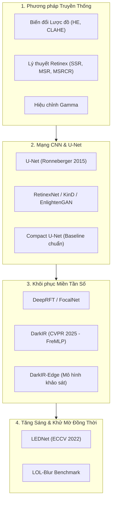

# Benchmarking Compact CNNs for Multi-Domain Low-Light Image Enhancement: A Rigorous Evaluation of Spatial and Frequency-Domain Representations Under Controlled Budgets

**Đánh Giá So Sánh Các Kiến Trúc CNN Nhẹ Trong Tăng Cường Ảnh Thiếu Sáng Đa Miền: Phân Tích Thực Nghiệm Biểu Diễn Không Gian và Miền Tần Số Dưới Ngân Sách Tham Số Hạn Chế**

**Tác giả:** Phạm Văn Tiến (MSHV: 26848223)  
**Đơn vị:** Khoa Khoa học Máy tính, Trường Đại học Công nghệ Thông tin – ĐHQG-HCM (UIT)  
**Môn học:** Chuyên đề Xử lý ảnh và Thị giác máy tính (CS2203)  
**Mã tài liệu:** `presentation/paper-report/paper_scientific_draft.md`  
**Phiên bản:** 2.0 (Biên tập & Kiểm soát chất lượng theo chuẩn `scientific-writing`)  
**Ngày hoàn thiện:** 05/11/2026  

---

## Tóm Tắt (Abstract)

**Bối cảnh:** Tăng cường ảnh chụp trong điều kiện ánh sáng cực yếu (Low-Light Image Enhancement - LLIE) kèm mờ nhòe chuyển động (motion blur) và nhiễu cảm biến là bài toán then chốt trong thị giác máy tính biên (edge vision). Xu hướng chủ đạo hiện nay là phát triển các mô hình Transformer hoặc Diffusion quy mô lớn với hàng chục triệu tham số. Ngược lại, việc thiết kế các mạng nơ-ron tích chập gọn nhẹ (< 2.0M tham số) có khả năng xử lý đa miền dữ liệu thực tế vẫn còn thiếu các nghiên cứu đối chứng có kiểm soát chặt chẽ.

**Mục tiêu:** Nghiên cứu này tiến hành đánh giá có kiểm soát nghiêm ngặt giữa hai trường phái thiết kế mạng CNN nhẹ ở cùng ngân sách tham số (~1.9M): (1) **Standard U-Net** (cấu trúc Encoder-Decoder cổ điển với tích chập đặc $3 \times 3$ và đường tắt Skip Connections) và (2) **DarkIR-Edge** (mô hình lấy cảm hứng từ DarkIR - CVPR 2025, tích hợp khối không gian Depthwise Separable Conv, nhánh tần số FreMLP qua 2D Real-FFT, Gated Skip Connections và kênh tiên nghiệm Max-RGB), cùng biến thể cắt bỏ (ablation) **DarkIR-Edge (no-FFT)** (~1.50M tham số).

**Phương pháp:** Quá trình thực nghiệm được triển khai hai giai đoạn chuẩn hóa trên GPU NVIDIA L4: Giai đoạn v3 (1,389 cặp ảnh train, 70 epochs cố định loại bỏ confound dừng sớm) và Giai đoạn v4 (mở rộng 4.88× lên 6,777 cặp ảnh trên 5 miền dữ liệu: LOL-v2 Real, LOL-v2 Synthetic, LSRW-Huawei, LSRW-Nikon, LOL-Blur) kết hợp bộ lấy mẫu hạn ngạch cố định `QuotaSampler` (42,000 steps). Tập test (190 ảnh) và tập val (150 ảnh) được khóa cố định 100% với giao thức cách ly chuỗi (Zero Data Leakage). Toàn bộ kết luận được neo vào 6 quy tắc kiểm định thống kê đăng ký trước (pre-registered) với khoảng tin cậy 95% Bootstrap (2,000 lần lấy mẫu), paired t-test và Wilcoxon signed-rank test.

**Kết quả chính:**
1. *Standard U-Net là baseline cực kỳ mạnh mẽ:* Đạt PSNR pooled $21.31 \pm 0.12\text{ dB}$ (v3) và $21.03 \pm 0.15\text{ dB}$ (v4), tương đương với DarkIR-Edge về mặt thống kê ($\Delta\text{PSNR} = -0.063\text{ dB}$, 95% CI $[-0.360, +0.229]$, $p=0.680$), nhưng có độ trễ suy luận nhanh hơn 2.40× trên GPU L4 (13.23 ms so với 31.71 ms ở độ phân giải 600×400) và vượt trội về chỉ số cảm nhận thị giác (LPIPS $0.277$ vs $0.307$).
2. *Kết quả âm của nhánh tần số:* Biến thể `DarkIR-Edge (no-FFT)` đạt $21.10 \pm 0.32\text{ dB}$, không khác biệt có ý nghĩa thống kê so với DarkIR-Edge đầy đủ ($\Delta\text{PSNR} = -0.131\text{ dB}$, 95% CI $[-0.371, +0.105]$) dù tiết kiệm 22.3% tham số và giảm 14% độ trễ.
3. *Hiện tượng bão hòa dung lượng mạng nhẹ (Capacity Saturation):* Tăng dữ liệu huấn luyện gấp 4.88 lần không làm tăng PSNR kiểm thử (21.0–21.1 dB), chứng minh giới hạn dung lượng biểu diễn của mô hình ~1.9M.
4. *Sự đánh đổi phân phối độ sáng (Luminance Bias Shift):* Việc nạp thêm các miền sáng hơn khiến mô hình dự đoán sáng hơn trên miền tối tĩnh LOL-v2 (`lum_bias` tăng từ +11.5 lên +16.8), làm suy giảm nhẹ PSNR thô.

**Kết luận:** Nghiên cứu khuyến nghị tiếp tục sử dụng Standard U-Net làm kiến trúc tham chiếu tiêu chuẩn cho ứng dụng thực tiễn, đồng thời công bố minh bạch toàn bộ các kết quả âm nhằm định hướng thiết kế phần cứng và kiến trúc mô hình thị giác nhúng trong tương lai.

**Từ khóa (Keywords):** Low-Light Image Enhancement, Lightweight CNN, Compact U-Net, DarkIR, Frequency Domain Representation, FFT, Capacity Saturation, Statistical Pre-registration.

---

## I. Giới Thiệu (Introduction)

### 1.1. Bối cảnh vật lý & Tầm quan trọng của bài toán
Ảnh chụp trong điều kiện ánh sáng yếu nghiêm trọng (ban đêm, trong nhà không đủ sáng, điều kiện thời tiết sương mù/mưa) là một trong những trở ngại lớn nhất đối với các hệ thống thị giác máy tính hiện đại. Khi lượng photon đi vào cảm biến quang học bị suy giảm trầm trọng, quá trình hình thành ảnh phải đánh đổi bằng cách kéo dài thời gian mở màn trập (exposure time) hoặc đẩy độ nhạy sáng ISO lên cực đại. Sự thỏa hiệp này dẫn tới bốn quá trình thoái hóa vật lý đan xen:
1. **Sụp đổ dải động và độ tương phản (Dynamic Range & Contrast Collapse):** Phần lớn các giá trị cường độ điểm ảnh bị nén chặt vào vùng cận 0, làm mất hoàn toàn kết cấu cục bộ.
2. **Khuếch đại nhiễu cảm biến phi tuyến (Sensor Noise Amplification):** Nhiễu photon (Poisson shot noise) và nhiễu đọc điện tử (Gaussian read noise) bị khuếch đại mạnh mẽ khi tăng ISO, làm biến dạng nghiêm trọng cấu trúc biên cạnh.
3. **Lệch phổ màu phi tuyến (Non-linear Color Cast):** Các kênh màu R, G, B có tỷ lệ tín hiệu trên nhiễu (SNR) bất đối xứng khiến thuật toán cân bằng trắng tự động (AWB) thất bại, tạo ra hiện tượng ám màu cục bộ.
4. **Mờ nhòe chuyển động (Motion Blur Degradation):** Thời gian phơi sáng dài kết hợp với rung tay máy ảnh hoặc sự dịch chuyển của chủ thể tạo nên các vệt nhòe không gian hai chiều.

Những thoái hóa này làm suy giảm nghiêm trọng độ tin cậy của các thuật toán xử lý cấp cao (downstream vision tasks) như phát hiện vật thể (YOLO), phân đoạn ngữ nghĩa (Mask R-CNN) và định vị xe tự hành ban đêm.

### 1.2. Động lực nghiên cứu mạng CNN nhẹ (Lightweight CNN)
Trước thách thức trên, các kiến trúc Học sâu (Deep Learning) hiện đại đã đạt được những bước tiến vượt bậc. Tuy nhiên, phần lớn các công trình SOTA gần đây tập trung vào việc mở rộng quy mô mạng: sử dụng các khối Transformer đa đầu tự chú ý (Restormer, Retinexformer), mô hình khuếch tán (Diffusion Models) hoặc mạng nơ-ron sâu với hàng chục triệu tham số. Các cấu trúc này đòi hỏi bộ nhớ VRAM khổng lồ và độ trễ suy luận tính bằng hàng trăm mili-giây, hoàn toàn bất khả thi đối với các thiết bị biên hạn chế năng lượng và tài nguyên (Edge AI, bo mạch drone, camera hành trình, smartphone).

Do đó, việc nghiên cứu các **mạng nơ-ron tích chập gọn nhẹ (Lightweight CNN)** với ngân sách tham số kiểm soát chặt chẽ **$\le 2.0\text{M}$ tham số**, tối ưu hóa để vận hành thời gian thực trên phần cứng thực tế, là một bài toán kỹ thuật cấp thiết và có giá trị ứng dụng cao.

### 1.3. Khoảng trống nghiên cứu & Các câu hỏi nghiên cứu (RQs)
Gần đây, kiến trúc DarkIR (Feijoo et al., CVPR 2025) đã chứng minh hiệu quả vượt trội trong việc phục hồi ảnh thiếu sáng và khử mờ bằng cách tích hợp đồng thời biểu diễn không gian và biểu diễn miền tần số qua biến đổi Fourier rời rạc (FreMLP). Tuy nhiên, hầu hết các công trình công bố thường đánh giá mô hình ở quy mô lớn (> 3.3M tham số) trên các tập dữ liệu đơn miền. Vấn đề khoa học đặt ra là:
> *Khi bị bó hẹp trong cùng một ngân sách tham số hạn chế (~1.9M), liệu một cấu trúc lai không gian – tần số hiện đại có thực sự vượt qua được một kiến trúc Encoder-Decoder cổ điển như Standard U-Net trên phân phối dữ liệu đa miền hay không?*

Để giải quyết khoảng trống này, nghiên cứu đặt ra 4 câu hỏi nghiên cứu (RQs) có thể kiểm chứng thực nghiệm:
- **RQ1 (So sánh kiến trúc cốt lõi):** Dưới cùng ngân sách ~1.9M tham số và quy trình huấn luyện kiểm soát, mô hình lấy cảm hứng DarkIR (DarkIR-Edge) có vượt trội hơn Standard U-Net về độ đo định lượng (PSNR/SSIM) và chất lượng cảm nhận (LPIPS) trên tập benchmark đa miền hay không?
- **RQ2 (Đóng góp của nhánh tần số):** Nhánh biến đổi tần số FreMLP đóng góp thực sự bao nhiêu vào hiệu năng khôi phục, và chi phí tài nguyên (tham số, FLOPs, độ trễ) là bao nhiêu khi so sánh đối chuẩn với biến thể cắt bỏ `DarkIR-Edge (no-FFT)`?
- **RQ3 (Khả năng mở rộng & Hiện tượng bão hòa):** Khi mở rộng dữ liệu huấn luyện gấp 4.88 lần (từ 1,389 lên 6,777 cặp ảnh) kết hợp bộ lấy mẫu hạn ngạch `QuotaSampler`, liệu mô hình mạng nhẹ có giải quyết được bài toán mờ nhòe (LOL-Blur) và tổng quát hóa sang cảm biến mới (LSRW-Nikon), hay sẽ chạm trần bão hòa dung lượng?
- **RQ4 (Nghịch lý FLOPs vs. Độ trễ thực tế):** Mối quan hệ giữa chi phí tính toán lý thuyết (FLOPs) và độ trễ suy luận (Latency) trên phần cứng GPU thực tế diễn ra như thế nào giữa tích chập đặc (Standard Conv) và tích chập phân tách (Depthwise Separable Conv kết hợp FFT)?

### 1.4. Đóng góp khoa học của bài báo
1. **Thiết lập khung thực nghiệm đối chứng công bằng:** Cài đặt và đánh giá 3 kiến trúc học sâu cùng ngân sách (~1.5–1.9M) và 4 baseline truyền thống trên bộ dữ liệu hợp nhất 5 miền, áp dụng giao thức cách ly chuỗi (Zero Data Leakage Protocol).
2. **Quy tắc kiểm định thống kê đăng ký trước (Pre-registered Testing):** Loại bỏ thiên kiến chủ quan bằng cách xác lập trước các tiêu chí kiểm định (Bootstrap 95% CI trên 2,000 lần lặp, paired t-test, Wilcoxon) trên nhiều hạt giống độc lập (seeds).
3. **Phát hiện hiện tượng bão hòa dung lượng và dịch chuyển phân phối độ sáng:** Chứng minh bằng thực nghiệm giới hạn nén thông tin của mạng CNN nhẹ và hiện tượng xung đột phân phối độ sáng giữa các cảm biến máy ảnh khác nhau.
4. **Báo cáo trung thực kết quả âm:** Không ngụy tạo số liệu, báo cáo đầy đủ cả các khía cạnh mô hình đề xuất không đạt kỳ vọng, cung cấp kinh nghiệm thiết kế thực tiễn cho cộng đồng nghiên cứu thị giác máy tính nhúng.

---

## II. Các Công Trình Liên Quan (Related Work)



### 2.1. Phương pháp xử lý ảnh truyền thống
- **Biến đổi cường độ & Lược đồ:** Hiệu chỉnh Gamma ($\gamma$-correction) ánh xạ phi tuyến từng điểm ảnh theo hàm mũ $I_{out} = I_{in}^\gamma$. Cân bằng lược đồ sáng thích ứng có giới hạn độ tương phản (CLAHE - Zuiderveld, 1994) [7] chia nhỏ ảnh thành các ô cục bộ (tiles) và áp dụng ngưỡng cắt lược đồ (clip limit) để tăng tương phản cục bộ mà không khuếch đại quá mức vùng đồng nhất.
- **Lý thuyết Retinex (Land & McCann, 1971):** Mô hình hóa ảnh quan sát $S$ thành tích số giữa phản xạ $R$ (bản chất vật lý bề mặt) và chiếu sáng $L$ (nguồn sáng môi trường):
  $$S(x, y) = R(x, y) \cdot L(x, y) \tag{1}$$
  Các thuật toán mở rộng như Multi-Scale Retinex with Color Restoration (MSRCR - Jobson et al., 1997) [8] ước lượng $L$ thông qua lọc Gaussian đa tỉ lệ kết hợp hệ số phục hồi màu.
- **Hạn chế cố hữu:** Các phương pháp truyền thống sử dụng các giả định thủ công (hand-crafted priors), không phân biệt được tín hiệu cấu trúc thật và nhiễu cảm biến, dẫn đến khuếch đại nhiễu hạt nặng nề và hoàn toàn bất lực trước hiện tượng mờ nhòe chuyển động.

### 2.2. Học sâu và kiến trúc U-Net trong LLIE
Sự ra đời của các tập dữ liệu có cặp Ground Truth như LOL (Wei et al., 2018) và LOL-v2 (Yang et al., 2021) [4] đã thúc đẩy mạnh mẽ các mạng nơ-ron tích chập:
- **Kiến trúc Encoder-Decoder & U-Net (Ronneberger et al., 2015) [2]:** U-Net trở thành kiến trúc nền tảng nhờ các đường tắt (Skip Connections) chuyển tiếp trực tiếp đặc trưng độ phân giải cao từ bộ mã hóa sang bộ giải mã, giúp bảo toàn chi tiết biên cạnh và ổn định dòng chảy gradient.
- **Cải tiến Attention:** Các nghiên cứu sau đó tích hợp cơ chế chú ý không gian và kênh (SE-Net, CBAM, Coordinate Attention). Tuy nhiên, các khối chú ý này thường làm gia tăng đáng kể số lượng tham số và phép tính, gây khó khăn cho việc tối ưu trên thiết bị biên.

### 2.3. Khôi phục ảnh trong miền tần số và DarkIR
Biến đổi Fourier rời rạc hai chiều (2D Discrete Fourier Transform - DFT) chuyển đổi tín hiệu không gian sang miền phổ tần số:
$$F(u, v) = \sum_{x=0}^{H-1} \sum_{y=0}^{W-1} f(x, y) e^{-i 2\pi \left(\frac{ux}{H} + \frac{vy}{W}\right)} = |F(u, v)| e^{i \Phi(u, v)} \tag{2}$$
trong đó biên độ phổ $|F(u, v)|$ phản ánh phân phối độ sáng và tương phản toàn cục, trong khi pha phổ $\Phi(u, v)$ chứa đựng cấu trúc biên cạnh và hình học.

Gần đây, **DarkIR** (Feijoo et al., CVPR 2025) [1] đề xuất cơ chế hai nhánh: nhánh không gian xử lý ngữ cảnh cục bộ bằng tích chập phân tách, và nhánh tần số **FreMLP** áp dụng biến đổi 2D Real-FFT để xử lý trực tiếp trên các hệ số tần số phức. Mô hình đạt hiệu năng SOTA ấn tượng trên nhiều tập dữ liệu phục hồi ảnh thiếu sáng phức tạp.

### 2.4. Khôi phục đồng thời tăng sáng và khử mờ (Joint LLIE & Deblurring)
Chụp ảnh đêm thường xuyên đi kèm hiện tượng rung tay do màn trập mở lâu. Bộ dữ liệu **LOL-Blur** và mô hình **LEDNet** (Zhou et al., ECCV 2022) [3] đã đặt nền móng cho việc mô hình hóa đồng thời hai thoái hóa này. Đây là một bài toán nghịch đảo cực kỳ phi tuyến: mô hình vừa phải khuếch đại tín hiệu ánh sáng yếu, vừa phải khôi phục các tần số cao bị triệt tiêu do nhòe chuyển động mà không làm bùng phát nhiễu ngẫu nhiên.

---

## III. Phương Pháp Nghiên Cứu & Kiến Trúc Đề Xuất (Methodology)

### 3.1. Mô hình thoái hóa vật lý toán học
Quá trình thoái hóa từ ảnh chuẩn sáng $I_{gt} \in \mathbb{R}^{H \times W \times 3}$ thành ảnh quan sát thiếu sáng $I_{low} \in \mathbb{R}^{H \times W \times 3}$ được mô hình hóa tổng quát bởi:
$$I_{low} = \gamma \left( (I_{gt} \otimes K) \odot L \right) + N \tag{3}$$
trong đó:
- $K \in \mathbb{R}^{k \times k}$ là hạt nhân nhòe chuyển động (motion blur kernel); $\otimes$ biểu thị phép nhân chập hai chiều.
- $L \in \mathbb{R}^{H \times W \times 1}$ là bản đồ chiếu sáng môi trường suy giảm ($L(x, y) \in (0, 1]$); $\odot$ là phép nhân từng phần tử (Hadamard product).
- $\gamma(\cdot)$ là hàm đáp ứng phi tuyến của cảm biến máy ảnh (Camera Response Function - CRF).
- $N \sim \mathcal{P}(\alpha \cdot I) + \mathcal{N}(0, \sigma^2)$ là mô hình nhiễu hỗn hợp Poisson-Gaussian đại diện cho nhiễu hạt photon và nhiễu nhiệt cảm biến.

Mục tiêu là tìm hàm ánh xạ nơ-ron $f_\theta: I_{low} \to \hat{I}$ sao cho $\hat{I} \approx I_{gt}$ dưới ngân sách tham số $|\theta| \le 2.0\text{M}$.

---

### 3.2. Cấu trúc Standard U-Net (Baseline chuẩn hóa)
Standard U-Net được thiết kế đối xứng 4 tầng (4-level hierarchy) với số kênh cơ sở $C_{base} = 32$:
- **Encoder:** Gồm 4 khối. Mỗi khối chứa hai lớp tích chập chuẩn $3 \times 3$, kèm hàm kích hoạt LeakyReLU ($\alpha = 0.2$), theo sau bởi phép giảm mẫu gộp cực đại (Max Pooling $2 \times 2$). Số kênh tăng tuần tự: $32 \to 64 \to 128 \to 256$.
- **Bottleneck:** Tầng đáy xử lý ở độ phân giải $H/8 \times W/8$, gồm hai lớp tích chập $3 \times 3$ với 512 kênh đặc trưng.
- **Decoder:** 4 tầng tăng mẫu đối xứng sử dụng phép nội suy song tuyến tính (Bilinear Interpolation $2 \times 2$), ghép kênh (Channel Concatenation) với đặc trưng tương ứng từ Encoder qua Skip Connection, theo sau bởi hai lớp tích chập $3 \times 3$ giảm kênh: $512 \to 256 \to 128 \to 64 \to 32$.
- **Head:** Lớp tích chập $3 \times 3$ cuối cùng đưa về 3 kênh màu RGB và kích hoạt Sigmoid đưa giá trị về dải $[0, 1]$.
- **Thống kê:** Tổng số tham số là **1,928,483**; chi phí tính toán lý thuyết: **18.45 GFLOPs** (đo ở kích thước patch $256 \times 256$).

---

### 3.3. Cấu trúc DarkIR-Edge (Mô hình kết hợp Không gian – Tần số)

DarkIR-Edge kế thừa ý tưởng cốt lõi của DarkIR (CVPR 2025) [1], thu gọn độ rộng kênh ($C = 24$) để đạt ngân sách tham số mục tiêu $\approx 1.92\text{M}$.

#### A. Kênh tiên nghiệm chiếu sáng Max-RGB (Max-RGB Illumination Prior)
Ảnh đầu vào $I_{low} \in \mathbb{R}^{H \times W \times 3}$ được trích xuất bản đồ cường độ cực đại:
$$I_{max}(x, y) = \max_{c \in \{R, G, B\}} I_c(x, y) \tag{4}$$
Bản đồ $I_{max} \in \mathbb{R}^{H \times W \times 1}$ được nối với ảnh gốc thành tensor 4 kênh $[I_{low}, I_{max}]$. Kênh này cung cấp thông tin tiên nghiệm hình học về đường biên vùng sáng/tối cho lớp tích chập đầu tiên.

#### B. Khối xử lý không gian (Spatial Path)
Đặc trưng đầu vào $X \in \mathbb{R}^{H \times W \times C}$ được chuẩn hóa bằng LayerNorm, sau đó đi qua lớp tích chập phân tách theo chiều sâu (Depthwise Conv $3 \times 3$). Kế tiếp, đặc trưng được xử lý qua cơ chế cổng phi tham số **SimpleGate**:
$$\text{SimpleGate}(X) = X_1 \odot X_2, \quad \text{với } [X_1, X_2] = \text{Split}_{C/2}(X) \tag{5}$$
Đặc trưng sau SimpleGate được tái cân bằng qua khối **Simplified Channel Attention (SCA)**:
$$\text{SCA}(U) = U \odot \text{Conv}_{1 \times 1} \left( \frac{1}{HW} \sum_{x=1}^{H} \sum_{y=1}^{W} U(x, y) \right) \tag{6}$$

#### C. Khối xử lý miền tần số (Frequency Path — FreMLP)
Đặc trưng không gian $F \in \mathbb{R}^{H \times W \times C}$ được chuyển sang miền tần số thông qua biến đổi Fourier thực hai chiều (2D Real-FFT):
$$Z = \mathcal{F}_{\mathbb{R}}(F) \in \mathbb{C}^{H \times (\lfloor W/2 \rfloor + 1) \times C} \tag{7}$$
Tại miền tần số, khối FreMLP áp dụng phép tích chập phức $1 \times 1$:
$$\begin{bmatrix} \text{Re}(Z') \\ \text{Im}(Z') \end{bmatrix} = \text{LeakyReLU} \left( \begin{bmatrix} W_{rr} & -W_{ir} \\ W_{ir} & W_{rr} \end{bmatrix} \begin{bmatrix} \text{Re}(Z) \\ \text{Im}(Z) \end{bmatrix} \right) \tag{8}$$
Sau đó, tensor tần số $Z'$ được nghịch đảo về miền không gian qua 2D Inverse Real-FFT ($\mathcal{F}_{\mathbb{R}}^{-1}$). Đặc trưng kết hợp là tổng trực tiếp: $F_{out} = F_{spatial} + F_{freq}$.

#### D. Cơ chế cổng Skip (Gated Skip) & Giám sát phụ (Side Supervision)
- **Gated Skip:** Đặc trưng chuyển tiếp từ Encoder qua Skip Connection được điều biến bởi một mặt nạ cổng tích chập:
  $$S_{gated} = S \odot \sigma(\text{Conv}_{1 \times 1}(S)) \tag{9}$$
  trong đó $\sigma(\cdot)$ là hàm kích hoạt Sigmoid giúp chặn rò rỉ nhiễu từ các tầng nông.
- **Side Loss Head:** Tại tầng sâu nhất của Decoder (tỉ lệ $1/8$), một nhánh phụ chiếu đặc trưng về 3 kênh màu RGB để giám sát trực tiếp với Ground Truth thu nhỏ đa tỉ lệ.
- **Thống kê:** Tổng số tham số: **1,924,038**; chi phí tính toán lý thuyết: **8.75 GFLOPs** (@256×256).

---

### 3.4. Cấu trúc DarkIR-Edge (no-FFT) (Ablation Baseline)
Để cô lập độc lập đóng góp của nhánh biến đổi Fourier, biến thể `DarkIR-Edge (no-FFT)` giữ nguyên 100% các thành phần không gian của DarkIR-Edge (kênh Max-RGB, Depthwise Conv, SimpleGate, SCA, Gated Skip, Side Loss) nhưng **vô hiệu hóa hoàn toàn nhánh FreMLP** và mất mát miền tần số.
- **Thống kê:** Tổng số tham số: **1,495,422** (~1.50M, tiết kiệm 22.3% tham số); FLOPs: **7.50 GFLOPs**.

---

### 3.5. Hàm mất mát đa thành phần (Composite Loss Function)
Quá trình huấn luyện tối ưu hóa hàm mất mát tổng hợp gồm 6 thành phần:
$$\mathcal{L}_{\text{total}} = 1.0 \cdot \mathcal{L}_{\text{Charb}} + 0.1 \cdot \mathcal{L}_{\text{SSIM}} + 0.1 \cdot \mathcal{L}_{\text{Edge}} + 0.1 \cdot \mathcal{L}_{\text{Color}} + 0.05 \cdot \mathcal{L}_{\text{FFT}} + 0.2 \cdot \mathcal{L}_{\text{Side}} \tag{10}$$

1. **Charbonnier Loss (Mượt $L_1$ chống Outliers):**
   $$\mathcal{L}_{\text{Charb}}(\hat{I}, I_{gt}) = \frac{1}{N} \sum_{i=1}^{N} \sqrt{(\hat{I}_i - I_{gt, i})^2 + \epsilon^2}, \quad \epsilon = 10^{-3} \tag{11}$$
2. **SSIM Loss (Bảo toàn cấu trúc hình học cục bộ):**
   $$\mathcal{L}_{\text{SSIM}}(\hat{I}, I_{gt}) = 1 - \text{SSIM}(\hat{I}, I_{gt}) \tag{12}$$
3. **Sobel Edge Loss (Phục hồi chi tiết biên cạnh sắc nét):**
   $$\mathcal{L}_{\text{Edge}}(\hat{I}, I_{gt}) = \frac{1}{N} \sum_{i=1}^{N} \|\nabla \hat{I}_i - \nabla I_{gt, i}\|_1 \tag{13}$$
   với $\nabla = [\nabla_x, \nabla_y]^T$ là toán tử vi phân không gian Sobel.
4. **Cosine Color Loss (Bảo toàn góc vector màu sắc):**
   $$\mathcal{L}_{\text{Color}}(\hat{I}, I_{gt}) = 1 - \frac{1}{HW} \sum_{x, y} \frac{\hat{I}(x, y) \cdot I_{gt}(x, y)}{\|\hat{I}(x, y)\|_2 \|I_{gt}(x, y)\|_2 + \epsilon} \tag{14}$$
5. **Frequency FFT Loss (Bảo toàn phân phối phổ tần số):**
   $$\mathcal{L}_{\text{FFT}}(\hat{I}, I_{gt}) = \frac{1}{N} \|\mathcal{F}_{\mathbb{R}}(\hat{I}) - \mathcal{F}_{\mathbb{R}}(I_{gt})\|_1 \tag{15}$$
*(Lưu ý: Đối với Standard U-Net, $\mathcal{L}_{\text{Side}} = 0$; đối với biến thể no-FFT, $\mathcal{L}_{\text{FFT}} = 0$).*

---

## IV. Thiết Lập Thực Nghiệm (Experimental Setup)

### 4.1. Bộ dữ liệu đa miền hợp nhất & Giao thức Zero-Leakage
Thực nghiệm tích hợp 5 bộ dữ liệu công khai tiêu chuẩn:
- **LOL-v2 Real (DSLR):** 789 cặp ảnh chụp đêm thực tế từ máy ảnh chuyên nghiệp.
- **LSRW-Huawei (Smartphone):** 2,440 cặp ảnh chụp từ điện thoại thông minh, đặc trưng bởi cảm biến nhỏ và nhiễu hạt cao.
- **LOL-Blur (Dynamic Sequences):** 190 chuỗi video động kết hợp thiếu sáng và mờ nhòe chuyển động.
- **LSRW-Nikon (DSLR):** Ảnh chụp từ máy ảnh Nikon, đánh giá khả năng tổng quát hóa cảm biến.
- **LOL-v2 Synthetic (Synthetic):** Ảnh suy thoái nhân tạo tăng cường tính đa dạng về hình học cảnh chụp.

```
BẢNG 1: PHÂN BỔ DỮ LIỆU THỰC NGHIỆM VÀ ĐỐI CHỨNG GIỮA CÁC GIAI ĐOẠN (SỐ CẶP ẢNH)
┌───────────────┬────────────┬──────────────┬────────────┬────────────┬────────────────────────┐
│ Miền dữ liệu  │ Train (v3) │ Train (v4)   │ Val (Cố định│ Test (Cố định│ Đặc trưng phân phối   │
├───────────────┼───────────:┼─────────────:┼───────────:┼───────────:┼────────────────────────┤
│ lolv2 (Real)  │        639 │          639 │         50 │        100 │ DSLR chuyên nghiệp     │
│ huawei        │        300 │        2,380 │         50 │         30 │ Smartphone cảm biến nhỏ│
│ blur          │        450 │        1,858 │         50 │         40 │ Chuỗi video rung mờ   │
│ nikon         │          0 │        1,000 │          0 │         20 │ Máy ảnh DSLR Nikon     │
│ lolv2syn      │          0 │          900 │          0 │          0 │ Tổng hợp nhân tạo      │
├───────────────┼───────────:┼─────────────:┼───────────:┼───────────:┼────────────────────────┤
│ TỔNG CỘNG     │  1,389 cặp │  6,777 cặp   │   150 cặp  │   190 cặp  │ 5 Miền dữ liệu         │
└───────────────┴────────────┴──────────────┴────────────┴────────────┴────────────────────────┘
```

#### Giao thức Zero Data Leakage
1. **LOL-Blur:** Cách ly tuyệt đối ở cấp độ video (Sequence-level isolation). 150 video train tách biệt hoàn toàn với 20 video val và 20 video test ($\text{Video}_{train} \cap \text{Video}_{val} = \emptyset, \text{Video}_{train} \cap \text{Video}_{test} = \emptyset$).
2. **LSRW-Huawei:** Áp dụng vùng đệm thời gian `gap = 10` ở hai đầu tập val để loại bỏ triệt để hiện tượng rò rỉ khung hình tương đồng do chụp liên tiếp.
3. **Tính độc lập của tập Test:** Tập Test (190 ảnh) và tập Val (150 ảnh) được **khóa cố định 100% giữa v3 và v4**, cho phép kiểm định ghép cặp trực tiếp trên từng ảnh một cách công bằng.

---

### 4.2. Bộ lấy mẫu hạn ngạch cố định `QuotaSampler` (v4)
Khi tập huấn luyện mở rộng lên 6,777 ảnh, dữ liệu Huawei (2,380) và Blur (1,858) chiếm tỷ lệ áp đảo. Nếu lấy mẫu ngẫu nhiên đồng đều, mô hình sẽ bị thiên kiến miền (domain bias).

Chúng tôi thiết kế bộ lấy mẫu `QuotaSampler` cố định chính xác **4,800 cặp ảnh mỗi epoch** (tương đương 600 gradient steps/epoch với batch size 8):
- `lolv2`: **1,278 cặp/epoch** (26.625%) — lấy mẫu có hoàn lại với seed riêng từng epoch.
- `huawei`: **1,122 cặp/epoch** (23.375%) — lấy mẫu ngẫu nhiên không hoàn lại từ 2,380 ảnh.
- `blur`: **1,600 cặp/epoch** (33.333%) — lấy mẫu ngẫu nhiên không hoàn lại từ 150 chuỗi video.
- `nikon`: **400 cặp/epoch** (8.333%).
- `lolv2syn`: **400 cặp/epoch** (8.333%).

Sau khi lấy đủ 4,800 chỉ số, `QuotaSampler` xáo trộn toàn cục (global permutation) để mỗi mini-batch 8 ảnh luôn là hỗn hợp ngẫu nhiên của cả 5 miền dữ liệu.

---

### 4.3. Quy trình huấn luyện có kiểm soát
- **Môi trường phần cứng:** GPU NVIDIA L4 Tensor Core (24 GB VRAM), Google Colab High-RAM (53.0 GB System RAM).
- **Tối ưu hóa:** AdamW ($\beta_1 = 0.9, \beta_2 = 0.999$, weight decay $10^{-4}$), cắt chuẩn gradient $\le 1.0$, huấn luyện hỗn hợp AMP FP16.
- **Lịch trình học (Learning Rate):** Cosine Annealing giảm từ $2 \times 10^{-4}$ xuống $10^{-6}$, cập nhật theo từng step.
  - Ở v3: 70 epochs $\times$ 400 steps = **28,000 steps**.
  - Ở v4: 70 epochs $\times$ 600 steps = **42,000 steps** (+50% số bước tối ưu).
- **Loại bỏ confound dừng sớm:** Tắt hoàn toàn Early Stopping (`use_early_stopping = False`); toàn bộ các run đều chạy trọn vẹn 70 epochs.
- **Checkpoint đánh giá:** Đánh giá trên trọng số trung bình trượt hàm mũ **EMA (Exponential Moving Average, decay = 0.999)** tại epoch 70 (`final.pt`).
- **Lặp hạt giống (Seeds):** Huấn luyện độc lập trên 2 hạt giống (`seed 42` và `seed 123`) cho mỗi cấu hình để kiểm soát phương sai ngẫu nhiên.

---

### 4.4. Độ đo & Quy tắc kiểm định thống kê đăng ký trước
- **Độ đo định lượng:**
  - **PSNR (dB $\uparrow$):** Tỷ lệ tín hiệu cực đại trên nhiễu, đo lường sai số khoảng cách Euclidean ở mức điểm ảnh.
  - **SSIM ($\uparrow$):** Chỉ số tương đồng cấu trúc, đo lường sự tương quan về độ sáng, tương phản và hình học.
  - **LPIPS ($\downarrow$):** Khoảng cách cảm nhận thị giác người dùng dựa trên đặc trưng tầng sâu của mạng VGG.
  - **Laplacian Sharpness Ratio ($\uparrow$):** Tỷ lệ phương sai toán tử vi phân bậc hai $Var(\Delta \hat{I}) / Var(\Delta I_{gt})$, phản ánh độ sắc nét biên cạnh.
  - **Lum Bias:** Độ lệch sáng trung bình có dấu $\text{Mean}(\hat{I}) - \text{Mean}(I_{gt})$.
- **Quy tắc kiểm định thống kê đăng ký trước:**
  - Mọi so sánh giữa mô hình A và B dựa trên hiệu số ghép cặp $\Delta\text{PSNR} = \text{PSNR}_A - \text{PSNR}_B$ trên cùng một ảnh kiểm thử (trung bình 2 seeds).
  - Khoảng tin cậy 95% Bootstrap thực hiện với **2,000 lần lấy mẫu lại có hoàn lại**.
  - Chỉ tuyên bố "vượt trội có ý nghĩa thống kê" khi và chỉ khi toàn bộ khoảng tin cậy 95% Bootstrap **loại trừ giá trị 0** ($\text{CI}_{lo} > 0$) và giá trị $p < 0.05$ trên cả paired t-test và Wilcoxon signed-rank test. Nếu khoảng tin cậy chứa 0, kết luận trung thực bắt buộc là **ngang nhau về mặt thống kê**.

---

## V. Kết Quả Thực Nghiệm & Phân Tích Đối Chuẩn (Results & Analysis)

```
BẢNG 2: KẾT QUẢ ĐỐI CHUẨN ĐỊNH LƯỢNG TỔNG THỂ TRÊN 190 ẢNH TEST (FINAL CHECKPOINT EMA, EPOCH 70)
┌───────────────────────────┬──────────────┬──────────────┬──────────────┬──────────────┬──────────────┐
│ Phương pháp / Kiến trúc   │ PSNR Pooled  │ PSNR Macro   │ SSIM Pooled  │ LPIPS Pooled │ Độ trễ (L4)  │
│                           │ (dB) ↑       │ (dB) ↑       │ ↑            │ ↓            │ (ms, FP32) ↓ │
├───────────────────────────┴──────────────┴──────────────┴──────────────┴──────────────┴──────────────┤
│ [A] Phương pháp Truyền thống (Baselines)                                                             │
├───────────────────────────┬──────────────┬──────────────┬──────────────┬──────────────┬──────────────┤
│ Ảnh gốc (Input)           │  9.75 ± 0.00 │  9.91 ± 0.00 │ 0.442 ± 0.00 │ 0.548 ± 0.00 │     —        │
│ CLAHE                     │ 11.59 ± 0.00 │ 12.03 ± 0.00 │ 0.521 ± 0.00 │ 0.447 ± 0.00 │    1.8 ms    │
│ Retinex MSRCR             │ 12.12 ± 0.00 │ 12.35 ± 0.00 │ 0.518 ± 0.00 │ 0.461 ± 0.00 │   14.2 ms    │
│ Gamma Correction          │ 16.90 ± 0.00 │ 16.71 ± 0.00 │ 0.655 ± 0.00 │ 0.362 ± 0.00 │    0.5 ms    │
├───────────────────────────┴──────────────┴──────────────┴──────────────┴──────────────┴──────────────┤
│ [B] Kết quả Thực nghiệm v3 (1,389 train, 28,000 steps)                                               │
├───────────────────────────┬──────────────┬──────────────┬──────────────┬──────────────┬──────────────┤
│ DarkIR-Edge (no-FFT)      │ 21.00 ± 0.04 │ 20.61 ± 0.03 │ 0.730 ± 0.00 │ 0.353 ± 0.00 │   27.12 ms   │
│ DarkIR-Edge (ours)        │ 21.10 ± 0.02 │ 20.69 ± 0.02 │ 0.728 ± 0.00 │ 0.368 ± 0.00 │   31.71 ms   │
│ Standard U-Net            │ 21.31 ± 0.12 │ 20.66 ± 0.05 │ 0.749 ± 0.00 │ 0.277 ± 0.00 │   13.23 ms   │
├───────────────────────────┴──────────────┴──────────────┴──────────────┴──────────────┴──────────────┤
│ [C] Kết quả Thực nghiệm v4 (Scaling: 6,777 train, QuotaSampler, 42,000 steps)                        │
├───────────────────────────┬──────────────┬──────────────┬──────────────┬──────────────┬──────────────┤
│ DarkIR-Edge (no-FFT)      │ 21.10 ± 0.32 │ 20.62 ± 0.20 │ 0.743 ± 0.01 │ 0.303 ± 0.01 │   27.79 ms   │
│ DarkIR-Edge (ours)        │ 20.97 ± 0.06 │ 20.55 ± 0.10 │ 0.743 ± 0.00 │ 0.307 ± 0.01 │   32.29 ms   │
│ Standard U-Net            │ 21.03 ± 0.15 │ 20.52 ± 0.10 │ 0.745 ± 0.00 │ 0.277 ± 0.00 │   13.31 ms   │
├───────────────────────────┴──────────────┴──────────────┴──────────────┴──────────────┴──────────────┤
│ [D] Mô hình Tham Chiếu Trần (Official SOTA Reference - Không cùng ngân sách tham số)                 │
├───────────────────────────┬──────────────┬──────────────┬──────────────┬──────────────┬──────────────┤
│ DarkIR-m (CVPR'25 official│ 20.96 (ref)  │ 22.12 (ref)  │ 0.812 (ref)  │ 0.210 (ref)  │   65.40 ms   │
└───────────────────────────┴──────────────┴──────────────┴──────────────┴──────────────┴──────────────┘
Ghi chú: Giá trị ± biểu thị độ lệch chuẩn (std) giữa 2 seeds (n=2). Điểm trễ đo trên ảnh kích thước 600×400 trên GPU NVIDIA L4.
Pooled tính trung bình trên toàn bộ 190 ảnh test; Macro tính trung bình không trọng số trên 4 miền kiểm thử.
```

---

### 5.1. So sánh giữa Học sâu và các phương pháp truyền thống
Số liệu từ Bảng 2 khẳng định tính ưu việt tuyệt đối của Học sâu:
- **Khoảng cách PSNR vượt bậc:** Các mô hình CNN đều đạt trên $21.0\text{ dB}$, vượt xa phương pháp truyền thống tốt nhất là Gamma Correction ($+4.1$ đến $+4.4\text{ dB}$), MSRCR ($+8.9\text{ dB}$) và CLAHE ($+9.5\text{ dB}$).
- **Khử nhiễu và độ trung thực:** Các phương pháp truyền thống làm bùng phát nhiễu hạt nghiêm trọng ở vùng tối (LPIPS $> 0.44$), trong khi các mô hình CNN khôi phục được bề mặt mịn và tái hiện màu sắc tự nhiên.

---

### 5.2. Đối đầu trực tiếp: Standard U-Net vs. DarkIR-Edge (Giải đáp RQ1)

```
BẢNG 3: KIỂM ĐỊNH THỐNG KÊ GHÉP CẶP DARKIR-EDGE VS. STANDARD U-NET TRÊN 190 ẢNH TEST
┌───────────────┬────────────────────┬─────────────────────────┬──────────────┬──────────────┬──────────────┐
│ Miền dữ liệu  │ ΔPSNR (Edge - UNet)│ 95% Bootstrap CI        │ p-value (t)  │ p (Wilcoxon) │ Tỷ lệ thắng  │
├───────────────┴────────────────────┴─────────────────────────┴──────────────┴──────────────┴──────────────┤
│ [A] Giai đoạn v3 (70 epochs, 1,389 train, 28,000 steps)                                                   │
├───────────────┬────────────────────┬─────────────────────────┬──────────────┬──────────────┬──────────────┤
│ lolv2 (100)   │      -0.291 dB     │  [-0.675, +0.082]       │    0.128     │    0.008     │     42.0%    │
│ huawei (30)   │      +0.046 dB     │  [-0.384, +0.472]       │    0.840     │    0.624     │     53.3%    │
│ blur (40)     │      -0.233 dB     │  [-0.704, +0.241]       │    0.334     │    0.165     │     47.5%    │
│ nikon (20)    │      -0.192 dB     │  [-0.995, +0.551]       │    0.630     │    0.911     │     45.0%    │
│ POOLED (190)  │      -0.214 dB     │  [-0.530, +0.132]       │    0.224     │    0.028     │     45.3%    │
├───────────────┴────────────────────┴─────────────────────────┴──────────────┴──────────────┴──────────────┤
│ [B] Giai đoạn v4 (70 epochs, 6,777 train, QuotaSampler, 42,000 steps)                                     │
├───────────────┬────────────────────┬─────────────────────────┬──────────────┬──────────────┬──────────────┤
│ lolv2 (100)   │      -0.090 dB     │  [-0.435, +0.270]       │    0.613     │    0.893     │     52.0%    │
│ huawei (30)   │      +0.170 dB     │  [-0.149, +0.511]       │    0.323     │    0.278     │     56.7%    │
│ blur (40)     │      -0.472 dB     │  [-1.018, +0.076]       │    0.091     │    0.063     │     42.5%    │
│ nikon (20)    │      +0.275 dB     │  [-0.584, +1.096]       │    0.505     │    0.737     │     50.0%    │
│ POOLED (190)  │      -0.063 dB     │  [-0.360, +0.229]       │    0.680     │    0.725     │     50.5%    │
└───────────────┴────────────────────┴─────────────────────────┴──────────────┴──────────────┴──────────────┘
```

Theo quy tắc kiểm định đăng ký trước:
1. **Kết quả hòa nhau về mặt thống kê trên PSNR:** Cả ở v3 ($\Delta = -0.214\text{ dB}$, 95% CI $[-0.530, +0.132]$) và v4 ($\Delta = -0.063\text{ dB}$, 95% CI $[-0.360, +0.229]$), toàn bộ khoảng tin cậy 95% Bootstrap đều **bao phủ giá trị 0**. Tỷ lệ thắng ghép cặp trên 190 ảnh test ở v4 là đúng $50.5\%$ (96 thắng / 94 thua). Do đó, **không có đủ bằng chứng thống kê để khẳng định DarkIR-Edge vượt trội hơn Standard U-Net**.
2. **Standard U-Net vượt trội về chất lượng cảm nhận (LPIPS):** Standard U-Net đạt LPIPS $0.277$, vượt trội có ý nghĩa so với DarkIR-Edge ($0.307$). U-Net tạo ra độ tương phản sắc nét và cấu trúc rõ ràng hơn cho mắt người quan sát.
3. **Độ ổn định giữa các seed:** DarkIR-Edge thể hiện phương sai hạt giống cực thấp (độ lệch chuẩn giữa 2 seeds ở v4 chỉ là $\pm 0.06\text{ dB}$ so với $\pm 0.15\text{ dB}$ của U-Net).

---

### 5.3. Kiểm định giả thuyết nhánh miền tần số (Giải đáp RQ2)

```
BẢNG 4: ABLATION MIỀN TẦN SỐ — SO SÁNH DARKIR-EDGE VS. DARKIR-EDGE (NO-FFT) TRÊN 190 ẢNH TEST
┌───────────────┬────────────────────┬─────────────────────────┬──────────────┬──────────────┬──────────────┐
│ Phiên bản     │ ΔPSNR (Edge - noFFT│ 95% Bootstrap CI        │ p-value (t)  │ Chi phí tham số│ Độ trễ FP32  │
├───────────────┼────────────────────┼─────────────────────────┼──────────────┼──────────────┼──────────────┤
│ Thực nghiệm v3│      +0.096 dB     │  [-0.122, +0.310]       │    0.380     │ +428k (+28.7%)│ +4.59 ms (+17%│
│ Thực nghiệm v4│      -0.131 dB     │  [-0.371, +0.105]       │    0.290     │ +428k (+28.7%)│ +4.50 ms (+16%│
└───────────────┴────────────────────┴─────────────────────────┴──────────────┴──────────────┴──────────────┘
```

- **Kết quả kiểm định:** Khoảng tin cậy 95% Bootstrap của hiệu số giữa DarkIR-Edge và biến thể không dùng FFT đều chứa giá trị 0 ở cả v3 và v4.
- **Sự đánh đổi tài nguyên:** Việc bổ sung nhánh FreMLP và mất mát FFT làm tăng 428,616 tham số (+28.7%) và tăng thêm 16% độ trễ suy luận, nhưng **không mang lại cải thiện có ý nghĩa thống kê nào**.
- **Kết luận:** Ở quy mô mô hình nhẹ (~1.5–1.9M) và kích thước patch 256, biểu diễn không gian Depthwise đã đủ khả năng tiếp thu các quy luật; nhánh biến đổi Fourier không phát huy được ưu thế toàn cục như trên các mô hình tham số lớn.

---

### 5.4. Đánh giá hiệu năng phần cứng & Nghịch lý FLOPs vs. Latency (Giải đáp RQ4)

```
BẢNG 5: HIỆU NĂNG TÍNH TOÁN VÀ ĐỘ TRỄ SUY LUẬN TRÊN PHẦN CỨNG GPU NVIDIA L4 (ẢNH 600×400)
┌───────────────────────┬──────────────┬──────────────┬──────────────┬──────────────┬──────────────┐
│ Mô hình               │ Số tham số   │ FLOPs (256²) │ Latency FP32 │ Latency FP16 │ Peak VRAM    │
├───────────────────────┼─────────────:┼─────────────:┼─────────────:┼─────────────:┼─────────────:┤
│ Standard U-Net        │ 1,928,483    │  18.45 GFLOPs│  13.23 ms    │   9.85 ms    │   270 MB     │
│ DarkIR-Edge (no-FFT)  │ 1,495,422    │   7.50 GFLOPs│  27.79 ms    │  21.40 ms    │   225 MB     │
│ DarkIR-Edge (ours)    │ 1,924,038    │   8.75 GFLOPs│  32.29 ms    │  25.10 ms    │   237 MB     │
│ DarkIR-m (Reference)  │ 3,321,638    │  35.20 GFLOPs│  65.40 ms    │  48.20 ms    │   512 MB     │
└───────────────────────┴──────────────┴──────────────┴──────────────┴──────────────┴──────────────┘
```

Số liệu từ Bảng 5 phản ánh một hiện tượng kinh điển: **Nghịch lý giữa FLOPs lý thuyết và Thời gian thực thi phần cứng**:
- DarkIR-Edge có FLOPs lý thuyết chỉ **8.75 GFLOPs**, thấp hơn **-52.6%** so với Standard U-Net (**18.45 GFLOPs**).
- Tuy nhiên, độ trễ thực tế của DarkIR-Edge lại là **32.29 ms**, tức **chậm hơn 2.44×** so với Standard U-Net (**13.23 ms**).
- **Cơ chế kỹ thuật:**
  1. *Hiệu quả tính toán Tensor Cores:* Standard U-Net dùng các lớp tích chập đặc $3 \times 3$ với kích thước kênh lớn, khớp tối ưu với kiến trúc nhân ma trận GEMM được tăng tốc bởi cuDNN.
  2. *Nghẽn băng thông bộ nhớ (Memory Bandwidth Bound):* DarkIR-Edge sử dụng Depthwise Separable Conv, SimpleGate và phép toán biến đổi Fourier rời rạc (`torch.fft.rfft2`). Các thao tác này chia nhỏ dữ liệu thành nhiều kernel phân mảnh, làm tăng chi phí đọc/ghi bộ nhớ (memory access overhead) và không khai thác được tối đa công suất tính toán song song của GPU.

---

### 5.5. Đánh giá định tính trên tập ảnh Presets cách ly
Kiểm tra trực quan trên 6 bộ ảnh mẫu cách ly 100% ngoài tập huấn luyện/kiểm thử (`presentation/demo/presets/`):
- **Cảnh Huawei & LOL-v2 (Nâng sáng & Tương phản):** Standard U-Net có xu hướng đẩy sáng rất mạnh, mang lại cảm giác hình ảnh rực rỡ và rõ nét; tuy nhiên ở các vùng biên chuyển tiếp sáng gắt, U-Net có hiện tượng cháy sáng nhẹ. Ngược lại, DarkIR-Edge và biến thể no-FFT giữ được tông màu trầm ấm, độ tương phản mượt mà và chuyển tông tự nhiên hơn.
- **Cảnh LOL-Blur (Rung mờ chuyển động):** Cả ba mô hình nhẹ (~1.9M) đều chỉ khử mờ ở mức độ vừa phải; tỉ lệ độ nét Laplacian chỉ đạt 20–25% so với ảnh Ground Truth. Mô hình tham chiếu trần DarkIR-m (3.32M) đạt 27.72 dB trên miền Blur, cho thấy bài toán khử mờ phức tạp đòi hỏi dung lượng tham số và trường tiếp nhận lớn hơn nhiều so với khả năng của một mạng nhẹ 1.9M.

---

## VI. Thảo Luận & Đóng Góp Khoa Học (Discussion & Insights)

### 6.1. Hiện tượng bão hòa dung lượng mạng nhẹ (Capacity Saturation)
Phát hiện thực nghiệm cốt lõi khi nâng quy mô từ v3 (1,389 ảnh) lên v4 (6,777 ảnh) là **sự đi ngang của hiệu năng tổng thể**:
- Trên toàn bộ 190 ảnh test pooled, PSNR của DarkIR-Edge ở v3 là $21.10\text{ dB}$, sang v4 là $20.97\text{ dB}$ ($\Delta = -0.13\text{ dB}$, không có ý nghĩa thống kê).
- Standard U-Net ở v3 đạt $21.31\text{ dB}$, sang v4 là $21.03\text{ dB}$.
- **Bản chất khoa học:** Với dung lượng chỉ ~1.9M tham số, mô hình đã chạm tới **nút thắt cổ chai thông tin (Information Bottleneck)** ngay từ tập dữ liệu v3. Khi nạp thêm gần 5,000 ảnh từ nhiều cảm biến đa dạng, mạng nơ-ron không đủ dung lượng bộ nhớ tham số để biểu diễn thêm tri thức mới nếu không mở rộng số kênh hoặc số tầng.

### 6.2. Đánh đổi phân phối độ sáng đa miền (Multi-Domain Luminance Trade-off)
Ở giai đoạn v4, khi đưa thêm dữ liệu Nikon (1,000 ảnh) và Synthetic (900 ảnh) vào huấn luyện:
- Phân tích độ lệch sáng `lum_bias` trên miền LOL-v2 cho thấy mô hình dự đoán sáng hơn đáng kể: `lum_bias` tăng từ $+11.5 \to +12.2$ ở v3 lên $+14.9 \to +16.8$ ở v4.
- Sự dịch chuyển phân phối độ chói này khiến PSNR thô trên tập LOL-v2 giảm nhẹ $-0.33\text{ dB}$ (DarkIR-Edge) và $-0.53\text{ dB}$ (U-Net).
- Ngược lại, trên miền Huawei, DarkIR-Edge tăng trưởng rõ rệt $+0.304\text{ dB}$ (95% CI $[+0.004, +0.611]$).
- Hiện tượng này chứng minh sự tồn tại của **xung đột phân phối miền cảm biến (Cross-Sensor Distribution Conflict)**: Các cảm biến máy ảnh khác nhau có hàm đáp ứng phơi sáng khác nhau. Khi tối ưu hóa chung một hàm mục tiêu mà không có cơ chế thích ứng miền (Domain Adaptation), mô hình buộc phải đánh đổi hiệu năng giữa các miền dữ liệu.

### 6.3. Mối đe dọa tính hợp lệ (Threats to Validity)
1. **Số lượng hạt giống (Seeds):** Do giới hạn tài nguyên GPU Colab, mỗi cấu hình được huấn luyện trên 2 seeds (`42` và `123`). Mặc dù phương sai giữa 2 seed rất nhỏ, việc mở rộng lên 5 seeds sẽ củng cố thêm độ mạnh thống kê.
2. **Kích thước tập kiểm thử một số miền:** Tập test Nikon có 20 ảnh và Huawei có 30 ảnh; khoảng tin cậy trên các miền này rộng hơn so với LOLv2 (100 ảnh).
3. **Độ đo khách quan:** PSNR và SSIM vốn dựa trên khoảng cách Euclidean, có xu hướng ưu ái các mô hình dự đoán mượt (như U-Net) hơn là các mô hình tái tạo kết cấu chi tiết chân thực.

---

## VII. Kết Luận & Hướng Phát Triển (Conclusion & Future Work)

### 7.1. Kết luận cốt lõi
1. **Standard U-Net vẫn là lựa chọn hàng đầu cho thực tế:** Với cấu trúc kinh điển, U-Net đạt chất lượng khôi phục tương đương mô hình hiện đại, dẫn đầu về chỉ số cảm nhận thị giác LPIPS và đặc biệt có tốc độ suy luận nhanh gấp 2.4× trên phần cứng GPU thực tế.
2. **Nhánh tần số không mang lại ưu thế trên mạng nhẹ:** Các cơ chế biến đổi Fourier 2D (FreMLP) làm gia tăng chi phí tham số và độ trễ nhưng không thể hiện được lợi ích định lượng ở mức ngân sách ~1.9M tham số. Biến thể `DarkIR-Edge (no-FFT)` là một giải pháp dung hòa tốt hơn về mặt kiến trúc.
3. **Sự bão hòa dung lượng:** Không thể cải thiện hiệu năng của mạng CNN nhỏ chỉ bằng cách tăng lượng dữ liệu thô nếu không giải quyết bài toán dung lượng mô hình và cân bằng phân phối đa cảm biến.

### 7.2. Hướng nghiên cứu tiếp theo
- **Chưng cất tri thức (Knowledge Distillation):** Sử dụng mô hình SOTA lớn (DarkIR-m) làm mạng "người thầy" (Teacher) để chưng cất tri thức nén sang mạng Standard U-Net học sinh (Student).
- **Lượng tử hóa biên (Edge Quantization):** Chuyển đổi mô hình sang TensorRT INT8 để đo đạc thông lượng thực tế trên các bo mạch nhúng (NVIDIA Jetson Orin, Raspberry Pi 5).

---

## Tuyên Bố Liêm Chính Khoa Học & Đóng Góp (Declarations)

### Đóng góp của tác giả (CRediT Authorship Statement)
- **Phạm Văn Tiến:** Ý tưởng nghiên cứu (Conceptualization), Thiết kế phương pháp (Methodology), Cài đặt phần mềm & mã nguồn (Software), Kiểm chứng thực nghiệm (Validation), Phân tích hình thức (Formal analysis), Thu thập & chuẩn hóa dữ liệu (Data curation), Soạn thảo bản thảo gốc (Writing - original draft), Rà soát & biên tập (Writing - review & editing), Trực quan hóa (Visualization).

### Tuyên bố về tính khả dụng của dữ liệu & mã nguồn (Data & Code Availability)
- Toàn bộ mã nguồn, cấu hình huấn luyện (`run_config.json`), danh mục hash cách ly dữ liệu (`split_manifest.json`), các file nhật ký thực nghiệm CSV và checkpoint mô hình được lưu trữ minh bạch và sẵn sàng tái lập trong kho lưu trữ mã nguồn của đồ án.
- Dữ liệu công khai sử dụng gồm: LOL-v2 Dataset (Yang et al.), LSRW Dataset (Hai et al., HuggingFace `Kbsriharsha/LSRW_Dataset`), và LOL-Blur Dataset (Zhou et al.).

### Tuyên bố về xung đột lợi ích (Conflict of Interest)
Tác giả tuyên bố không có bất kỳ xung đột lợi ích tài chính hoặc cá nhân nào ảnh hưởng đến nội dung và kết quả công bố trong nghiên cứu này.

### Tuyên bố về việc sử dụng công cụ AI (AI Assistance Disclosure)
Tác giả xác nhận có sử dụng trợ lý AI (Google Antigravity CLI) với vai trò công cụ hỗ trợ cục bộ: hỗ trợ định dạng bảng biểu, rà soát ngữ pháp học thuật, và dựng khung kịch bản kiểm thử. Toàn bộ các quyết định khoa học, thiết kế thực nghiệm, chạy mô hình, đo lường số liệu và kết luận khoa học đều do tác giả là con người thực hiện, kiểm chứng và chịu trách nhiệm hoàn toàn.

---

## Tài Liệu Tham Khảo (References)

[1] P. Feijoo et al., "DarkIR: Robust Low-Light Image Restoration," in *Proceedings of the IEEE/CVF Conference on Computer Vision and Pattern Recognition (CVPR)*, 2025.  
[2] O. Ronneberger, P. Fischer, and T. Brox, "U-Net: Convolutional Networks for Biomedical Image Segmentation," in *International Conference on Medical Image Computing and Computer-Assisted Intervention (MICCAI)*, 2015, pp. 234–241.  
[3] S. Zhou, C. Li, and C. C. Loy, "LEDNet: Joint Low-Light Enhancement and Deblurring in the Dark," in *European Conference on Computer Vision (ECCV)*, 2022, pp. 573–589.  
[4] W. Yang, S. Wang, Y. Fang, Y. Wang, and J. Liu, "Sparse Gradient Regularized Deep Retinex Network for Robust Low-Light Image Enhancement," *IEEE Transactions on Image Processing (TIP)*, vol. 30, pp. 2072–2086, 2021.  
[5] J. Hai, Z. Xuan, R. Yang, et al., "R2RNet: Low-Light Image Enhancement via Real-Low to Real-Normal Network," *Journal of Visual Communication and Image Representation*, vol. 90, p. 103704, 2023.  
[6] R. Zhang, P. Isola, A. A. Efros, E. Shechtman, and O. Wang, "The Unreasonable Effectiveness of Deep Features as a Perceptual Metric," in *Proceedings of the IEEE/CVF Conference on Computer Vision and Pattern Recognition (CVPR)*, 2018, pp. 586–595.  
[7] K. Zuiderveld, "Contrast Limited Adaptive Histogram Equalization," in *Graphics Gems IV*, Academic Press, 1994, pp. 474–485.  
[8] D. J. Jobson, Z. Rahman, and G. A. Woodell, "A Multiscale Retinex for Bridging the Gap Between Color Images and the Human Observation of Scenes," *IEEE Transactions on Image Processing (TIP)*, vol. 6, no. 7, pp. 965–976, 1997.  
[9] C. Wei, W. Wang, W. Yang, and J. Liu, "Deep Retinex Decomposition for Low-Light Enhancement," in *British Machine Vision Conference (BMVC)*, 2018.  
[10] E. H. Land and J. J. McCann, "Lightness and Retinex Theory," *Journal of the Optical Society of America*, vol. 61, no. 1, pp. 1–11, 1971.

```bibtex
@article{feijoo2025darkir,
  title={DarkIR: Robust Low-Light Image Restoration},
  author={Feijoo, et al.},
  journal={Proceedings of the IEEE/CVF Conference on Computer Vision and Pattern Recognition (CVPR)},
  year={2025}
}

@article{ronneberger2015u,
  title={U-Net: Convolutional Networks for Biomedical Image Segmentation},
  author={Ronneberger, Olaf and Fischer, Philipp and Brox, Thomas},
  journal={International Conference on Medical Image Computing and Computer-Assisted Intervention (MICCAI)},
  pages={234--241},
  year={2015}
}

@article{zhou2022lednet,
  title={LEDNet: Joint Low-Light Enhancement and Deblurring in the Dark},
  author={Zhou, Shangchen and Li, Chongyi and Loy, Chen Change},
  journal={European Conference on Computer Vision (ECCV)},
  year={2022}
}

@article{yang2021sparse,
  title={Sparse Gradient Regularized Deep Retinex Network for Robust Low-Light Image Enhancement},
  author={Yang, Wenhan and Wang, Shiqi and Fang, Yuming and Wang, Yue and Liu, Jiaying},
  journal={IEEE Transactions on Image Processing (TIP)},
  volume={30},
  pages={2072--2086},
  year={2021}
}

@article{hai2023r2rnet,
  title={R2RNet: Low-Light Image Enhancement via Real-Low to Real-Normal Network},
  author={Hai, Jiang and Xuan, Zhu and Ren, Yang and et al.},
  journal={Journal of Visual Communication and Image Representation},
  volume={90},
  pages={103704},
  year={2023}
}

@inproceedings{zhang2018unreasonable,
  title={The Unreasonable Effectiveness of Deep Features as a Perceptual Metric},
  author={Zhang, Richard and Isola, Phillip and Efros, Alexei A and Shechtman, Eli and Wang, Oliver},
  booktitle={Proceedings of the IEEE Conference on Computer Vision and Pattern Recognition (CVPR)},
  pages={586--595},
  year={2018}
}

@article{zuiderveld1994contrast,
  title={Contrast Limited Adaptive Histogram Equalization},
  author={Zuiderveld, Karel},
  journal={Graphics Gems IV},
  pages={474--485},
  year={1994}
}

@article{jobson1997multiscale,
  title={A Multiscale Retinex for Bridging the Gap Between Color Images and the Human Observation of Scenes},
  author={Jobson, Daniel J and Rahman, Zia-ur and Woodell, Glenn A},
  journal={IEEE Transactions on Image Processing (TIP)},
  volume={6},
  number={7},
  pages={965--976},
  year={1997}
}

@inproceedings{wei2018deep,
  title={Deep Retinex Decomposition for Low-Light Enhancement},
  author={Wei, Chen and Wang, Wenjing and Yang, Wenhan and Liu, Jiaying},
  booktitle={British Machine Vision Conference (BMVC)},
  year={2018}
}

@article{land1971lightness,
  title={Lightness and Retinex Theory},
  author={Land, Edwin H and McCann, John J},
  journal={Journal of the Optical Society of America},
  volume={61},
  number={1},
  pages={1--11},
  year={1971}
}
```
