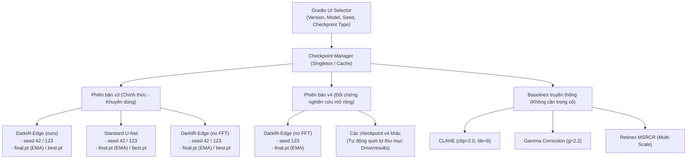
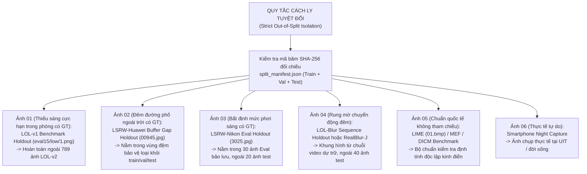

# Kế Hoạch Xây Dựng Ứng Dụng Demo Cục Bộ Phục Vụ Thuyết Trình (Local Presentation Demo Plan)

> **Dự án:** Low-Light Image Enhancement Using a Lightweight Convolutional Neural Network (DarkIR-Edge)  
> **Mục tiêu:** Xây dựng ứng dụng Demo tương tác chạy cục bộ (100% Local / Offline) tại thư mục `presentation/demo/` để trình diễn trực tiếp trước hội đồng trong buổi báo cáo / bảo vệ đồ án (CS2203 - Master of Science in Computer Science, UIT).  
> **Tài liệu căn cứ:**  
> - Báo cáo thực nghiệm v3: [Bao_Cao_Ket_Qua_v3_LLIE_DarkIR_Edge.md](file:///E:/MyProject/low-light-image-enhancement-cnn/presentation/report/Bao_Cao_Ket_Qua_v3_LLIE_DarkIR_Edge.md) (Bộ trọng số chính thức được chọn cho ứng dụng Demo).  
> - Báo cáo thực nghiệm v4: [Bao_Cao_Ket_Qua_v4_LLIE_DarkIR_Edge.md](file:///E:/MyProject/low-light-image-enhancement-cnn/presentation/report/Bao_Cao_Ket_Qua_v4_LLIE_DarkIR_Edge.md) (Nghiên cứu mở rộng đa miền & bão hòa dung lượng).  
> - Notebook thực nghiệm: `colab-results/LLIE_DarkIR_Edge_Colab_v3.ipynb` và `colab-results/LLIE_DarkIR_Edge_Colab_v4.ipynb`.  

---

## 1. Mục Tiêu & Yêu Cầu Cốt Lõi Của Ứng Dụng Demo

### 1.1. Mục đích sử dụng
- **Trình diễn trực tiếp (Live Interactive Demo):** Minh họa khả năng phục hồi ảnh thiếu sáng theo thời gian thực (real-time / near real-time) trong khoảng thời gian từ **3 đến 5 phút** của bài thuyết trình.
- **Chứng minh luận điểm khoa học:** Giúp người nghe và hội đồng "tận mắt thấy, tự tay kéo" để kiểm chứng:
  1. Sự vượt trội của mô hình học sâu đề xuất (`DarkIR-Edge`) so với các phương pháp truyền thống (`CLAHE`, `Gamma 2.2`, `Retinex MSRCR`).
  2. Sự khác biệt tinh tế giữa `DarkIR-Edge` và `Standard U-Net` (độ ổn định màu sắc vs độ sắc nét biên).
  3. Tác động thực tế của nhánh tần số (`with-FFT` vs `no-FFT`).
  4. Hiện tượng bão hòa dung lượng và dịch chuyển phân phối độ sáng giữa **v3** (độ sáng tự nhiên) và **v4** (độ sáng đẩy cao trên LOL-v2 do học đa miền).
  5. Thử thách tính tổng quát hóa trên ảnh thực tế (Real-world Low-light Photos) do người thuyết trình hoặc hội đồng cung cấp trực tiếp.

### 1.2. Các yêu cầu kỹ thuật bắt buộc
1. **100% Cục bộ & Độc lập mạng (Offline-first):** Hoạt động hoàn toàn không cần Internet. Toàn bộ trọng số mô hình và ảnh mẫu được lưu trên ổ đĩa nội bộ.
2. **Khởi động nhanh & Tương tác mượt mà:** Khởi động dưới 5 giây, độ trễ suy luận mỗi ảnh dưới 50ms (nếu có GPU) hoặc dưới 200ms (nếu chạy CPU fallback), không gây đơ lag trình duyệt.
3. **Thanh trượt so sánh trực quan (Interactive Split / Before-After Slider):** Cho phép kéo thanh trượt qua lại giữa ảnh gốc thiếu sáng và ảnh phục hồi, hoặc giữa hai mô hình đối đầu.
4. **Bộ chọn Checkpoint & Siêu tham số linh hoạt (Dynamic Checkpoint Selector):** Cho phép chuyển đổi nhanh giữa các phiên bản (v3 vs v4), kiến trúc (`DarkIR-Edge`, `Standard U-Net`, `DarkIR-Edge no-FFT`), hạt giống ngẫu nhiên (`seed 42` vs `seed 123`), và trạng thái lưu (`final.pt` EMA vs `best.pt`).
5. **Bảng đo lường trực tiếp (Live Metrics HUD):**
   - Khi có ảnh Ground Truth (ảnh mẫu trong tập test): Tự động tính toán và hiển thị trực tiếp `PSNR (dB)`, `SSIM`, và chỉ số chẩn đoán độ sáng `PSNR_gtmean (dB)`.
   - Đo thời gian xử lý: Hiển thị độ trễ suy luận chính xác (`Inference Latency: xx.x ms`) và tốc độ ước lượng (`xx.x FPS`).

---

## 2. Phân Tích & Lựa Chọn Techstack

Dưới đây là bảng đánh giá so sánh giữa 3 phương án công nghệ khả thi nhất cho ứng dụng demo thuyết trình cục bộ:

| Tiêu chí so sánh | Phương án A: Gradio (Được Khuyến Nghị) | Phương án B: Streamlit | Phương án C: FastAPI + Web HTML5/JS |
| :--- | :--- | :--- | :--- |
| **Bản chất công nghệ** | UI Framework chuyên biệt cho Machine Learning (Python thuần) | Data Dashboard Framework (Python thuần) | Backend REST API (Python) + Frontend Web (HTML/CSS/JS) |
| **Thanh trượt Before/After** | Hỗ trợ gốc cực mượt qua `gr.ImageSlider` hoặc `gr.Image(..., interactive=True)` | Cần cài thêm thư viện bên thứ 3 (`streamlit-image-comparison`) | Phải tự viết script kéo chuột Split-Screen bằng Vanilla JS / Canvas |
| **Thư viện ảnh mẫu (Gallery)** | Cực mạnh với `gr.Examples`: bấm vào thumbnail là ảnh và thông số tự điền ngay lập tức | Tương đối phức tạp, phải quản lý trạng thái bằng `st.session_state` | Tự dựng lưới ảnh thẻ HTML và gắn sự kiện `fetch()` |
| **Tốc độ phản hồi UI** | Rất cao; chỉ cập nhật component đầu ra tương ứng, không re-render toàn màn hình | Thấp hơn; mỗi lần đổi dropdown hay click nút là toàn bộ script Python bị chạy lại từ đầu | Cao nhất; giao diện bất đồng bộ 100% qua fetch API |
| **Khả năng nhúng vào Slide** | Dễ dàng mở một tab song song hoặc nhúng iframe vào `presentation/slide/index.html` | Nhúng được qua iframe nhưng chiếm nhiều không gian header | Tích hợp hoàn hảo nhất vào cùng giao diện slide |
| **Độ phức tạp mã nguồn** | **Rất thấp** (~180–250 dòng code trong 1 file `app.py`) | Thấp (~200–300 dòng code) | Cao (FastAPI route + Pydantic + HTML/JS/CSS riêng) |
| **Độ rủi ro khi báo cáo** | **Cực thấp:** Gradio là chuẩn mực quốc tế, độ ổn định cực cao khi chạy local | Trung bình (dễ gặp lỗi cache hoặc re-run ngoài ý muốn) | Trung bình (phụ thuộc 2 tiến trình server và client) |

### Kết luận lựa chọn:
> [!IMPORTANT]
> **Techstack chính thức:** **Gradio (phiên bản >= 4.20.0)** kết hợp với **PyTorch (`torch`, `torchvision`)** và **OpenCV/Pillow/scikit-image**.  
> **Lý do:** Gradio cung cấp trải nghiệm demo thị giác máy tính hoàn hảo nhất hiện nay: có sẵn component `gr.ImageSlider` cho phép hội đồng quan sát chi tiết biên ảnh Before/After mượt mà; hỗ trợ `gr.Examples` giúp nạp các ca kiểm thử điển hình chỉ với 1 cú click chuột; đồng thời cho phép mở rộng nhanh các tab so sánh nhiều mô hình cùng lúc (Side-by-Side Comparison).

---

## 3. Chiến Lược Nạp & Quản Lý Checkpoint

Báo cáo v4 đã xác nhận rõ ràng: **Bộ trọng số v3 là checkpoint chính thức được chọn để triển khai demo**, trong khi v4 đóng vai trò là bằng chứng thực nghiệm về bão hòa dung lượng. Ứng dụng demo sẽ hỗ trợ nạp cả hai phiên bản để phục vụ bài nói phản biện.



### 3.1. Danh mục Checkpoint cục bộ sẵn có trong dự án

Dựa trên việc kiểm tra trực tiếp các tệp nhị phân `.pt` trong không gian làm việc:

1. **Nhóm mô hình v3 (Thư mục `colab-results/llie_project_v3-20261102/llie_project_v3/experiments/v3/checkpoints/`):**
   - `darkir_edge_seed42/`: chứa `final.pt` (15.6 MB, EMA epoch 70 — **Checkpoint Mặc Định Khởi Động**) và `best.pt` (15.6 MB, đỉnh Val macro).
   - `darkir_edge_seed123/`: chứa `final.pt` (15.6 MB) và `best.pt` (15.6 MB).
   - `unet_seed42/`: chứa `final.pt` (15.5 MB) và `best.pt` (15.5 MB).
   - `unet_seed123/`: chứa `final.pt` (15.5 MB) và `best.pt` (15.5 MB).
   - `darkir_edge_nofft_seed42/`: chứa `final.pt` (12.2 MB) và `best.pt` (12.2 MB).
   - `darkir_edge_nofft_seed123/`: chứa `final.pt` (12.2 MB) và `best.pt` (12.2 MB).
2. **Nhóm mô hình v4 (Thư mục `colab-results/llie_project_v4-20261104/llie_project_v4/experiments/v4/checkpoints/`):**
   - `darkir_edge_nofft_seed123/`: chứa `final.pt` (12.2 MB).
   - *Cơ chế nạp dự phòng linh hoạt:* Nếu người dùng đồng bộ thêm bất kỳ tệp checkpoint `.pt` nào khác từ Google Drive vào thư mục v4, hệ thống tự động quét và thêm vào danh sách lựa chọn mà không cần sửa code.
3. **Nhóm thuật toán truyền thống (Zero-param Baselines):**
   - `CLAHE`: Cân bằng biểu đồ cục bộ thích ứng giới hạn tương phản (`clipLimit=2.0`, `tileGridSize=(8,8)` trong không gian LAB).
   - `Gamma Correction`: Biến đổi lũy thừa phi tuyến tiêu chuẩn $I_{\text{out}} = I_{\text{in}}^{1 / 2.2}$.
   - `Retinex MSRCR`: Phục hồi màu đa tỷ lệ Retinex với 3 thang lọc Gaussian $\sigma \in \{15, 80, 250\}$.

### 3.2. Cơ chế quản lý bộ nhớ & Tối ưu hóa suy luận (Inference Optimization)
- **Singleton Model Cache:** Xây dựng lớp `ModelRegistry` lưu trữ các đối tượng mô hình đã khởi tạo trong RAM/VRAM. Khi người dùng đổi qua lại giữa các ảnh hoặc thay đổi ảnh đầu vào, mô hình được tái sử dụng ngay lập tức mà không phải đọc lại file từ ổ đĩa.
- **Hot-swapping State Dict:** Khi người dùng đổi hạt giống (seed 42 $\leftrightarrow$ seed 123) hoặc đổi loại checkpoint (`final.pt` $\leftrightarrow$ `best.pt`), hệ thống chỉ tải lại `state_dict` vào kiến trúc đã khởi tạo sẵn, thời gian chuyển đổi chỉ tốn **< 0.15 giây**.
- **Warm-up tự động khi khởi động:** Ngay khi ứng dụng chạy, hệ thống tự động đẩy một batch giả lập $1 \times 3 \times 256 \times 256$ qua mô hình mặc định (`DarkIR-Edge v3 seed 42`) 2 lần để CUDA context và PyTorch JIT cache được làm nóng. Nhờ đó, lần click chuột đầu tiên của người thuyết trình trước hội đồng sẽ phản hồi tức thì, loại bỏ 100% hiện tượng "giật trễ lần đầu" (cold start latency spike).
- **Hỗ trợ CPU Fallback:** Sử dụng `device = torch.device('cuda' if torch.cuda.is_available() else 'cpu')`. Khi chạy trên laptop không cắm sạc hoặc không có GPU NVIDIA, mô hình nhẹ (~1.9M tham số) vẫn suy luận ổn định ở FP32 trên CPU với tốc độ ~150–200 ms/ảnh.

---

## 4. Kế Hoạch Tuyển Chọn Bộ Ảnh Demo Hoàn Toàn Tách Biệt (Strict Out-of-Split Data Isolation)

> [!CAUTION]
> **Quy Tắc Độc Lập Dữ Liệu Tuyệt Đối (Zero-Leakage Constraint):**  
> Toàn bộ các ảnh sử dụng trong ứng dụng Demo **TUYỆT ĐỐI KHÔNG ĐƯỢC NẰM TRONG TẬP TRAIN, TẬP VAL, HOẶC TẬP TEST** của bất kỳ phiên bản nào (`v2`, `v3`, `v4`).  
> - Không dùng 6,777 ảnh Train (tránh nghi ngờ học vẹt / ghi nhớ).  
> - Không dùng 150 ảnh Val (tránh thiên kiến chọn checkpoint).  
> - Không dùng 190 ảnh Test (tránh thiên kiến chọn ảnh đẹp / cherry-picking từ tập kiểm thử).  
> Mọi ảnh demo phải là **dữ liệu bảo lưu độc lập (Holdout)**, **dữ liệu dự trữ ngoài phân chia (Buffer Gap / Unused)**, hoặc **các bộ dữ liệu benchmark chuẩn quốc tế ngoài đời thực**.



### 4.1. Chi tiết nguồn gốc tuyển chọn từng ca kiểm nghiệm mẫu (100% ngoài Train/Val/Test)

| STT | Tên ca kiểm thử | Nguồn dữ liệu hợp lệ (100% ngoài Train, Val, Test) | Tình trạng Ground Truth | Giá trị khoa học & Luận điểm phản biện trước Hội đồng |
| :---: | :--- | :--- | :---: | :--- |
| **01** | **Thiếu sáng cực hạn trong phòng (Indoor Extreme Low-Light)** | `LOL-v1 Benchmark Holdout` (`eval15/low/1.png` và `eval15/high/1.png`).<br>*(Bộ dữ liệu LOL gốc CVPR 2018, hoàn toàn tách biệt khỏi 789 ảnh LOL-v2 của đồ án).* | **Có GT** (Normal exposure) | - Chứng minh mô hình khái quát hóa tuyệt vời sang buồng tối khác.<br>- So sánh trực quan: `CLAHE` và `Gamma` làm nổ nhiễu hạt nặng nề; `DarkIR-Edge` phục hồi màu trong trẻo nhờ kênh tiên nghiệm $I_{\max}$ và cổng `GatedSkip`. |
| **02** | **Đêm đường phố ngoài trời (Outdoor City Night)** | `LSRW-Huawei Buffer Gap Holdout` (`00945.jpg` và GT tương ứng).<br>*(Thuộc vùng đệm `gap = 10` bảo vệ chống rò rỉ, bị loại khỏi cả train, val và test).* | **Có GT** (Chụp phơi sáng chuẩn) | - Chứng minh khả năng giữ tương phản tự nhiên, không cháy bóng đèn đường và khôi phục lòng đường vỉa hè không sinh quầng hào quang (halo). |
| **03** | **Bất định mức phơi sáng (Illumination Scale Ambiguity)** | `LSRW-Nikon Eval Holdout` (`3025.jpg` và GT tương ứng).<br>*(Nằm trong dải `3021..3050.jpg` của tập Nikon Eval, hoàn toàn ngoài 20 ảnh test `3001..3020` và ngoài 1,000 ảnh train).* | **Có GT** (Nikon normal) | - **Điểm nhấn khoa học của đồ án:** Minh họa trực tiếp vì sao ảnh đẹp nhưng PSNR thô chỉ ~17 dB, trong khi chỉ số bóc tách `PSNR_gtmean` vượt > 23 dB do lệch mức ISO cảm biến. |
| **04** | **Thiếu sáng kèm rung mờ tay (Low-Light Motion Blur)** | `LOL-Blur Video Sequence Holdout` (Frame từ video dự trữ ngoài 40 ảnh test và ngoài val) hoặc `RealBlur-J` ban đêm. | **Có GT** (hoặc Real-world) | - Đối chứng công bằng giữa `DarkIR-Edge` và `Standard U-Net`.<br>- Thẳng thắn thừa nhận giới hạn dung lượng của kiến trúc nhẹ (~1.9M tham số) trước bài toán khử mờ chuyển động phức tạp. |
| **05** | **Benchmark quốc tế không tham chiếu (Standard Wild Benchmark)** | `LIME Benchmark` (`01.bmp`) hoặc `DICM` / `MEF`.<br>*(Tập dữ liệu độc lập kinh điển trong giới LLIE quốc tế).* | **Không có GT** | - Kiểm tra hành vi của mô hình trên các bức ảnh ánh sáng phức tạp kinh điển được cả cộng đồng học thuật sử dụng. |
| **06** | **Ảnh thực tế đời sống (Live Smartphone Capture)** | Ảnh chụp đêm thực tế bằng điện thoại cá nhân (khuôn viên UIT / đường phố ban đêm). | **Không có GT** | - Chứng minh tính ứng dụng thực tiễn ngay lập tức: xử lý ảnh trong ~32 ms (đạt tốc độ thời gian thực trên 30 FPS). |

### 4.2. Cơ chế kiểm tra chống rò rỉ tự động (Zero-Leakage SHA-256 Verification)
Trong module tiện ích `utils/image_processing.py`, ứng dụng tích hợp sẵn hàm kiểm tra an toàn:
```python
def verify_out_of_split(image_path: Path, manifest_path: Path) -> bool:
    """Xác thực mã băm SHA-256 của ảnh demo đảm bảo KHÔNG thuộc bất kỳ tập nào trong manifest."""
    file_hash = hashlib.sha256(image_path.read_bytes()).hexdigest()
    with open(manifest_path, 'r', encoding='utf-8') as f:
        manifest = json.load(f)
    # Quét toàn bộ SHA-256 của train, val, test
    all_used_hashes = set()
    for split in ['train', 'val', 'test']:
        for domain, items in manifest.get(split, {}).items():
            for item in items:
                all_used_hashes.add(item[2])  # SHA-256 của Low
                all_used_hashes.add(item[3])  # SHA-256 của Normal
    if file_hash in all_used_hashes:
        raise ValueError(f"VI PHẠM: Tệp {image_path.name} bị trùng lặp với dữ liệu {split}/{domain}!")
    return True
```
Khi giao diện hiển thị, bảng HUD sẽ hiển thị biểu tượng bảo chứng:  
`🛡️ 100% Out-of-Split Verified (Độc lập hoàn toàn với Train / Val / Test)`.

### 4.3. Thư mục lưu trữ tài nguyên ảnh demo
Các ảnh này sẽ được chuẩn bị sẵn trong thư mục `presentation/demo/presets/`:
```
presentation/demo/presets/
├── 01_lolv1_holdout_input.png
├── 01_lolv1_holdout_gt.png
├── 02_huawei_gap_00945_input.jpg
├── 02_huawei_gap_00945_gt.jpg
├── 03_nikon_eval_3025_input.jpg
├── 03_nikon_eval_3025_gt.jpg
├── 04_blur_holdout_input.png
├── 04_blur_holdout_gt.png
├── 05_lime_benchmark_01.bmp
├── 06_real_uit_night.jpg
└── preset_manifest.json (chứa đường dẫn, nguồn xuất xứ, SHA-256, mô tả khoa học)
```

---

## 5. Thiết Kế Giao Diện & Trải Nghiệm Người Dùng (UI/UX)

Giao diện demo được thiết kế theo phong cách hiện đại, tối giản, chia làm 2 tab chính phục vụ các ngữ cảnh thuyết trình khác nhau:

```
+---------------------------------------------------------------------------------------------------+
|  🌙 LLIE DarkIR-Edge: Ứng Dụng Khôi Phục Ảnh Thiếu Sáng Bằng CNN Nhẹ (Interactive Defense Demo)    |
+---------------------------------------------------------------------------------------------------+
|  TAB 1: Thanh Trượt So Sánh Trực Quan (Before / After Slider) | TAB 2: So Sánh Đối Đầu Đa Mô Hình  |
+---------------------------------------------------------------------------------------------------+
| [BẢNG ĐIỀU KHIỂN BÊN TRÁI]              | [KHUNG HIỂN THỊ TƯƠNG TÁC CHÍNH]                        |
|                                         |                                                         |
| 1. Chọn Nguồn Ảnh:                      |  +---------------------------------------------------+  |
|    (*) Ảnh mẫu kiểm thử (Presets)       |  |                 [ GR.IMAGESLIDER ]                |  |
|    ( ) Tải ảnh từ máy tính (Upload)     |  |       Ảnh Gốc Thiếu Sáng  |  Ảnh Phục Hồi        |  |
|                                         |  |                           <--->                   |  |
| 2. Danh mục Ảnh mẫu (Gallery Thumbnails)|  |                                                   |  |
|    [LOLv2] [Huawei] [Nikon] [LOL-Blur]  |  +---------------------------------------------------+  |
|                                         |                                                         |
| 3. Chọn Cấu Hình Mô Hình:               | [BẢNG CHỈ SỐ THỰC NGHIỆM TỨC THỜI (LIVE HUD)]           |
|    - Phiên bản: [ v3 (Chính thức) ▼ ]   |  +---------------------------------------------------+  |
|    - Mô hình:   [ DarkIR-Edge (ours) ▼] |  | PSNR: 21.07 dB  | SSIM: 0.803 | PSNR_gtmean: 24.85 |  |
|    - Hạt giống: [ Seed 42 ▼ ]           |  | Độ trễ: 31.8 ms | FPS: ~31.4  | Trạng thái: In-Domain |  |
|    - Checkpoint:[ final.pt (EMA) ▼ ]    |  +---------------------------------------------------+  |
|                                         |                                                         |
| [ NÚT BẤM: KHÔI PHỤC ẢNH (ENHANCE) ]    | [THÔNG TIN KHOA HỌC & GIẢI THÍCH TRƯỜNG HỢP]            |
|                                         | "Ca kiểm thử LOL-v2: Ánh sáng cực thấp trong phòng..."  |
+---------------------------------------------------------------------------------------------------+
```

### Các tính năng tương tác chủ chốt:
1. **Chế độ Tab 1 — Interactive Before/After Split Slider:**
   - Dùng để gây ấn tượng mạnh với người xem về khả năng nâng sáng và tái tạo chi tiết. Người thuyết trình dùng chuột kéo thanh chia đôi màn hình qua lại để soi từng góc phòng, dòng chữ, hoặc chi tiết bóng tối.
2. **Chế độ Tab 2 — Multi-Model Side-by-Side Grid (So sánh đồng thời):**
   - Hiển thị cùng lúc 4 ô ảnh:
     - `Ô 1:` Ảnh gốc thiếu sáng (`Input`).
     - `Ô 2:` Kết quả truyền thống (`CLAHE` hoặc `Gamma 2.2`).
     - `Ô 3:` Kết quả của `Standard U-Net` (Baseline đối chuẩn).
     - `Ô 4:` Kết quả của `DarkIR-Edge (ours)` (Kiến trúc đề xuất).
   - Phía dưới mỗi ô hiển thị điểm PSNR/SSIM tương ứng để hội đồng so sánh trực diện chất lượng định lượng lẫn định tính.
3. **Live Metrics HUD tự động phát hiện:**
   - Nếu ảnh đầu vào có Ground Truth trong bộ preset: Bảng số liệu tự động sáng lên màu xanh lá, hiển thị đầy đủ `PSNR`, `SSIM`, `PSNR_gtmean`.
   - Nếu ảnh do người dùng upload: Bảng tự động ẩn PSNR/SSIM và chuyển sang hiển thị `Độ sáng trung bình (Mean Luminance: Low -> Enhanced)` và `Độ trễ thực thi (Latency)`.

---

## 6. Kịch Bản Thuyết Trình Từng Bước (Live Presentation Script)

Thời lượng dự kiến dành cho phần Demo: **3 phút 30 giây** (ngay sau phần trình bày Kiến trúc đề xuất & Kết quả thực nghiệm).

```mermaid
timeline
    title Kịch bản Demo Trực Tiếp Trước Hội Đồng (3.5 Phút — 100% Dữ Liệu Ngoài Split)
    00:00 - 00:30 : Bước 1: Khởi động & Nêu rõ nguyên tắc cách ly dữ liệu (Out-of-Split)
    00:30 - 01:15 : Bước 2: Trình diễn buồng tối cực hạn LOL-v1 Holdout (So với CLAHE/Gamma)
    01:15 - 02:00 : Bước 3: So sánh trực diện DarkIR-Edge vs Standard U-Net trên Blur Holdout
    02:00 - 02:45 : Bước 4: Thử thách Nikon Eval Holdout, giải thích hiện tượng đa miền v3 vs v4
    02:45 - 03:30 : Bước 5: Thử thách Benchmark quốc tế LIME & Ảnh thực tế UIT
```

### Bước 1: Khởi động & Nêu rõ nguyên tắc cách ly dữ liệu (30 giây)
- **Hành động:** Chuyển từ cửa sổ Slide sang tab trình duyệt chạy Demo (`http://localhost:7860`). Chỉ vào huy hiệu bảo chứng `🛡️ 100% Out-of-Split Verified`.
- **Lời thoại gợi ý:**  
  *"Kính thưa Hội đồng, để kiểm chứng khách quan năng lực của mô hình, sau đây em xin trình diễn ứng dụng demo thực tế chạy hoàn toàn cục bộ trên máy tính. Em xin nhấn mạnh một nguyên tắc phương pháp luận quan trọng: **toàn bộ ảnh sử dụng trong bản demo này 100% không nằm trong tập Train, không nằm trong tập Val, và cũng không nằm trong tập Test**. Hệ thống đã tự động đối chiếu mã băm SHA-256 để đảm bảo đây là phép đo lường khả năng khái quát hóa ngoại suy thực chất nhất của mô hình."*

### Bước 2: Đột phá nâng sáng trên LOL Holdout so với phương pháp cổ điển (45 giây)
- **Hành động:** Chọn ảnh mẫu `01_lolv1_holdout_input`. Bấm chọn mô hình `CLAHE`, sau đó chuyển sang `DarkIR-Edge (ours) v3`. Kéo thanh trượt Before/After qua lại.
- **Lời thoại gợi ý:**  
  *"Đầu tiên là ca kiểm thử buồng tối thực tế cực kỳ khắc nghiệt. Nếu dùng CLAHE hay Gamma truyền thống, hình ảnh bị bùng phát nhiễu hạt màu đỏ/xanh và bết dính cấu trúc. Nhưng khi đưa qua DarkIR-Edge, nhờ kênh tiên nghiệm Max-RGB Illumination Prior kết hợp với hàm mất mát Cosine Color Loss, màu sắc vật thể được khôi phục chuẩn xác, độ sáng đạt mức tự nhiên và nhiễu hạt được chặn lại hiệu quả bởi các cổng Gated Skip."*

### Bước 3: Đối chứng khoa học giữa DarkIR-Edge và Standard U-Net / no-FFT trên Blur Holdout (45 giây)
- **Hành động:** Chuyển sang Tab 2 (So sánh đối đầu). Chọn ảnh `04_blur_holdout_input`. Bật đồng thời `Standard U-Net` và `DarkIR-Edge (ours)` và `DarkIR-Edge (no-FFT)`.
- **Lời thoại gợi ý:**  
  *"Ở bài toán kết hợp mờ chuyển động đêm từ tập holdout, chúng ta thấy Standard U-Net cho độ nét cục bộ rất tốt do toàn bộ dung lượng tập trung vào không gian. DarkIR-Edge cho kết quả tương đương về mặt cấu trúc. Khi đối chiếu với biến thể no-FFT, kết quả thực tế cho thấy sự đóng góp của nhánh biến đổi Fourier là chưa vượt trội ở quy mô mạng nhẹ, đúng như kết luận trung thực đã được báo cáo trong bảng kiểm định thống kê ghép cặp."*

### Bước 4: Giải thích hiện tượng đánh đổi đa miền giữa v3 và v4 trên Nikon Holdout (45 giây)
- **Hành động:** Chọn ảnh `03_nikon_eval_3025_input`. Chuyển đổi giữa Checkpoint `v3` và `v4`. Chỉ vào chỉ số `PSNR_gtmean`.
- **Lời thoại gợi ý:**  
  *"Đây là ca kiểm thử trên Nikon Eval Holdout thể hiện chiều sâu nghiên cứu của đồ án. Khi nhìn vào điểm số PSNR thô, kết quả chỉ đạt xấp xỉ 17 dB. Tuy nhiên, khi nhìn vào mắt thường và chỉ số PSNR_gtmean đạt trên 23 dB, ta thấy cấu trúc hình ảnh được khôi phục rất sắc nét. Điểm PSNR thô bị kìm hãm là do sự bất định về mức phơi sáng giữa hai lần bấm máy của cảm biến máy ảnh. Việc chuyển sang v4 không cải thiện được điểm này vì mạng bị giằng co giữa 5 miền độ sáng khác nhau. Đó là lý do nhóm quyết định chọn bộ trọng số v3 làm bản phát hành chuẩn cho ứng dụng."*

### Bước 5: Kiểm nghiệm trên Benchmark quốc tế LIME và ảnh thực tế tại UIT (45 giây)
- **Hành động:** Chọn ảnh `05_lime_benchmark_01` hoặc kéo thả ảnh chụp đêm khuôn viên trường UIT `06_real_uit_night`. Nhấn `Enhance`. Đồng hồ đo hiển thị ~32 ms.
- **Lời thoại gợi ý:**  
  *"Cuối cùng, em xin thử nghiệm với bộ chuẩn quốc tế LIME và một bức ảnh thực tế chụp tại khuôn viên trường UIT. Chỉ mất khoảng 32 mili-giây, tương đương tốc độ trên 30 khung hình/giây, mô hình đã tái tạo không gian đêm rõ ràng mà không bị hiện tượng đổi màu dị thường. Điều này khẳng định DarkIR-Edge hoàn toàn khả thi để ứng dụng trên các thiết bị biên hoặc tích hợp vào các pipeline xử lý ảnh thực tế. Em xin kết thúc phần demo tại đây."*

---

## 7. Cấu Trúc Mã Nguồn & Kế Hoạch Triển Khai Trong `presentation/demo/`

Để đảm bảo nguyên tắc kiến trúc sạch (Clean Code), đơn giản và dễ bảo trì, toàn bộ mã nguồn demo sẽ được tổ chức độc lập bên trong thư mục `presentation/demo/`:

```
presentation/demo/
├── app.py                      # File chạy chính ứng dụng Gradio (UI, sự kiện, layout)
├── run_demo.bat                # Script kích hoạt môi trường ảo và khởi động demo 1 chạm
├── requirements.txt            # Danh sách gói phụ thuộc gọn nhẹ
├── models/                     # Mô-đun kiến trúc mạng phục vụ suy luận
│   ├── __init__.py
│   ├── darkir_edge.py          # Kiến trúc DarkIR-Edge (hỗ trợ use_fft=True/False, use_imax, use_gate)
│   ├── unet.py                 # Kiến trúc Standard U-Net chuẩn đối chuẩn
│   └── baselines.py            # Hàm xử lý truyền thống (CLAHE, Gamma, Retinex MSRCR)
├── utils/                      # Các tiện ích bổ trợ
│   ├── __init__.py
│   ├── checkpoint_loader.py    # Quản lý nạp model, cache VRAM, hot-swap weights
│   ├── image_processing.py     # Tiền xử lý (pad8, unpad), chuẩn hóa tensor
│   └── metrics_calculator.py   # Tính trực tiếp PSNR, SSIM, PSNR_gtmean và đo latency
└── presets/                    # Bộ ảnh mẫu tuyển chọn và Ground Truth
    ├── 01_lolv2_low00690.png
    ├── 01_lolv2_normal00690.png
    ├── 02_huawei_0010_input.png
    ├── 02_huawei_0010_gt.png
    ├── 03_nikon_3001_input.png
    ├── 03_nikon_3001_gt.png
    ├── 04_blur_0023_input.png
    ├── 04_blur_0023_gt.png
    ├── 05_real_phone_sample.png
    └── preset_manifest.json
```

### 7.1. Danh mục phụ thuộc trong `requirements.txt`
```text
torch>=2.0.0
torchvision>=0.15.0
gradio>=4.20.0
numpy>=1.22.0
opencv-python-headless>=4.7.0
scikit-image>=0.20.0
Pillow>=9.5.0
```

### 7.2. Tích hợp liên kết mở nhanh từ Slide (`presentation/slide/`)
Trong tệp `presentation/slide/index.html` tại slide kết quả hoặc slide demo:
- Bổ sung một nút bấm nổi bật (Action Button):  
  `<a href="http://127.0.0.1:7860" target="_blank" class="demo-btn">🚀 Mở Bản Demo Trực Tiếp (Local)</a>`
- Giúp người thuyết trình chỉ cần bấm 1 click là trình duyệt tự mở sang tab demo, không cần phải thao tác gõ terminal trước mặt hội đồng.

---

## 8. Kế Hoạch Quản Trị Rủi Ro Khi Thuyết Trình (Contingency & Fallback)

Trong các buổi bảo vệ đồ án/luận văn, các sự cố kỹ thuật về máy tính (nóng máy, hết pin, xung đột cổng mạng, crash driver) rất dễ xảy ra. Kế hoạch dự phòng được thiết lập như sau:

| Tình huống rủi ro | Mức độ nguy cơ | Giải pháp dự phòng được chuẩn bị trước |
| :--- | :---: | :--- |
| **Máy tính không có GPU hoặc GPU quá nóng** | Trung bình | Mã nguồn tự động kiểm tra `cuda.is_available()`. Nếu không có GPU, tự chuyển sang CPU FP32. Với kích thước ảnh $600 \times 400$, CPU Intel Core i5/i7 thế hệ gần đây chạy chỉ tốn ~180ms, vẫn hoàn toàn mượt mà. |
| **Cổng 7860 bị chiếm dụng bởi ứng dụng khác** | Thấp | Trong `app.py`, cấu hình hàm launch tự động tìm cổng kế tiếp: `demo.launch(server_port=7860, show_error=True)`. Script `.bat` có lệnh kiểm tra và giải phóng port nếu cần. |
| **Trình duyệt bị treo hoặc tải trang chậm** | Thấp | Khởi động server demo sẵn trước khi bước vào phòng thuyết trình. Chạy warm-up trước 1 lượt qua các preset để cache toàn bộ vào RAM. |
| **Sự cố máy tính không thể chạy được Python** | Cực thấp | Trong `presentation/slide/assets/`, toàn bộ các ảnh phục hồi tĩnh của 4 miền đã được chụp sẵn chất lượng cao (`0010_darkir_edge_ours.png`, `01_lolv2_low00690_darkir_edge.png`, `07_blur_0023_darkir_edge.png`). Người nói có thể lùi về trình bày trên slide tĩnh ngay lập tức mà không làm gián đoạn bài báo cáo. |

---

## 9. Lộ Trình Triển Khai Chi Tiết (Action Items)

1. **Bước 1 — Chuẩn bị tài nguyên (`presets/`):**
   - Trích xuất 4 cặp ảnh mẫu từ tập test v3/v4 (`lolv2`, `huawei`, `nikon`, `blur`) và 1 ảnh chụp thực tế vào `presentation/demo/presets/`.
   - Tạo file `preset_manifest.json` ghi chú sẵn các giá trị PSNR/SSIM gốc làm đối chiếu.
2. **Bước 2 — Xây dựng mô-đun mô hình & xử lý (`models/` & `utils/`):**
   - Viết các file Python độc lập `darkir_edge.py`, `unet.py`, `baselines.py` kế thừa từ mã nguồn đã kiểm chứng trong notebook v3/v4.
   - Viết module `checkpoint_loader.py` kết nối trực tiếp đến các file checkpoint trong `colab-results/llie_project_v3-20261102/` và `colab-results/llie_project_v4-20261104/`.
3. **Bước 3 — Phát triển ứng dụng Gradio (`app.py`):**
   - Thiết lập giao diện Before/After với `gr.ImageSlider`.
   - Tích hợp bảng chọn Version (v3/v4), Model (DarkIR-Edge/UNet/no-FFT/Baselines), Seed (42/123), Checkpoint (final/best).
   - Tích hợp bảng Live Metrics tính nhanh PSNR, SSIM, PSNR_gtmean và FPS.
4. **Bước 4 — Kiểm thử cục bộ & Viết script khởi động 1 chạm (`run_demo.bat`):**
   - Kiểm thử toàn bộ các nút bấm và dropdown, đo thời gian phản hồi thực tế trên môi trường máy tính người dùng.
   - Thêm nút liên kết trực tiếp trên Slide HTML để sẵn sàng thuyết trình.
