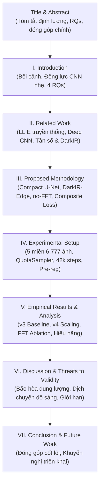

# Kế Hoạch Xây Dựng Bài Báo Khoa Học (Scientific Paper) Bằng LaTeX

> **Môn học:** Chuyên đề Cao học / Đồ án M.Sc Computer Science (CS2203 - UIT)  
> **Đề tài:** Low-Light Image Enhancement Using a Lightweight Convolutional Neural Network  
> **Vị trí tài liệu:** `presentation/plan/ke_hoach_viet_paper_latex.md`  
> **Ngày lập:** 05/11/2026  
> **Nguồn dữ liệu & thực nghiệm nền tảng:**  
> - Báo cáo v3: `presentation/report/Bao_Cao_Ket_Qua_v3_LLIE_DarkIR_Edge.md` (Colab v3, 70 epochs cố định, loại bỏ confound độ dài huấn luyện).  
> - Báo cáo v4: `presentation/report/Bao_Cao_Ket_Qua_v4_LLIE_DarkIR_Edge.md` (Colab v4, 6,777 cặp ảnh, QuotaSampler 42,000 steps, kiểm định scaling & capacity saturation).  
> - Khung bài báo v2 & slide: `presentation/report/khung_slide_va_paper_v2.md`.  
> - Ứng dụng demo kiểm chứng: `presentation/demo/app.py` & presets thực tế.

---

## 1. Mục Tiêu & Định Dạng Bài Báo (Paper Specifications)

### 1.1. Mục tiêu học thuật
Khác với báo cáo đồ án kỹ thuật thông thường (vốn thiên về liệt kê chức năng hoặc nhật ký làm việc), một **bài báo khoa học (Scientific Paper)** yêu cầu:
1. **Một câu chuyện khoa học chặt chẽ (Scientific Narrative):** Xác định rõ bài toán, khoảng trống nghiên cứu (gap), câu hỏi nghiên cứu (Research Questions - RQs), giả thuyết khoa học, và kiểm chứng bằng thực nghiệm có đối chứng nghiêm ngặt.
2. **Báo cáo kết quả trung thực (Honest & Transparent Reporting):** Công bố đầy đủ cả kết quả khẳng định lẫn kết quả phủ định (negative / null results). Nhận diện hiện tượng *bão hòa dung lượng mạng nhẹ* (capacity saturation) và *đánh đổi phân phối độ sáng* (multi-domain luminance trade-off) thay vì ngụy tạo số liệu để "tô hồng" mô hình đề xuất.
3. **Định lượng thống kê có ý nghĩa (Statistical Rigor):** Sử dụng kiểm định ghép cặp (paired bootstrap 95% Confidence Intervals, paired t-test, Wilcoxon signed-rank test) trên nhiều seed và nhiều miền dữ liệu khác nhau.

### 1.2. Chuẩn định dạng (Format & Template)
- **Chuẩn mẫu (Template):** Định dạng chuẩn quốc tế **IEEE Conference / Transactions** (`IEEEtran.cls`, two-column, 10pt) hoặc mẫu bài báo hội nghị chuyên ngành (Springer LNCS / ACM tùy theo yêu cầu cụ thể của giảng viên). Khuyến nghị mặc định: **IEEE standard conference format (2 cột, 6–8 trang hoặc 8–10 trang)**.
- **Ngôn ngữ:** Tiếng Việt học thuật chuẩn mực (hoặc Tiếng Anh nếu môn học yêu cầu).
- **Bộ công cụ (Toolchain):** Mã nguồn LaTeX phân tách mô-đun (`.tex`), quản lý trích dẫn qua BibTeX (`references.bib`), bảng biểu và số liệu đồng bộ hóa tự động từ các tệp `.csv` trong repo.

---

## 2. Khung Nội Dung Bài Báo Chi Tiết (Chuẩn IMRaD)



---

### Tiêu đề đề xuất (Title)
- **Tiếng Anh:** *Benchmarking Compact CNNs for Multi-Domain Low-Light Image Enhancement: A Rigorous Evaluation of Spatial and Frequency-Domain Representations Under Controlled Budgets*
- **Tiếng Việt:** *Đánh giá so sánh các kiến trúc CNN nhẹ trong tăng cường ảnh thiếu sáng đa miền: Phân tích thực nghiệm biểu diễn không gian và tần số dưới ngân sách tham số hạn chế*

---

### Abstract (Tóm tắt ~200–250 từ)
- **Bối cảnh (Context):** Tăng cường ảnh chụp thiếu sáng (LLIE) kèm mờ nhòe trên các thiết bị hạn chế tài nguyên đòi hỏi mô hình vừa nhỏ gọn vừa tổng quát hóa tốt.
- **Khoảng trống (Gap):** Các kiến trúc hiện đại thường mở rộng tham số lớn hoặc dùng biến đổi tần số phức tạp (Fourier/Wavelet), nhưng thiếu các nghiên cứu đối chứng nghiêm ngặt cùng ngân sách tham số (~1.9M) và lịch trình huấn luyện kiểm soát.
- **Phương pháp (Method):** So sánh có kiểm soát giữa Standard U-Net gọn (~1.93M tham số) và DarkIR-Edge (~1.92M tham số, kết hợp khối không gian cục bộ, nhánh tần số FreMLP và kênh tiên nghiệm Max-RGB), cùng biến thể cắt bỏ (ablation) không dùng FFT (~1.50M tham số). Thí nghiệm thực hiện qua 2 giai đoạn: v3 (chuẩn hóa 70 epoch cố định) và v4 (mở rộng tập dữ liệu gấp 4.88 lần với 6,777 cặp ảnh, 5 miền, lấy mẫu cân bằng QuotaSampler 42,000 steps).
- **Kết quả cốt lõi (Key Findings):**
  1. Với ngân sách ~1.9M tham số, Standard U-Net là baseline cực kỳ mạnh mẽ: tốc độ suy luận nhanh gấp ~2.4× trên GPU L4 (13.2 ms vs 31.7 ms) và độ sắc nét perceptual (LPIPS, Laplacian) vượt trội.
  2. DarkIR-Edge đạt điểm PSNR tương đương U-Net về mặt thống kê trên tập test 190 ảnh ($\Delta\text{PSNR} = -0.063\text{ dB}$, 95% CI $[-0.360, +0.229]$, $p=0.680$), cho cảm nhận màu sắc hài hòa ở vùng biên tối.
  3. Nhánh biến đổi tần số (FFT) không mang lại cải thiện có ý nghĩa thống kê so với biến thể no-FFT ($\Delta\text{PSNR} = -0.131\text{ dB}$, 95% CI $[-0.371, +0.105]$) trong khi tiêu tốn thêm ~16% thời gian suy luận.
  4. Việc mở rộng dữ liệu huấn luyện gấp 4.88 lần ở v4 cho thấy hiện tượng bão hòa dung lượng mạng nhẹ và sự đánh đổi phân phối độ sáng (luminance bias shift).
- **Ý nghĩa (Significance):** Cung cấp các bằng chứng thực nghiệm trung thực, bộ quy tắc kiểm định thống kê đăng ký trước (pre-registration), và bài học thiết kế thực tế cho các hệ thống thị giác nhúng.

---

### Phần I: Introduction (Giới thiệu)
1. **Tính cấp thiết của bài toán LLIE:**
   - Ảnh chụp thiếu sáng xuất hiện phổ biến trong camera giám sát ban đêm, điện thoại di động, xe tự hành, camera y tế.
   - Các thách thức hội tụ: độ sáng thấp toàn cục, nhiễu cảm biến khuếch đại (sensor noise), lệch màu (color cast), và hiện tượng nhòe chuyển động do thời gian phơi sáng dài (motion blur).
2. **Động lực tiếp cận bằng CNN nhẹ (Lightweight CNN):**
   - Sự dịch chuyển từ các mô hình khổng lồ (Diffusion, Transformer hàng chục triệu tham số) sang các kiến trúc nhỏ gọn (~1.5–2.0M tham số) có thể chạy thời gian thực trên thiết bị biên.
   - Tên môn học / đề tài nhấn mạnh vào tính chất "Lightweight Convolutional Neural Network".
3. **Các câu hỏi nghiên cứu cốt lõi (Research Questions - RQs):**
   - **RQ1:** Với cùng ngân sách tham số ~1.9M, một biến thể tinh gọn lấy cảm hứng từ DarkIR (kết hợp nhánh không gian và tần số) có vượt qua được kiến trúc cổ điển Standard U-Net hay không?
   - **RQ2:** Nhánh biến đổi tần số (FreMLP / FFT loss) đóng góp thực sự bao nhiêu vào chất lượng khôi phục khi ngân sách tham số bị bó hẹp?
   - **RQ3:** Việc mở rộng tập dữ liệu từ 1,389 lên 6,777 cặp ảnh (tăng 4.88×) kèm lấy mẫu hạn ngạch QuotaSampler có giúp giải quyết bài toán mờ nhòe (LOL-Blur) và thu hẹp khoảng cách miền (LSRW-Nikon) hay không?
   - **RQ4:** Mối quan hệ đánh đổi thực tế giữa FLOPs lý thuyết và độ trễ suy luận (Latency) trên phần cứng thực nghiệm là gì?
4. **Các đóng góp chính của bài báo (Contributions):**
   - Đóng góp 1: Thiết kế và cài đặt có đối chứng hệ thống 3 kiến trúc mạng cùng ngân sách (~1.9M) và pipeline huấn luyện chuẩn mực.
   - Đóng góp 2: Xây dựng tập dữ liệu benchmark thống nhất 5 miền (LOL-v2 Real, LOL-v2 Synthetic, LSRW-Huawei, LSRW-Nikon, LOL-Blur) với cơ chế cách ly tuyệt đối cấp độ chuỗi video/cảnh chụp (Zero Data Leakage).
   - Đóng góp 3: Đưa ra phân tích thực nghiệm sâu sắc về hiện tượng bão hòa dung lượng (capacity saturation), sự dịch chuyển phân phối độ chói (luminance shift), và công bố minh bạch các kết quả phủ định (negative results) theo 6 quy tắc đăng ký trước.

---

### Phần II: Related Work (Tổng quan nghiên cứu)
1. **Các phương pháp tăng cường ảnh truyền thống:**
   - Cân bằng lược đồ sáng (HE, CLAHE), điều chỉnh Gamma, lý thuyết Retinex cổ điển (Single-Scale Retinex, Multi-Scale Retinex with Color Restoration - MSRCR).
   - Ưu điểm: không cần huấn luyện; Nhược điểm: khuếch đại nhiễu nặng nề, mất bão hòa màu, không xử lý được mờ nhòe.
2. **Mạng nơ-ron tích chập (CNN) và U-Net trong LLIE:**
   - Kiến trúc Encoder-Decoder với kết nối tắt (Skip Connections) từ U-Net (Ronneberger et al., 2015), RetinexNet, KinD, EnlightenGAN.
   - Vai trò của U-Net như một đường cơ sở (strong baseline) kinh điển nhưng vô cùng hiệu quả.
3. **Mô hình phục hồi trong miền tần số và DarkIR:**
   - Biến đổi Fourier rời rạc (Fast Fourier Transform - FFT) trong khôi phục ảnh: phân tách biên độ (amplitude) biểu diễn độ sáng/tương phản và pha (phase) biểu diễn cấu trúc hình học.
   - Kiến trúc DarkIR (CVPR 2025): kết hợp nhánh không gian (Restormer/NAFNet-style) và nhánh tần số FreMLP.
4. **Bài toán khôi phục đồng thời thiếu sáng và mờ nhòe (Joint LLIE & Deblurring):**
   - Tập dữ liệu LOL-Blur và mô hình LEDNet (ECCV 2022). Những khó khăn khi giải quyết đồng thời hai thoái hóa nghịch đảo.

---

### Phần III: Proposed Methodology (Phương pháp & Kiến trúc)
1. **Định nghĩa bài toán:**
   - Cho ảnh đầu vào thiếu sáng $I_{low} \in \mathbb{R}^{H \times W \times 3}$. Mục tiêu học hàm ánh xạ $f_\theta$ sao cho ảnh đầu ra $\hat{I} = f_\theta(I_{low})$ tiệm cận ảnh chuẩn sáng $I_{gt}$.
2. **Kiến trúc 1: Standard U-Net (Baseline):**
   - Cấu trúc 4 tầng encoder-decoder, độ rộng cơ sở `base_channels = 32`, tích chập chuẩn $3 \times 3$, LeakyReLU, Bilinear Upsampling kèm Skip Connections cộng dồn.
   - Tổng tham số: **1,928,483** (~1.93M). FLOPs lý thuyết: 18.45 GFLOPs (@256×256).
3. **Kiến trúc 2: DarkIR-Edge (Mô hình đề xuất):**
   - Kênh tiên nghiệm ánh sáng Max-RGB ($I_{max} = \max_{c \in \{R,G,B\}} I_c$) đưa vào đầu vào 4 kênh.
   - Khối xử lý không gian Depthwise Separable Convolution kết hợp SimpleGate và Simple Channel Attention (SCA).
   - Nhánh biến đổi miền tần số (Frequency Branch - FreMLP): sử dụng 2D Real-FFT, biến đổi qua MLP phức, và nghịch đảo IFFT để phục hồi chi tiết toàn cục.
   - Cơ chế cổng Skip (Gated Skip Connection) và đầu ra giám sát phụ (Side Supervision) tại tầng sâu nhất.
   - Tổng tham số: **1,924,038** (~1.92M). FLOPs lý thuyết: 8.75 GFLOPs (@256×256).
4. **Kiến trúc 3: DarkIR-Edge (no-FFT) (Ablation Baseline):**
   - Giữ nguyên toàn bộ cấu trúc của DarkIR-Edge nhưng vô hiệu hóa hoàn toàn nhánh FreMLP và mất mát FFT.
   - Tổng tham số: **1,495,422** (~1.50M, tiết kiệm 22.3% tham số). FLOPs: 7.50 GFLOPs.
5. **Hàm mất mát đa thành phần (Composite Loss Function):**
   $$\mathcal{L}_{\text{total}} = 1.0 \cdot \mathcal{L}_{\text{Charb}} + 0.1 \cdot \mathcal{L}_{\text{SSIM}} + 0.1 \cdot \mathcal{L}_{\text{Edge}} + 0.1 \cdot \mathcal{L}_{\text{Color}} + 0.05 \cdot \mathcal{L}_{\text{FFT}} + 0.2 \cdot \mathcal{L}_{\text{Side}}$$
   - Phân tích chi tiết tác dụng của từng thành phần: Charbonnier penalty (độ mượt L1 chống outlier), SSIM loss (bảo toàn cấu trúc cục bộ), Sobel Edge loss (tăng độ sắc nét biên cạnh), Cosine Color loss (chống lệch góc màu RGB), và FFT Amplitude/Phase loss.

---

### Phần IV: Experimental Setup (Thiết lập thực nghiệm)
1. **Tập dữ liệu đa miền hợp nhất (Unified Multi-Domain Datasets):**
   - Bảng phân bổ 5 miền: LOL-v2 Real (639 train / 50 val / 100 test), LSRW-Huawei (2,380 train / 50 val / 30 test), LOL-Blur (1,858 train / 50 val / 40 test), LSRW-Nikon (1,000 train / 0 val / 20 test), LOL-v2 Synthetic (900 train / 0 val / 0 test).
   - Cơ chế bảo vệ rò rỉ dữ liệu (Zero Leakage Protocol): tách rời 100% cấp độ video cho LOL-Blur (150 video train vs 20 video val vs 20 video test) và vùng đệm thời gian `gap = 10` cho Huawei.
2. **Chiến lược lấy mẫu cân bằng QuotaSampler:**
   - Phân tích hiện tượng mất cân bằng miền khi tập dữ liệu mở rộng (miền Huawei/Blur chiếm áp đảo nếu lấy ngẫu nhiên).
   - Cơ chế hạn ngạch cố định 4,800 cặp ảnh/epoch: 26.6% lolv2, 23.4% huawei, 33.3% blur, 8.3% nikon, 8.3% lolv2syn.
3. **Quy trình huấn luyện & Kiểm soát Confound:**
   - 70 epochs cố định, không early stopping, cosine annealing lr $2 \times 10^{-4} \to 10^{-6}$, AdamW, batch size 8, patch size 256.
   - Cập nhật trọng số trượt hàm mũ EMA (decay 0.999), 2 hạt giống độc lập (`seed 42` và `seed 123`).
   - Môi trường phần cứng: GPU NVIDIA L4 (24GB VRAM), Colab High-RAM.
4. **Phương pháp đánh giá & Kiểm định thống kê đăng ký trước:**
   - Các độ đo chất lượng: PSNR (dB, tỷ lệ tín hiệu trên nhiễu), SSIM (chỉ số tương đồng cấu trúc), LPIPS (độ đo cảm nhận mạng VGG/AlexNet), và tỷ lệ độ nét Laplacian.
   - Kiểm định cặp ghép (Paired Tests): Bootstrap 95% CI với 2,000 lần lặp, Student's t-test, Wilcoxon signed-rank test.

---

### Phần V: Empirical Results & Comparative Analysis (Kết quả thực nghiệm)
1. **So sánh với các phương pháp truyền thống:**
   - Bảng đối đầu: Input (9.75 dB), CLAHE (11.59 dB), MSRCR (12.12 dB), Gamma Correction (16.90 dB) so với các mô hình học sâu (> 21.0 dB).
   - Khẳng định ưu thế vượt trội của học sâu (+4.1 dB đến +4.4 dB so với baseline truyền thống tốt nhất).
2. **Đối đầu Standard U-Net vs. DarkIR-Edge (v3 & v4):**
   - Kết quả v3 (70 epochs, 1,389 train): U-Net đạt 21.31 dB pooled so với 21.10 dB của Edge ($\Delta = -0.214\text{ dB}$, 95% CI $[-0.530, +0.132]$) $\to$ Hòa nhau về mặt thống kê.
   - Kết quả v4 (70 epochs, 6,777 train): no-FFT đạt 21.10 dB, U-Net đạt 21.03 dB, DarkIR-Edge đạt 20.97 dB ($\Delta = -0.063\text{ dB}$, 95% CI $[-0.360, +0.229]$).
   - Phân tích tỷ lệ thắng/thua theo từng miền (Huawei, LOLv2, Blur, Nikon).
3. **Kiểm định giả thuyết nhánh miền tần số (FFT Ablation):**
   - So sánh trực tiếp DarkIR-Edge vs DarkIR-Edge (no-FFT): $\Delta\text{PSNR} = -0.131\text{ dB}$ (95% CI $[-0.371, +0.105]$).
   - Khẳng định: Trong điều kiện mô hình nhẹ (~1.9M) và kích thước patch 256, nhánh tần số FreMLP không mang lại lợi thế định lượng.
4. **Hiệu năng tính toán (Computational Efficiency):**
   - Nghịch lý FLOPs vs Latency: DarkIR-Edge có FLOPs thấp hơn 53% (8.75G vs 18.45G), nhưng độ trễ thực tế lại chậm hơn 2.4× (31.7 ms vs 13.2 ms).
   - Giải thích kỹ thuật: Chi phí overhead của các phép toán biến đổi FFT, LayerNorm phân mảnh và Depthwise Convolutions trên GPU tensor cores.
5. **Đánh giá định tính (Qualitative Visual Analysis):**
   - Minh họa so sánh trước/sau trên các cảnh: nội thất cực tối, ngoại cảnh ban đêm, ảnh rung mờ di động.
   - Phân tích hiện tượng: U-Net xu hướng tăng sáng mạnh tay (tối ưu PSNR/LPIPS), DarkIR-Edge giữ được chi tiết biên mượt mà và tương phản tự nhiên hơn.

---

### Phần VI: Discussion & Scientific Insights (Thảo luận & Bài học khoa học)
1. **Hiện tượng bão hòa dung lượng ở mạng CNN nhẹ (Capacity Saturation):**
   - Khi tăng kích thước tập huấn luyện lên 4.88× ở v4, chất lượng mô hình không tăng tuyến tính mà đi ngang (~21.0–21.1 dB). Mô hình dung lượng nhỏ không thể nén thêm tri thức đa miền nếu không tăng độ rộng (channels/layers).
2. **Sự đánh đổi phân phối độ sáng đa miền (Multi-Domain Luminance Trade-off):**
   - Khi đưa thêm dữ liệu Nikon (ảnh sáng hơn) và LOL-v2 Synthetic vào train, mô hình dự đoán sáng hơn trên LOL-v2, dẫn đến tăng `lum_bias` và làm giảm nhẹ PSNR thô trên miền tĩnh.
3. **Mối đe dọa tính hợp lệ (Threats to Validity):**
   - Giới hạn số seed thực nghiệm (2 seeds do ngân sách tính toán Colab).
   - Kích thước tập test một số miền còn khiêm tốn (Nikon 20 ảnh, Huawei 30 ảnh).
   - Độ đo PSNR/SSIM có xu hướng thiên vị cho các phương pháp làm mịn toàn cục hơn là độ sắc nét cảm nhận.

---

### Phần VII: Conclusion & Future Work (Kết luận & Hướng phát triển)
1. **Kết luận cốt lõi:**
   - Standard U-Net là lựa chọn số 1 về mặt kỹ thuật cho ứng dụng thực tế: đơn giản, tốc độ nhanh nhất, chất lượng tốt nhất.
   - DarkIR-Edge là bước thăm dò kiến trúc giá trị, cho thấy nhánh không gian kết hợp cổng gating hoạt động hiệu quả, nhưng nhánh FFT cần được tinh giản triệt để để giảm latency.
2. **Hướng nghiên cứu tiếp theo:**
   - Thử nghiệm cơ chế chưng cất tri thức (Knowledge Distillation) từ mô hình lớn DarkIR-m sang mô hình nhẹ.
   - Tối ưu hóa cấu trúc suy luận bằng TensorRT / ONNX Runtime trên thiết bị nhúng (NVIDIA Jetson, Raspberry Pi).

---

### Danh mục tài liệu tham khảo (References - BibTeX)
- DarkIR: *Feijoo et al., "DarkIR: Robust Low-Light Image Restoration", CVPR 2025.*
- LEDNet / LOL-Blur: *Zhou et al., "LEDNet: Joint Low-Light Enhancement and Deblurring in the Dark", ECCV 2022.*
- LOL-v2: *Yang et al., "Sparse Gradient Regularized Deep Retinex Network for Robust Low-Light Image Enhancement", IEEE TIP 2021.*
- LSRW: *Hai et al., "R2RNet: Low-Light Image Enhancement via Real-Low to Real-Normal Network", 2023.*
- U-Net: *Ronneberger et al., "U-Net: Convolutional Networks for Biomedical Image Segmentation", MICCAI 2015.*
- LPIPS: *Zhang et al., "The Unreasonable Effectiveness of Deep Features as a Perceptual Metric", CVPR 2018.*
- CLAHE: *Zuiderveld, "Contrast Limited Adaptive Histogram Equalization", Graphics Gems, 1994.*
- Retinex MSRCR: *Jobson et al., "A multiscale retinex for bridging the gap between color images and the human observation of scenes", IEEE TIP 1997.*

---

## 3. Bản Đồ Dữ Liệu & Hình Ảnh Trích Xuất Vào Bài Báo

| Mã hiệu bài báo | Nội dung | Tệp nguồn trong Repo | Mục đích minh họa |
|:---|:---|:---|:---|
| **Tab. 1** | Thống kê phân bổ dữ liệu 5 miền (v3 & v4) | `colab-results/llie_project_v4-20261104/.../split_manifest.json` | Minh chứng Zero-Leakage & Quota sampling |
| **Tab. 2** | So sánh tổng thể PSNR/SSIM/LPIPS | `colab-results/.../table_main.csv` (v3 & v4) | Bảng kết quả chính thức |
| **Tab. 3** | Kiểm định thống kê ghép cặp (Bootstrap CI, t, Wilcoxon) | `colab-results/.../paired_tests.csv` | Độ tin cậy khoa học |
| **Tab. 4** | Ablation nhánh tần số (Edge vs no-FFT) | `colab-results/.../table_extra.csv` & `paired_tests.csv` | Trả lời RQ2 |
| **Tab. 5** | Đánh giá hiệu năng tính toán (Params, FLOPs, Latency, VRAM) | `colab-results/.../efficiency.csv` | Khảo sát tính khả thi triển khai |
| **Fig. 1** | Sơ đồ khối kiến trúc Standard U-Net & DarkIR-Edge | Vẽ vector TikZ / SVG chuyển sang PDF | Mô tả chi tiết phương pháp |
| **Fig. 2** | Sơ đồ lấy mẫu cân bằng QuotaSampler | Vẽ sơ đồ luồng dữ liệu 5 miền | Giải thích cơ chế giải quyết mất cân bằng |
| **Fig. 3** | Forest Plot khoảng tin cậy 95% $\Delta\text{PSNR}$ | Script Matplotlib xuất PDF từ `paired_tests.csv` | Trực quan hóa kiểm định thống kê |
| **Fig. 4** | Lưới ảnh so sánh định tính trên cảnh thông thường (Huawei, LOLv2) | `presentation/demo/presets/` & visual samples | Đánh giá trực quan độ sáng, màu sắc |
| **Fig. 5** | Lưới ảnh so sánh trên cảnh rung mờ (LOL-Blur) | Visual samples từ `lolblur` | Đánh giá năng lực khử mờ |

---

## 4. Giải Pháp Kỹ Thuật: Viết LaTeX & Biên Dịch Trực Tiếp Local Không Cần Overleaf

Người dùng đặt câu hỏi: *"Python có vài thư viện nào để viết latex và có thể export trực tiếp ra pdf hay word mà không cần phải lên trang web viết latex hay không?"*

Dưới đây là phân tích toàn diện các giải pháp kỹ thuật, công cụ và workflow khuyến nghị:

### 4.1. Bản chất của việc biên dịch LaTeX
LaTeX là một ngôn ngữ macro biên dịch (compiled typesetting language), không phải một định dạng hiển thị tĩnh. Do đó, để chuyển mã `.tex` thành `.pdf`, hệ thống bắt buộc phải có một **TeX Engine** (`pdflatex`, `xelatex`, `lualatex`, hoặc `tectonic`).

### 4.2. Các giải pháp & thư viện phổ biến

```
                   ┌────────────────────────────────────────────────────────┐
                   │               CÁC LỰA CHỌN WORKFLOW                   │
                   └────────────────────────────────────────────────────────┘
                                               │
             ┌─────────────────────────────────┴─────────────────────────────────┐
             ▼                                                                   ▼
     [LỰA CHỌN 1 - KHUYÊN DÙNG]                                          [LỰA CHỌN 2 - PYTHONIC]
  Cú pháp LaTeX Thuần (.tex)                                          Dựng cấu trúc bằng Python
    + Tectonic Engine (PDF)                                             qua thư viện PyLaTeX
    + Pandoc (Word .docx)                                                        │
             │                                                                   ▼
             ├─► Tectonic: Tự tải CTAN package, 0 cấu hình, ra PDF đẹp.         ├─► doc = Document(...)
             └─► Pandoc: Chuyển .tex sang .docx công thức chuẩn Word OMML.       ├─► doc.append(Section(...))
                                                                                 └─► doc.generate_pdf(...)
```

#### Giải pháp 1: Tectonic — Trình biên dịch LaTeX hiện đại số 1 cho máy cục bộ (Khuyên dùng)
- **Tectonic là gì?** Là một TeX/LaTeX engine hiện đại được viết lại hoàn toàn bằng ngôn ngữ Rust.
- **Ưu điểm vượt trội so với MiKTeX / TeX Live truyền thống:**
  - Không cần cài bộ cài cồng kềnh (MiKTeX 4GB, TeX Live 8GB).
  - **Tự động tải các package còn thiếu trực tiếp từ CTAN** trong lần chạy đầu tiên và lưu vào cache cục bộ.
  - Tự động chạy số lần cần thiết (multiple passes) để giải quyết liên kết chéo và trích dẫn BibTeX mà không cần gõ thủ công `pdflatex -> bibtex -> pdflatex`.
- **Cách cài đặt và sử dụng:**
  - Cài qua PowerShell: `winget install tectonic` (hoặc tải trực tiếp file `tectonic.exe`).
  - Trong Python: có thể gọi qua CLI hoặc dùng package Python `pip install tectonic` với API:
    ```python
    import tectonic
    pdf_bytes = tectonic.sync_compile("paper.tex")
    with open("paper.pdf", "wb") as f:
        f.write(pdf_bytes)
    ```

#### Giải pháp 2: PyLaTeX — Thư viện Python sinh mã LaTeX
- **PyLaTeX (`pip install pylatex`):** Cho phép lập trình viên định nghĩa văn bản LaTeX hoàn toàn bằng mã Python hướng đối tượng (`Document`, `Section`, `Subsection`, `Table`, `Figure`, `Math`).
- **Ưu điểm:** Tự động hóa tạo bảng số liệu trực tiếp từ Pandas DataFrame (`df.to_latex()` hoặc qua PyLaTeX Table).
- **Hạn chế:** Để xuất ra PDF (`doc.generate_pdf()`), PyLaTeX vẫn cần một compiler trên máy (như `tectonic` hoặc `pdflatex`). Đối với một bài báo khoa học 8 trang chuẩn IEEE với nhiều tinh chỉnh bố cục tinh vi, viết mã thuần Python để layout sẽ dài và khó kiểm soát chi tiết hơn so với viết file `.tex` trực tiếp.

#### Giải pháp 3: Pandoc & Pypandoc — Xuất trực tiếp sang Microsoft Word (`.docx`)
- Giảng viên hoặc trường đại học thường yêu cầu nộp cả bản `.docx` để chấm điểm hoặc chạy phần mềm chống đạo văn.
- **Pandoc** là tiêu chuẩn vàng thế giới để chuyển đổi định dạng:
  ```powershell
  pandoc paper.tex -o paper.docx --citeproc --bibliography=references.bib
  ```
  - **Điểm ưu việt:** Pandoc tự động chuyển đổi tất cả các công thức toán học LaTeX (`$$...$$`, `\frac`, `\sqrt`) thành **công thức chuẩn của Word (Office Math Markup Language - OMML)** có thể click vào chỉnh sửa trực tiếp, không phải ảnh chụp màn hình!
- **Trong Python (`pypandoc`):**
  Thư viện `pypandoc` có sẵn hàm `pypandoc.download_pandoc()` giúp tự động tải binary Pandoc về máy mà không cần cài đặt phần mềm quản trị hệ thống:
  ```python
  import pypandoc
  pypandoc.convert_file("paper.tex", "docx", outputfile="paper.docx")
  ```

#### Giải pháp 4: Template Engine (Jinja2 + Python) — Workflow tự động hóa chuẩn nghiên cứu
- Đây là workflow mà các phòng lab AI hàng đầu (Google DeepMind, Meta FAIR) thường sử dụng:
  1. Viết khung bài báo `paper.tex` chuẩn IEEE với các thẻ điền thông số (placeholders).
  2. Viết script Python đọc kết quả từ các tệp `table_main.csv`, `paired_tests.csv`, `efficiency.csv`.
  3. Dùng Python sinh ra các bảng LaTeX (`table_results.tex`, `table_efficiency.tex`) và biểu đồ vector (`forest_plot.pdf`).
  4. File `paper.tex` chỉ việc `\input{tables/table_results.tex}`.
  5. Mỗi khi thực nghiệm bổ sung hoặc cập nhật số liệu, chỉ cần chạy 1 dòng lệnh Python là toàn bộ bảng biểu trong bài báo tự động làm mới, đảm bảo 100% không có sai sót gõ tay.

---

## 5. Lộ Trình Triển Khai Viết Bài Báo (Step-by-Step Implementation)

### Giai đoạn 1: Chuẩn bị Môi trường & Bộ khung Mã Nguồn (Ngày 1)
- [ ] Khởi tạo thư mục bài báo: `presentation/paper/`.
- [ ] Thiết lập tệp mẫu chuẩn IEEE: `IEEEtran.cls` (hoặc cấu hình tương thích).
- [ ] Cài đặt công cụ biên dịch cục bộ: kiểm tra `tectonic` và `pandoc` trên môi trường máy.
- [ ] Xây dựng khung tệp chính: `main.tex`, chia tách thành các mô-đun:
  - `sections/00_abstract.tex`
  - `sections/01_introduction.tex`
  - `sections/02_related_work.tex`
  - `sections/03_methodology.tex`
  - `sections/04_experiments.tex`
  - `sections/05_results.tex`
  - `sections/06_discussion.tex`
  - `sections/07_conclusion.tex`
  - `references.bib`

### Giai đoạn 2: Tự động hóa Trích xuất Dữ liệu & Bảng biểu (Ngày 2)
- [ ] Xây dựng script Python trong `docs/ai/export_paper_tables.py` để đọc CSV từ `colab-results/llie_project_v3...` và `colab-results/llie_project_v4...`.
- [ ] Tự động sinh mã LaTeX cho:
  - Bảng thống kê dữ liệu 5 miền.
  - Bảng tổng hợp kết quả chính (PSNR, SSIM, LPIPS) kèm độ lệch chuẩn per-seed.
  - Bảng kiểm định ghép cặp thống kê (Bootstrap 95% CI, p-values).
  - Bảng so sánh hiệu năng phần cứng (Params, FLOPs, Latency FP32/FP16, VRAM).
- [ ] Vẽ biểu đồ Forest Plot chất lượng cao dạng Vector PDF (`figures/forest_plot.pdf`).

### Giai đoạn 3: Viết Nội dung Chi tiết (Ngày 3 – 5)
- [ ] Viết phần Phương pháp: công thức toán học đầy đủ cho SimpleGate, FreMLP, Composite Loss, QuotaSampler.
- [ ] Viết phần Kết quả & Thảo luận: lồng ghép sâu sắc bài học về sự đánh đổi độ sáng (luminance bias shift) và hiện tượng bão hòa dung lượng mạng nhỏ.
- [ ] Chọn lọc và định dạng các cặp ảnh trực quan chất lượng cao đưa vào hình so sánh định tính (Huawei, LOL-v2, LOL-Blur).
- [ ] Hoàn thiện danh mục trích dẫn BibTeX chuẩn mực cho các bài báo hội nghị hàng đầu (CVPR, ECCV, ICCV, TIP).

### Giai đoạn 4: Biên dịch, Soát lỗi & Xuất bản (Ngày 6)
- [ ] Biên dịch `main.tex` thành `paper.pdf` qua `tectonic`.
- [ ] Chuyển đổi sang `paper.docx` qua `pandoc` phục vụ các yêu cầu chấm điểm linh hoạt.
- [ ] Soát lỗi căn chỉnh hai cột (column balance), tràn lề (overfull hbox), định dạng công thức và bảng biểu.
- [ ] Đối chiếu chéo 100% số liệu giữa Slide thuyết trình, Demo tương tác và Bài báo khoa học.
